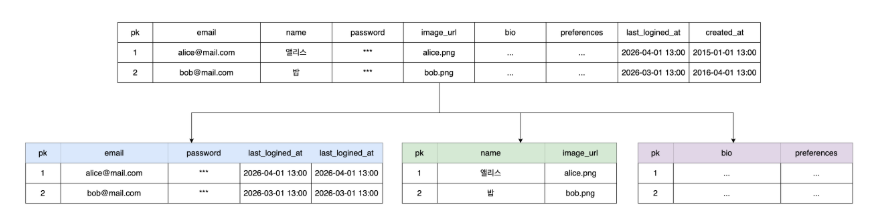

저장소에 데이터가 수천만 수억 건 쌓이기 시작하면 쿼리 성능이 급격히 떨어진다. 인덱스를 아무리 잘 설계해도 스캔 비용 자체가 커지고, 백업이나 유지보수 작업도 부담스러워진다.

> **바로잡기** 인덱스로 몇 건 찾는 비용은 거의 그대로다. 느려지는 건 넓은 범위 조회와 대량 삭제·운영 작업이다.

이럴 때 가장 먼저 고려해야 하는 해결책이 파티셔닝이다. 큰 데이터 테이블을 작은 단위로 쪼개서 관리하면 쿼리는 필요한 조각만 읽고, 운영 부담도 줄어든다.

- 파티셔닝
  - 대용량 테이블이나 인덱스를 더 작고 관리하기 쉬운 단위로 분할하는 프로세스. 그 단위를 파티션이라고 하며, 파티션을 만드는 행위를 파티셔닝이라고 부른다.
- 파티션 프루닝
  - 파티션의 핵심은 결국 불필요한 파티션은 생략, 필요한 파티션만 다루는 것이다. 이를 파티션 프루닝이라고 부르며, 파티션 전략을 선택하는 기준점이 바로 파티션 프루닝이다. 데이터를 얼마나 예쁘게 보관하는지가 중심이 아니다. 데이터를 삽입하거나 조회할 때 즉, 사용할 때가 중심이 되어야 한다.

*조건절이 파티션 키를 가리키면 해당 파티션만 읽는다.*

> **보충** 파티션 키를 가공하거나 형변환하면 프루닝이 안 된다. 실행 계획의 `Pstart`·`Pstop`으로 확인한다.

> **보충** 월 단위로 나누면 오래된 데이터를 `DROP PARTITION`으로 통째로 지울 수 있어 `DELETE`보다 훨씬 싸다.

파티셔닝 전략은 크게 3가지 축으로 나누어 생각해볼 수 있다.

- 기능 파티셔닝

  > **보충** 업무 영역(주문, 회원 등)별로 데이터를 다른 테이블 묶음이나 DB에 나누는 것이다. 영역을 넘는 조인·트랜잭션은 애플리케이션이 맡는다.

- 수평 파티셔닝
  - 모든 파티션이 동일한 스키마를 갖도록 유지한 채, 행을 기준으로 데이터를 나눈다. 규모의 단위를 테이블에서 데이터베이스로 키우면 샤딩으로 볼 수도 있다.

    (샤딩은 여러 DB에 분산된 데이터를 관리하므로 트랜잭션 관리나 Join이 복잡하다. 가능하면 테이블 파티셔닝을 우선적으로 채택 후 샤딩을 고려하는 것이 좋다)

  1. 수평 파티셔닝 - 범위

     범위 파티셔닝은 날짜나 숫자처럼 구간을 특정지을 수 있는 컬럼 값의 범위를 기준으로 데이터를 분할한다. 연도별, 월별, 일별 같은 시계열 데이터가 가장 적합하다.

  2. 수평 파티셔닝 - 해시

     파티션 키에 해시 함수를 적용해 파티션 전체에 균일하게 데이터를 분산시킨다. 시계열 데이터가 없거나, 파티션마다 데이터가 균등하게 분배되는 것이 가장 중요한 경우 선택하기 좋다.

     > **보충** 프루닝은 `=`·`IN` 조건에서만 된다.

  3. 수평 파티셔닝 - 리스트

     미리 정의된 값 리스트를 기반으로 데이터를 그룹화한다. 지역이나 부서 등으로 제한적이고 명확한, 잘 변하지 않는 진리 같은 값을 이용하는 것이 좋다

  4. 수평 파티셔닝 - 복합

     파티셔닝 구조에 추가적인 세분화 단계를 더한다. 예를 들어, 날짜로 범위 파티셔닝 후 각 파티션 내부를 지역으로 다시 리스트 파티셔닝하는 방식이다. 초대형, 이력 데이터 등에 활용하게 된다. 당연히 리스트/리스트, 리스트/범위 등의 다양한 조합이 가능하다.

     > **바로잡기** 조합은 DBMS마다 다르다(MySQL은 범위·리스트 아래 해시 서브파티션만 가능).

- 수직 파티셔닝
  - 단일 테이블을 컬럼 기준으로 여러 개의 작은 테이블로 분할하는 개념이다. 각기 원본 테이블 일부의 컬럼을 가지며, 동일한 PK를 공유한다. 동일한 PK는 필요시 Join에 활용

*수직 파티셔닝 예시*

> **보충** 자주 읽는 컬럼만 남기면 읽는 블록 수가 줄지만, 나뉜 컬럼을 함께 읽는 쿼리가 많으면 조인 비용으로 손해다.
