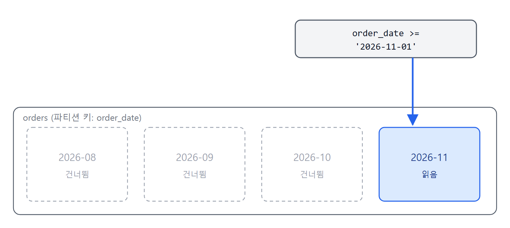

주문 테이블에 10억 건이 쌓였다고 해 보자. 화면은 대부분 최근 한 달 주문만 조회하고, 매달 초에는 3년이 지난 주문을 지운다. 그런데 최근 한 달을 조회하는 쿼리도, 오래된 주문을 지우는 배치도 점점 느려진다. 인덱스도 잘 만들어 두었는데 왜 그럴까? 그리고 테이블을 쪼갠다면, 무엇을 기준으로 쪼개야 할까?

이 질문의 답으로 가장 먼저 거론되는 것이 파티셔닝이다. 이 글에서는 파티셔닝이 무엇을 해결하는지, 범위·해시·리스트·복합 중 무엇을 고를지, 그리고 수평·수직·기능 파티셔닝이 각각 무엇을 나누는지를 차례로 따라가 본다. 문법 예시는 오라클 기준이고, 다른 DBMS와 다른 부분은 따로 밝힌다.

## 인덱스가 있는데 왜 느려질까

먼저 "데이터가 많아지면 인덱스로도 감당이 안 된다"는 말을 조금 더 정확히 해 둘 필요가 있다. B-Tree 인덱스로 한두 건을 찾는 비용은 데이터가 늘어도 거의 그대로다. 10억 건이 되어도 인덱스 높이는 몇 단계 늘어날 뿐이다.

문제는 **많이 읽어야 하는 쿼리**와 **한꺼번에 바꿔야 하는 작업**이다.

- 최근 한 달 주문 집계처럼 수천만 건을 읽어야 하는 쿼리는 인덱스를 타면 테이블 랜덤 액세스가 수천만 번 일어나고, Full Scan을 하면 10억 건 전체를 읽는다. 원하는 건 "이번 달 데이터만 처음부터 끝까지 읽기"인데, 테이블이 하나라면 그런 선택지가 없다.
- 3년 지난 주문을 `DELETE`로 지우면 지우는 행마다 Undo와 Redo가 생기고, 그 테이블에 걸린 모든 인덱스에서도 항목이 하나씩 지워진다. 수억 건이라면 몇 시간짜리 작업이다.
- 백업, 통계 수집, 인덱스 재구성 같은 운영 작업도 테이블 단위로 해야 하니 매번 10억 건을 상대한다.

세 문제의 공통점은 "필요한 것은 데이터의 일부인데, 다룰 수 있는 단위가 테이블 전체뿐"이라는 점이다. 그렇다면 다룰 수 있는 단위를 작게 만들면 된다.

## 하나의 테이블, 여러 개의 저장 단위

**파티셔닝**은 큰 테이블이나 인덱스를 더 작고 관리하기 쉬운 단위로 나누는 것이고, 나뉜 각 단위가 **파티션**이다. 중요한 점은 애플리케이션 입장에서는 여전히 테이블이 하나라는 것이다. `SELECT * FROM orders`는 그대로 동작한다. 바뀌는 것은 물리적인 저장 방식이다. 오라클에서 파티션은 각자 독립된 세그먼트로 저장되므로, 파티션 하나만 읽거나, 지우거나, 다른 테이블스페이스로 옮길 수 있다.

```sql
CREATE TABLE orders (
  order_id    NUMBER,
  order_date  DATE,
  region      VARCHAR2(10),
  amount      NUMBER
)
PARTITION BY RANGE (order_date) (
  PARTITION p202608 VALUES LESS THAN (DATE '2026-09-01'),
  PARTITION p202609 VALUES LESS THAN (DATE '2026-10-01'),
  PARTITION p202610 VALUES LESS THAN (DATE '2026-11-01'),
  PARTITION p202611 VALUES LESS THAN (DATE '2026-12-01')
);
```

어느 파티션에 들어갈지를 정하는 컬럼(여기서는 `order_date`)을 **파티션 키**라고 한다. 이제 앞의 세 문제가 어떻게 풀리는지 보자.

## 필요한 조각만 읽기: 파티션 프루닝

```sql
SELECT region, SUM(amount)
FROM   orders
WHERE  order_date >= DATE '2026-11-01'
GROUP  BY region;
```

옵티마이저는 조건절의 `order_date` 범위를 보고, 이 쿼리가 `p202611` 파티션에만 해당한다는 것을 안다. 그래서 나머지 파티션은 아예 읽지 않는다. 이것이 **파티션 프루닝(Partition Pruning)** 이다.


*조건절이 파티션 키를 가리키면 옵티마이저는 해당 파티션만 읽는다. 나머지는 열어 보지도 않는다.*

이제 "이번 달 데이터만 처음부터 끝까지 읽기"가 가능해졌다. 파티션 하나를 Full Scan하는 것은 10억 건이 아니라 한 달치를 읽는 일이다. 프루닝이 일어났는지는 실행 계획의 `Pstart`·`Pstop` 컬럼으로 확인한다. 숫자가 찍혀 있으면 파싱 시점에 읽을 파티션이 정해진 것(정적 프루닝)이고, `KEY`라고 찍혀 있으면 바인드 변수 값을 보고 실행 시점에 정하는 것(동적 프루닝)이다. `1`부터 마지막 번호까지 전부 찍혀 있다면 프루닝이 일어나지 않은 것이다.

프루닝은 조건절이 파티션 키를 **그대로** 가리킬 때만 일어난다. `WHERE TO_CHAR(order_date, 'YYYYMM') = '202611'`처럼 파티션 키를 함수로 감싸거나, 문자열과 날짜 사이에 묵시적 형변환이 일어나거나, 조건절에 파티션 키가 아예 없으면 옵티마이저는 어느 파티션인지 판단하지 못하고 전부 읽는다. 인덱스 컬럼을 가공하면 인덱스를 못 타는 것과 같은 원리다.

그래서 파티셔닝 전략을 고를 때 기준점은 프루닝이다. 데이터를 보기 좋게 나눠 담는 것이 목적이 아니라, **데이터를 넣고 읽을 때 필요한 조각만 다루게 하는 것**이 목적이다. 주요 쿼리의 조건절에 자주 등장하는 컬럼이 파티션 키 후보가 된다.

## 조각 단위로 지우고 관리하기

프루닝만큼 중요한 두 번째 이득이 있다. 지우는 문제로 돌아가 보자. 파티션이 월 단위로 나뉘어 있다면 3년 지난 주문을 지우는 일은 이렇게 바뀐다.

```sql
ALTER TABLE orders DROP PARTITION p202308;
```

행을 하나씩 지우는 `DELETE`와 달리, 파티션 세그먼트를 통째로 떼어 내는 딕셔너리 작업이다. 행마다 Undo와 Redo를 만들지 않으므로 몇 시간짜리 작업이 순식간에 끝난다. 새 데이터를 다른 테이블에 미리 적재해 두고 `EXCHANGE PARTITION`으로 파티션과 맞바꿔 한 번에 반영하는 방법도 있다. 백업, 통계 수집, 압축도 파티션 단위로 할 수 있고, 지난달 파티션은 더 이상 바뀌지 않으니 읽기 전용 테이블스페이스로 옮길 수도 있다.

그러니 파티션 키는 조회 조건뿐 아니라 **데이터를 버리고 관리하는 단위**와도 맞아야 한다. 주문처럼 "날짜로 조회하고 날짜로 버리는" 데이터라면 두 기준이 일치하니 고민할 것이 적다. 둘이 어긋나면 어느 쪽 이득을 택할지 정해야 한다.

## 행을 어떤 규칙으로 나눌까: 범위, 해시, 리스트, 복합

지금까지 본 방식은 행을 기준으로 나누는 **수평 파티셔닝**이고, 모든 파티션은 같은 컬럼 구조를 가진다. 행을 어떤 규칙으로 파티션에 배정할지에 따라 네 가지로 나뉜다.

**범위(Range)** 는 날짜나 숫자처럼 구간을 정할 수 있는 값으로 나눈다. 연·월·일 단위로 쌓이는 이력 데이터에 가장 잘 맞고, 앞에서 본 조회와 삭제의 이득을 가장 크게 누린다. 매달 파티션을 미리 만들어 두는 것이 번거롭다면, 오라클은 11g부터 정해진 간격으로 파티션을 자동으로 만드는 **인터벌 파티셔닝**(`INTERVAL (NUMTOYMINTERVAL(1, 'MONTH'))`)을 지원한다. 범위에 들지 않는 값이 들어오면 오류가 나므로, 인터벌을 쓰지 않는다면 마지막에 `MAXVALUE` 파티션을 두는 것이 안전하다.

**해시(Hash)** 는 파티션 키에 해시 함수를 적용해 파티션에 고르게 흩어 놓는다. 시간 순서 같은 자연스러운 구간이 없고, 특정 파티션에 데이터나 접근이 몰리지 않게 하는 것이 목적일 때 고른다. 예를 들어 고객 ID로 해시 파티셔닝하면 동시에 들어오는 INSERT가 여러 파티션으로 흩어져 한 블록에 경합이 몰리는 것을 줄일 수 있다. 대신 두 가지를 알고 써야 한다. 첫째, 프루닝은 `=`나 `IN` 조건일 때만 된다. 해시값에는 순서가 없으니 `BETWEEN` 같은 범위 조건으로는 어느 파티션인지 알 수 없다. 둘째, 오라클에서 데이터가 고르게 나뉘려면 파티션 수를 2의 거듭제곱(4, 8, 16…)으로 정해야 한다.

**리스트(List)** 는 미리 정한 값 목록으로 묶는다. 지역, 국가, 사업부처럼 값의 종류가 정해져 있고 잘 변하지 않는 컬럼에 맞다. 목록에 없는 값이 들어올 수 있다면 `DEFAULT` 파티션을 두고, 오라클 12c R2부터는 새 값이 들어오면 파티션을 자동으로 만드는 자동 리스트 파티셔닝도 있다.

**복합(Composite)** 은 두 단계로 나눈다. 먼저 월 단위 범위로 나누고, 각 월 파티션을 다시 지역별 리스트로 나누는 식이다(범위-리스트). 이렇게 하면 "11월의 서울 주문"만 읽는 쿼리는 서브파티션 하나로 좁혀지고, 오래된 데이터는 여전히 월 단위로 떼어 낼 수 있다. 첫 번째 기준은 관리 단위(보통 날짜)로, 두 번째 기준은 주요 조회 조건이나 분산 목적으로 고르는 경우가 많다. 다만 지원하는 조합은 DBMS마다 다르다. 오라클은 범위·리스트·해시의 대부분의 조합을 지원하지만, MySQL은 범위나 리스트 파티션 아래에 해시(KEY) 서브파티션만 둘 수 있다.

| 방식 | 나누는 기준 | 잘 맞는 데이터 | 프루닝되는 조건 | 주의할 점 |
| --- | --- | --- | --- | --- |
| 범위 | 값의 구간 | 날짜별 이력, 로그 | `=`, 범위 조건 | 범위 밖 값, 최신 파티션 쏠림 |
| 해시 | 해시 함수 결과 | 자연스러운 구간이 없는 키 | `=`, `IN` | 범위 조건 불가, 파티션 단위 삭제 의미 없음 |
| 리스트 | 값 목록 | 지역, 사업부, 상태 | `=`, `IN` | 목록 밖 값, 값별 크기 편차 |
| 복합 | 두 기준의 조합 | 초대형 이력 데이터 | 두 키 각각의 조건 | 파티션 수 급증, 설계 복잡도 |

범위 파티셔닝에서 표의 "최신 파티션 쏠림"은 한 번 짚고 넘어갈 만하다. 날짜로 나누면 오늘 들어오는 INSERT는 전부 이번 달 파티션 하나에 몰린다. 조회와 삭제에는 이상적이지만, 쓰기를 분산시키지는 않는다. 쓰기 분산이 목적이라면 해시가, 둘 다 필요하면 범위-해시 복합이 후보가 된다.

## 행이 아니라 다른 것으로 나눌 수도 있다

파티셔닝은 행을 나누는 것만 있지 않다. 무엇을 나누느냐에 따라 세 축으로 정리할 수 있다.


*수평은 행을, 수직은 컬럼을, 기능은 업무 영역을 나눈다.*

**수직 파티셔닝**은 테이블을 컬럼 기준으로 나눈다. 나뉜 테이블들은 원래 테이블의 일부 컬럼을 갖고 같은 PK를 공유하며, 필요하면 그 PK로 조인해 원래 모습을 만든다. 목록 화면에서 늘 읽는 회원 이름·등급은 한 테이블에, 가끔 읽는 긴 자기소개나 이미지 같은 큰 컬럼은 다른 테이블에 두는 식이다. 자주 읽는 테이블의 행이 작아지면 한 블록에 더 많은 행이 들어가므로 같은 쿼리가 읽는 블록 수가 준다. 주민번호처럼 민감한 컬럼만 떼어 내 접근 권한을 따로 관리하는 데도 쓴다. 대가는 조인이다. 나뉜 컬럼을 함께 읽어야 하는 쿼리가 많다면 오히려 손해다.

**기능 파티셔닝**은 업무 영역에 따라 데이터를 나눈다. 주문 데이터와 회원 데이터, 상품 재고를 각각 다른 테이블 묶음이나 다른 데이터베이스에 두는 것이다. 영역마다 읽기·쓰기 패턴과 확장 요구가 다르니 따로 두면 각자에 맞게 설계하고 확장할 수 있다. 서비스를 업무 단위로 나누는 마이크로서비스 구조에서 서비스마다 데이터베이스를 따로 갖는 것이 이 방식이다. 대신 영역을 넘나드는 조인과 트랜잭션은 애플리케이션이 맡아야 한다.

세 축은 함께 쓸 수 있다. 기능별로 데이터베이스를 나누고, 그 안의 큰 테이블을 수평으로 파티셔닝하고, 그중 일부 컬럼을 수직으로 떼어 내는 식이다.

## 파티셔닝과 샤딩은 어디서 갈리나

수평 파티셔닝의 단위를 테이블 안에서 데이터베이스 서버 단위로 키우면 **샤딩**이 된다. 고객 ID 범위에 따라 고객 데이터를 서로 다른 DB 서버에 나눠 담는 식이다.

둘의 차이는 "한 서버 안이냐, 여러 서버에 걸치느냐"다. 테이블 파티셔닝은 결국 한 DB 서버 안의 일이라, 서버 하나의 CPU·메모리·쓰기 처리량을 넘어서지는 못한다. 그 한계를 넘으려면 샤딩이 필요하다. 대신 샤딩을 하면 여러 샤드에 걸친 조인과 트랜잭션, 샤드 간 데이터 재분배, 샤드 키를 잘못 골랐을 때 생기는 쏠림을 직접 다뤄야 한다. 그래서 순서는 보통 이렇다. 먼저 한 서버 안에서 테이블 파티셔닝과 튜닝으로 버틸 수 있는지 보고, 서버 한 대의 한계가 분명해졌을 때 샤딩을 검토한다.

## 파티션 키를 고르기 전에 확인할 것

처음 질문으로 돌아가 보자. 인덱스가 있는데도 느려진 것은, 필요한 것은 데이터의 일부인데 다룰 단위가 테이블 전체뿐이었기 때문이다. 파티셔닝은 그 단위를 작게 만들고, 쿼리는 프루닝으로 필요한 조각만 읽고, 운영은 파티션 단위로 지우고 관리하게 해 준다. 주문 테이블이라면 "날짜로 조회하고 날짜로 버린다"는 사용 방식이 그대로 월 단위 범위 파티셔닝이라는 답이 된다.

다만 파티셔닝이 모든 쿼리를 빠르게 하지는 않는다. 설계 전에 다음을 확인해 보자.

- **주요 쿼리의 조건절에 파티션 키가 들어가는가?** 파티션 키 없이 고객 ID로만 조회하는 쿼리가 많다면, 그 쿼리는 모든 파티션을 뒤진다. 특히 각 파티션마다 따로 만들어지는 **로컬 인덱스**를 쓰면 파티션이 100개일 때 인덱스 탐색도 100번 일어난다. 이런 쿼리가 중요하다면 테이블 전체를 하나로 덮는 **글로벌 인덱스**를 검토한다.
- **삭제·보관 단위가 파티션 키와 맞는가?** `DROP PARTITION`의 이득은 버리는 단위가 파티션과 일치할 때만 생긴다. 글로벌 인덱스가 있다면 파티션을 떼어 낼 때 `UPDATE GLOBAL INDEXES`로 인덱스를 함께 정리해야 인덱스가 사용 불가 상태가 되지 않는다.
- **파티션 하나의 크기와 개수가 적당한가?** 너무 잘게 나누면 파티션 수만큼 메타데이터와 관리 대상이 늘고, 프루닝이 안 되는 쿼리는 더 느려진다.
- **값이 고르게 나뉘는가?** 리스트 파티션에서 한 지역이 전체의 80%를 차지하거나, 범위 파티션에서 특정 달만 거대하면 파티션의 이점이 그만큼 줄어든다.

확인 방법도 정해져 있다. 실행 계획에서 `Pstart`·`Pstop`이 기대한 파티션 번호로 찍히는지 보고, `USER_TAB_PARTITIONS`에서 파티션별 행 수(`NUM_ROWS`)와 크기를 보며 쏠림이 없는지 본다.

이 글에서는 테이블을 나누는 방법을 봤다. 그런데 앞에서 잠깐 등장한 로컬 인덱스와 글로벌 인덱스는 각각 어떻게 생겼고, 어느 쪽을 언제 골라야 할까? 파티션 테이블 위의 인덱스 설계는 다음 질문으로 남겨 둔다.
