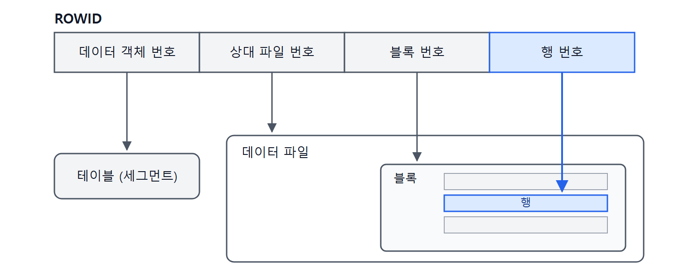
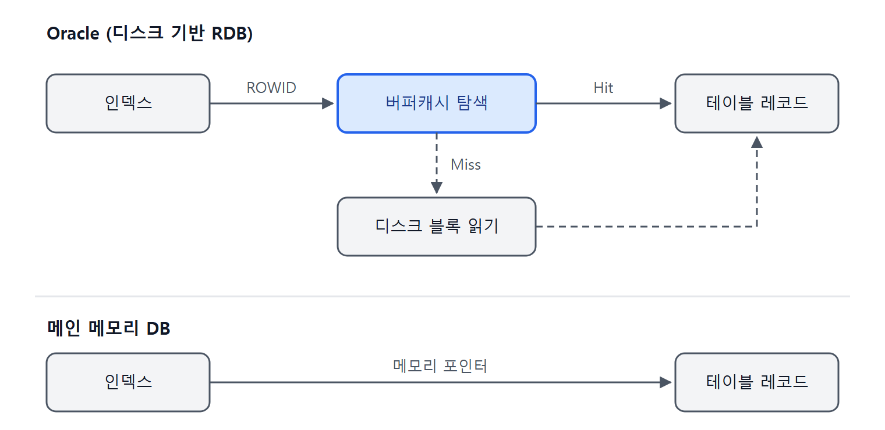

인덱스를 만들었으니 이제 빠르겠지, 하고 실행 계획을 열어 보면 낯선 줄이 하나 더 붙어 있다.

```sql
SELECT * FROM emp WHERE deptno = 10;
```

```text
TABLE ACCESS BY INDEX ROWID   EMP
  INDEX RANGE SCAN            EMP_DEPTNO_IDX
```

> 설명을 위한 예시 실행 계획이다. 실제 계획은 통계, 버전, 인덱스 구성에 따라 달라진다.

아래 줄 `INDEX RANGE SCAN`은 익숙하다. 인덱스에서 `deptno = 10`인 범위를 훑는 단계다. 그런데 그 위에 `TABLE ACCESS BY INDEX ROWID`가 또 있다. 인덱스에서 이미 원하는 행을 찾았는데, 왜 테이블에 한 번 더 가야 할까? 그리고 그게 왜 '비용'으로 따로 잡힐까?

이 질문을 붙잡고 따라가다 보면, ROWID라는 작은 주소 하나가 생각보다 많은 걸 숨기고 있다는 걸 알게 된다. 먼저 그 주소가 무엇으로 이뤄져 있는지부터 열어 보자.

## ROWID 안에는 무엇이 들어 있을까

B-tree 인덱스의 각 항목은 인덱스 키와 함께 **ROWID**를 갖고 있다. ROWID는 테이블 레코드가 어디 있는지 알려 주는 위치 정보다. 인덱스에서 키를 찾으면 그 행의 ROWID도 함께 얻으니, 테이블의 어디로 가야 할지는 알게 되는 셈이다.

그 위치 정보는 네 조각으로 이뤄져 있다. 가장 바깥은 **데이터 객체 번호**로, 행이 어느 세그먼트에 속하는지 알려 준다. 테이블이나 인덱스 같은 객체가 만들어질 때 할당되는 번호이고, 클러스터처럼 한 세그먼트에 여러 테이블이 들어 있으면 그 테이블들은 같은 번호를 나눠 쓴다. 다음은 **상대 파일 번호**로, 행이 저장된 데이터 파일을 가리킨다. 여기서 "상대"라는 말이 중요한데, 이 번호는 데이터베이스 전체가 아니라 **테이블스페이스 안에서만** 파일을 구분한다. 그 안쪽은 파일 속 블록의 위치인 **블록 번호**다. 블록 번호도 파일마다 따로 매겨지기 때문에, 같은 테이블스페이스의 다른 파일에 같은 블록 번호가 있을 수 있다. 마지막 **행 번호**는 그 블록 안에서 몇 번째 행인지를 나타낸다.

네 조각을 나란히 놓으면, 바깥에서 안쪽으로 범위를 좁혀 가는 구조가 보인다.


*ROWID는 객체 → 파일 → 블록 → 행 순서로 범위를 좁혀 행 하나의 위치를 특정한다.*

실제로 ROWID를 조회하면 `AAAPecAAFAAAABSAAA` 같은 18자리 문자열이 나온다. `OOOOOOFFFBBBBBBRRR` 형식으로, 객체 번호 6자리, 파일 번호 3자리, 블록 번호 6자리, 행 번호 3자리를 base64로 인코딩한 값이다.

파일, 블록, 행까지 정확히 알려 주니 이 정도면 바로 찾아갈 수 있을 것 같다. 그런데 왜 그게 따로 비용이 될까?

## 정확한 위치를 아는데 왜 바로 갈 수 없을까

오라클 문서는 일반 테이블의 ROWID를 **물리 ROWID**라고 부른다. 저장 위치를 직접 담고 있기 때문이다. (논리 ROWID라는 말도 있는데, 이건 행의 위치가 바뀔 수 있는 인덱스 구성 테이블(IOT)에서 기본 키를 바탕으로 만든 식별자를 가리킨다.)

하지만 "물리적인 위치"와 "메모리에서 곧바로 따라갈 수 있는 주소"는 다르다. ROWID가 말해 주는 건 "몇 번 파일의 몇 번 블록, 그 안의 몇 번째 행"까지다. 그 블록이 지금 메모리에 올라와 있는지, 올라와 있다면 메모리의 어디에 있는지는 알려 주지 않는다. 그건 접근하는 순간 따로 찾아야 한다.

이 차이가 얼마나 큰지는, 처음부터 데이터를 메모리에만 두는 DB와 나란히 놓아 보면 분명해진다.

## 메모리 DB에는 없고 오라클에는 있는 단계

**메인 메모리 DB(MMDB)** 는 데이터를 모두 메모리에 올려 두고 메모리로만 I/O를 한다. 그래서 인덱스가 레코드의 메모리 주소, 즉 **포인터**를 가질 수 있다. 인덱스에서 포인터를 얻으면 곧바로 레코드로 갈 수 있으니, 인덱스를 거쳐 테이블에 가는 비용이 낮다.

오라클 같은 디스크 기반 RDB의 인덱스가 가진 건 포인터가 아니라 ROWID, 즉 디스크 상의 위치다. 그래서 레코드를 읽으려면 한 단계를 더 거친다. ROWID가 가리키는 블록을 먼저 **버퍼캐시**에서 찾아보고, 있으면(Hit) 거기서 읽고, 없을 때만(Miss) 디스크에서 블록을 읽어 버퍼캐시에 올린 뒤 읽는다.


*오라클은 버퍼캐시에서 블록을 찾았더라도(Hit) 탐색 단계를 매번 거친다. MMDB에는 이 단계가 없다.*

여기까지 보면 이런 생각이 든다. Miss일 때 디스크를 읽는 게 비싼 건 알겠는데, 버퍼캐시에 이미 있다면(Hit) 그냥 메모리에서 읽는 것 아닌가? Hit이어도 비용이 든다고 할 이유가 있을까?

## 캐시에 있어도 공짜가 아닌 이유

버퍼캐시에서 블록 하나를 찾는 과정을 따라가 보면 답이 보인다. 오라클은 찾으려는 블록의 주소(파일 번호 + 블록 번호)를 **해시 함수**에 넣어 해시 버킷을 정하고, 그 버킷에 매달린 **해시 체인**을 따라가며 해당 블록의 버퍼 헤더를 찾는다. 헤더가 있으면 그 버퍼를 읽고, 없으면 디스크에서 블록을 읽어 와 체인에 새로 연결한다.

문제는 버퍼캐시가 모든 서버 프로세스가 함께 쓰는 공유 메모리(SGA)에 있다는 점이다. 여러 프로세스가 같은 체인을 동시에 읽고 고치다 꼬이지 않도록, 체인을 탐색하는 동안 **래치(latch)** 를 잡아야 한다. 래치는 SGA의 공유 자료구조를 보호하는 아주 짧은 직렬화 장치다. 버퍼캐시 해시 체인을 지키는 래치를 `cache buffers chains` 래치라고 하는데, 같은 블록에 많은 세션이 몰리면 이 래치를 기다리는 대기(`latch: cache buffers chains`)가 생기기도 한다.

디스크를 전혀 읽지 않더라도 행 하나를 읽을 때마다 해시 탐색과 래치 획득이 따라붙는다. 그리고 `TABLE ACCESS BY INDEX ROWID`는 이 일을 인덱스가 넘겨준 **행마다** 반복한다.

그렇다면 같은 100건을 읽더라도, 그 100건이 몇 개의 블록에 흩어져 있느냐에 따라 비용이 달라지지 않을까?

## 행들이 모여 있을까, 흩어져 있을까

그렇다. 인덱스 순서대로 읽은 행들이 한 블록에 모여 있으면 같은 블록을 이어서 읽으면 되지만, 제각각 흩어져 있으면 행마다 다른 블록을 찾아가야 한다.

이 차이를 수치로 나타낸 것이 **클러스터링 팩터(clustering factor)** 다. 인덱스 순서로 테이블 행을 읽어 갈 때 블록이 바뀌는 횟수를 센 값으로, 테이블이 아니라 **인덱스마다** 따로 계산된다. 이 값이 테이블의 블록 수에 가까우면 행이 인덱스 키 순서대로 잘 모여 있다는 뜻이고, 인덱스 범위 스캔 후의 테이블 액세스도 효율적이다. 반대로 행 수에 가까우면 행이 흩어져 있어서, 같은 건수를 읽어도 찾아가는 블록이 훨씬 많다.

오라클도 이 문제를 알고 있다. 12c부터는 실행 계획에 `TABLE ACCESS BY INDEX ROWID BATCHED`가 나오기도 한다. 인덱스에서 ROWID를 조금씩 모은 뒤 테이블 블록 순서로 정리해서 읽어, 같은 블록을 여러 번 오가는 일을 줄이는 방식이다.

## 처음 질문으로 돌아가면

인덱스로 행을 찾았는데 왜 테이블 액세스가 따로 비쌀까? 이제 답할 수 있다. ROWID는 행이 디스크 어디에 있는지를 알려 줄 뿐, 메모리에서 바로 따라갈 포인터가 아니다. 그래서 오라클은 행마다 버퍼캐시에서 블록을 찾아야 하고, 그 과정에는 Hit이어도 해시 탐색과 래치가, Miss면 디스크 I/O까지 따른다. 그 행들이 여러 블록에 흩어져 있을수록 이 비용은 더 커진다.

이 이해는 실행 계획을 읽을 때 바로 쓸 수 있다. `INDEX RANGE SCAN`이 몇 건을 넘겨주는지가 곧 테이블 액세스 횟수다. 그렇게 찾아간 행 중 상당수를 테이블의 추가 조건으로 버리고 있다면, 버릴 행을 위해 블록을 찾아간 셈이니 그 조건 컬럼을 인덱스에 넣을 수 있는지 따져 볼 만하다. 인덱스의 클러스터링 팩터가 어느 쪽에 가까운지는 `USER_INDEXES.CLUSTERING_FACTOR`를 `USER_TABLES`의 `BLOCKS`, `NUM_ROWS`와 비교해 보면 된다. 행 단위로 직접 보고 싶다면 `DBMS_ROWID`로 ROWID를 분해해 볼 수 있다.

```sql
SELECT ROWID,
       DBMS_ROWID.ROWID_OBJECT(ROWID)       AS obj_no,
       DBMS_ROWID.ROWID_RELATIVE_FNO(ROWID) AS file_no,
       DBMS_ROWID.ROWID_BLOCK_NUMBER(ROWID) AS block_no,
       DBMS_ROWID.ROWID_ROW_NUMBER(ROWID)   AS row_no
FROM   emp
WHERE  deptno = 10;
```

`block_no`가 여러 행에 반복된다면 그 행들은 한 블록에 모여 있고, 제각각이라면 행마다 다른 블록을 찾아가고 있는 것이다.

그런데 이 "행마다 블록을 찾아가는 비용"이 한 번으로 끝나지 않고, 다른 테이블의 행 수만큼 통째로 반복되는 곳이 있다. 두 테이블을 조인할 때다. 그 비용을 오라클은 어떻게 다룰까? 다음 글에서는 NL 조인, 소트 머지 조인, 해시 조인이 이 문제에 각자 어떻게 답하는지 따라가 본다.
