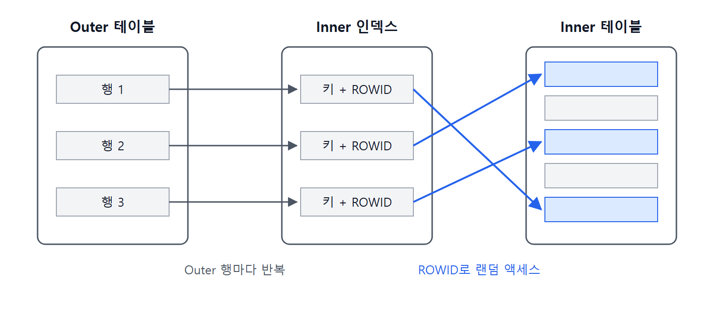
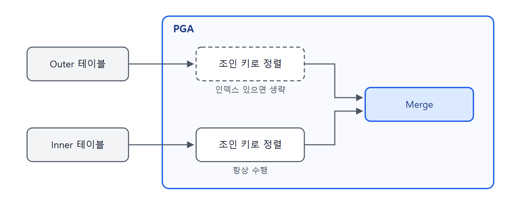
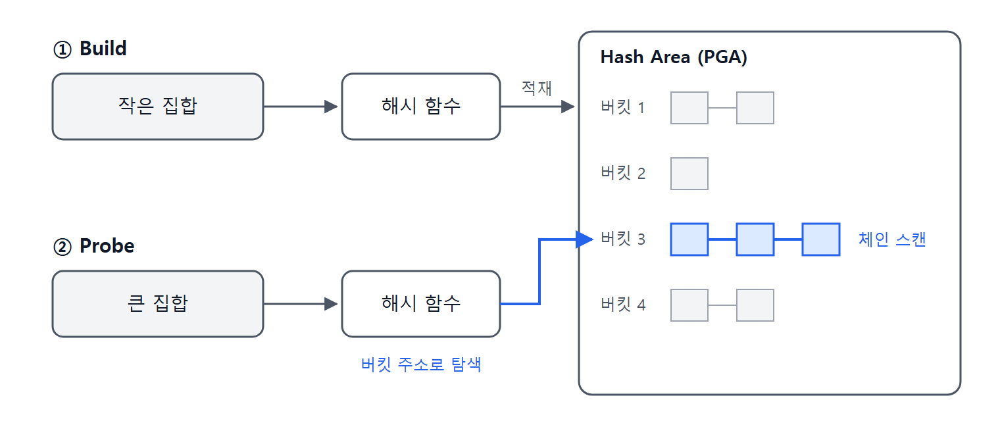

이전 글에서 인덱스로 찾은 행을 테이블에서 읽어 오는 데 비용이 든다는 걸 확인했다. ROWID로 블록을 찾아가려면 행마다 버퍼캐시를 탐색하고 래치를 잡아야 하고, 블록이 캐시에 없으면 디스크까지 다녀와야 한다.

이 비용이 가장 크게 불어나는 곳이 조인이다. 같은 두 테이블을 조인해도 실행 계획에는 `NESTED LOOPS`, `MERGE JOIN`, `HASH JOIN` 중 하나가 찍힌다. 결과는 같은데 왜 방식이 셋이나 있을까? 그리고 무엇을 기준으로 골라야 할까?

가장 단순한 방식에서 출발해, 그 방식이 어디서 막히는지 따라가 보자.

## 가장 단순한 방법: 하나씩 짝을 찾는다

두 테이블을 조인하는 가장 직관적인 방법은 이중 반복문이다. 한 테이블에서 행을 하나 꺼내고, 다른 테이블에서 그 행과 짝이 맞는 행을 찾는다. 다음 행을 꺼내고, 또 짝을 찾는다. 이것이 **NL(Nested Loops) 조인**이다.

```sql
-- 의사 코드
for outer_row in (Outer 테이블) loop
  for inner_row in (Inner 테이블에서 조인 조건에 맞는 행) loop
    -- 조인 결과로 반환
  end loop;
end loop;
```

바깥 반복문에서 행을 꺼내는 테이블을 **Outer 테이블**(또는 Driving 테이블), 안쪽에서 짝을 찾는 테이블을 **Inner 테이블**이라고 부른다. Outer 테이블의 행을 하나 읽을 때마다 Inner 테이블을 탐색해 조인 조건에 맞는 행을 돌려주고, Outer 행이 끝날 때까지 이걸 반복한다.

이 구조에서 두 테이블의 처지는 꽤 다르다. Outer 테이블은 처음부터 끝까지 **한 번만** 읽으면 되므로, 크기가 크지 않다면 인덱스 없이 Full Scan으로 읽어도 괜찮다. 하지만 Inner 테이블은 Outer 행 **하나하나마다** 다시 찾아가야 한다. Inner 쪽 조인 컬럼에 인덱스가 없다면 Outer 행마다 Inner 테이블을 통째로 훑게 되니, Inner 쪽 인덱스가 사실상 성능을 결정한다.

그런데 인덱스가 있으면 문제가 해결될까? Inner 쪽에서 실제로 무슨 일이 일어나는지 그려 보면 그렇지 않다는 게 보인다.


*Outer 행 하나마다 Inner 인덱스 탐색과 ROWID를 통한 테이블 액세스가 한 번씩 일어난다. 찾아가는 테이블 블록은 매번 다른 곳일 수 있다.*

Outer 행마다 Inner 인덱스를 타고, 인덱스가 준 ROWID로 테이블 블록을 찾아간다. 이전 글에서 본 그 **랜덤 액세스가 Outer 행 수만큼 반복**되는 것이다. Outer에서 10건이 넘어오면 10번, 10만 건이 넘어오면 10만 번이다.

뒤집어 보면 NL 조인이 언제 좋은지도 알 수 있다. 조인할 대상이 **적고**, Inner 테이블을 조인 조건으로 **효율적으로 찾아갈 수 있을 때**다. 또 NL 조인은 정렬이나 해시 테이블 같은 준비 작업 없이 Outer 첫 행부터 바로 결과를 내놓기 때문에, 전체 결과보다 **첫 몇 건을 빨리** 받아야 할 때(`FIRST_ROWS` 모드)에도 유리하다.

오라클도 이 반복 랜덤 액세스를 그냥 두지는 않는다. 최근 버전에는 캐시에 없는 블록을 하나씩 읽지 않고 여러 요청을 모아 한 번에 처리하는 **NL 조인 배칭**이 있다(실행 계획의 `TABLE ACCESS BY INDEX ROWID BATCHED`). 또 **적응형 실행 계획**은 실행 중에 실제 행 수가 임계값을 넘으면 NL 조인을 해시 조인으로 바꾸기도 한다.

그래도 근본 문제는 남는다. 조인할 대상이 많으면 랜덤 액세스 횟수가 그대로 비용이 된다. 그렇다면 짝을 하나씩 찾아다니지 않는 방법은 없을까?

## 짝을 찾아다니지 말고, 줄을 세워 두면 어떨까

두 반 학생들을 번호로 짝지어야 한다고 해 보자. 한 명씩 불러서 상대 반에서 같은 번호를 찾는 대신, 두 반을 각각 번호순으로 줄 세운 다음 앞에서부터 나란히 맞춰 가면 훨씬 빠르다. **소트 머지 조인**이 이 방식이다. 두 집합을 **조인 키로 각각 정렬한 뒤, 정렬된 순서대로 맞춰 가며 병합**한다.

과정을 따라가 보면 이렇다. Outer 테이블에서 조인 대상을 읽어 조인 키로 정렬하고(`SORT JOIN`), Inner 테이블에서도 조인 대상을 읽어 정렬한다(`SORT JOIN`). 그다음 정렬된 두 집합을 앞에서부터 비교하며 짝을 맞춘다(`MERGE JOIN`). 이 정렬과 병합은 모두 **PGA**에서 일어난다.


*정렬과 병합이 모두 PGA에서 일어난다. 정렬을 대신할 인덱스가 있어도 생략되는 쪽은 Outer뿐이다.*

그림에서 두 정렬 단계가 다르게 그려진 데는 이유가 있다. Outer 쪽은 조인 키 순서로 정렬된 인덱스가 있으면 그 순서대로 읽기만 하면 되므로 **정렬을 생략**할 수 있다. 그런데 Inner 쪽은 인덱스가 있어도 **항상 정렬한다.** 오라클 문서에도 "인덱스가 있으면 첫 번째 데이터 집합의 정렬은 피할 수 있지만, 두 번째 데이터 집합은 인덱스와 관계없이 항상 정렬한다"고 적혀 있다. ([Oracle SQL Tuning Guide 12.1 – Sort Merge Joins](https://docs.oracle.com/database/121/TGSQL/tgsql_join.htm))

이렇게 줄을 세워 두면 무엇을 얻을까? 일단 병합 과정 자체에는 랜덤 액세스가 없다. 정렬된 두 집합을 앞에서부터 차례로 훑을 뿐이다. (정렬할 데이터를 처음 읽는 단계에서 인덱스를 쓴다면, 그 읽기 단계에는 랜덤 액세스가 있을 수 있다.) 또 순서대로 맞춰 가는 방식이라 `=`가 아닌 `<`, `<=`, `>`, `>=` 같은 **범위 조건으로도 조인**할 수 있다. 결과를 어차피 조인 키로 `ORDER BY`해야 하는 경우처럼 **다른 연산 때문에 정렬이 필요할 때**도 그 정렬을 조인과 함께 쓸 수 있어 유리하다.

물론 공짜는 아니다. NL 조인에 없던 **정렬 비용**을 치른다. 그런데도 이 방식이 의미가 있는 건, 정렬과 병합이 일어나는 곳이 PGA이기 때문이다. PGA에서 한다는 게 왜 그렇게 중요할까?

## 같은 메모리인데 PGA는 왜 더 빠를까

오라클의 메모리는 크게 둘로 나뉜다.

| 구분 | SGA (System Global Area) | PGA (Program Global Area) |
| --- | --- | --- |
| 소유 | 모든 서버·백그라운드 프로세스가 공유 | 각 프로세스 전용(공유하지 않음) |
| 담는 것 | 버퍼캐시, 공유 SQL 영역(실행 계획) 등 | 정렬·해시 작업 공간, 세션별 SQL 실행 정보 등 |
| 동시 접근 제어 | 래치 등으로 공유 자료구조 접근을 직렬화 | 혼자 쓰므로 직렬화 불필요 |
| 공간 부족 시 | – | 정렬·해시 작업은 Temp 테이블스페이스로 넘김 |

이전 글에서 본 버퍼캐시는 SGA에 있다. 그래서 블록 하나를 읽을 때도 래치를 잡아 다른 프로세스와의 경합을 조율해야 했다. PGA는 내 프로세스만 쓰는 공간이라 그런 조율이 필요 없다. 같은 데이터를 다뤄도 PGA에서 다루는 쪽이 빠르다.

이제 소트 머지 조인이 무엇을 바꾼 건지 보인다. NL 조인은 Inner 테이블의 블록을 행마다 SGA에서 찾아다녔다. 소트 머지 조인은 데이터를 한 번 PGA로 가져와 정렬해 두고, 그 뒤의 비교와 병합은 공유 메모리를 건드리지 않고 끝낸다. 랜덤 액세스를 정렬 비용과 맞바꾼 것이다.

그런데 대부분의 조인 조건은 `=`다. 등치 조건만 맞추면 되는데 굳이 양쪽을 다 정렬할 필요가 있을까?

## 줄을 세우지 않고, 바로 찾아갈 수는 없을까

등치 조건이라면 정렬보다 더 직접적인 방법이 있다. 한쪽 집합으로 **해시 테이블**을 만들어 두면, 다른 쪽의 각 행은 해시 함수만 계산해서 짝이 있을 버킷으로 곧장 갈 수 있다. **해시 조인**이 이 방식이다. 대량의 데이터를 조인할 때 주로 쓰인다.

해시 조인은 두 단계로 진행된다. 먼저 **Build** 단계에서 둘 중 작은 집합(Build Input)을 읽어 PGA의 **Hash Area**에 조인 키 기준 해시 테이블을 만든다. 그다음 **Probe** 단계에서 큰 집합(Probe Input)을 읽으면서, 각 행의 조인 키를 같은 해시 함수에 넣어 나온 **버킷 주소**로 찾아가고, 그 버킷의 **해시 체인**을 스캔해 일치하는 행을 찾는다.


*Probe 쪽 행은 해시 함수가 알려 준 버킷 하나만 확인하면 된다. 체인이 길수록 그 확인이 길어진다.*

정렬도 없고 랜덤 액세스도 없다. 대신 해시라는 도구의 성질 때문에 제약이 생긴다. 해시 함수는 같은 값을 같은 버킷으로 보낼 뿐, 값의 크고 작음은 보존하지 않는다. 그래서 `<`, `>` 같은 범위 조건으로는 버킷을 찾을 수 없고, **등치(`=`) 조건이 적어도 하나는 있어야** 해시 조인을 쓸 수 있다. 또 해시 조인은 **비용 기반 옵티마이저(CBO)** 가 비용을 따져 고르는 방식이다.

그렇다면 해시 조인의 비용은 어디서 생길까? 대부분 해시 테이블을 만드는 데서 생긴다. 그래서 Build Input이 **Hash Area에 담길 만큼 작아야** 하고, Build Input의 해시 키 컬럼에 **중복 값이 거의 없어야** 한다. 중복이 많으면 같은 버킷에 행이 몰려 체인이 길어지고(그림의 버킷 3), Probe할 때마다 그 긴 체인을 훑어야 한다. Hash Area 역시 PGA에 있으니 **충분한 PGA 메모리**가 필요하고, 해시 계산과 체인 스캔은 **CPU**를 쓰는 작업이라는 점도 기억해 둘 만하다.

그런데 만약 Build Input이 Hash Area에 다 들어가지 않는다면 어떻게 될까?

## 메모리가 모자라면 생기는 일

이때 오라클은 해시 테이블의 일부를 디스크로 내린다. 작은 집합을 읽으며 해시 버킷을 PGA와 디스크에 나눠 만들고, Hash Area가 차면 가장 큰 파티션을 **Temp 테이블스페이스**에 쓴다. 큰 집합도 같은 방식으로 파티션을 나눈 뒤, 서로 대응하는 파티션끼리 조인한다. 메모리에서 끝낼 때보다 Temp I/O가 더 붙으니 성능이 크게 떨어질 수 있다.

흥미롭게도 이런 상황에서는 앞에서 본 소트 머지 조인이 해시 조인보다 나을 수 있다고 오라클 문서는 말한다. 어느 하나가 늘 이기는 게 아니라, 데이터의 크기와 조건에 따라 우열이 바뀐다는 뜻이다. 그렇다면 셋을 나란히 놓고 정리해 보자.

## 세 방식을 나란히 놓으면

| 구분 | NL 조인 | 소트 머지 조인 | 해시 조인 |
| --- | --- | --- | --- |
| 핵심 아이디어 | 하나씩 짝을 찾아간다 | 양쪽을 줄 세워 맞춘다 | 한쪽을 해시 테이블로 만들어 바로 찾아간다 |
| 주된 비용 | Inner 쪽 반복 랜덤 액세스 | 정렬 | 해시 테이블 생성 |
| 작업 공간 | 버퍼캐시 (SGA) | PGA (Sort Area) | PGA (Hash Area) |
| 메모리 부족 시 | 해당 없음 | 정렬을 Temp로 넘김 | 해시 파티션을 Temp로 넘김 |
| 인덱스 | Inner 조인 컬럼 인덱스가 사실상 필수 | Outer 정렬을 대체할 수 있음 | 조인 자체에는 필요 없음 |
| 조인 조건 | 제한 없음 | 등치가 아니어도 가능 | 등치 필요 |
| 잘 맞는 상황 | 조인 대상이 적음, 첫 결과를 빨리 | 범위 조건 조인, 이미 정렬이 필요한 경우 | 대량 데이터의 등치 조인 |

## 처음 질문으로 돌아가면

결과가 같은데 왜 조인 방식이 셋이나 있을까? 각 방식이 서로 다른 비용을 치르기 때문이다. NL 조인은 준비 없이 바로 시작하는 대신 랜덤 액세스를 반복하고, 소트 머지 조인은 그 랜덤 액세스를 정렬과 맞바꾸고, 해시 조인은 정렬 대신 해시 테이블을 만든다. 어느 비용이 싼지는 데이터의 크기, 조인 조건, 메모리에 따라 달라진다.

그래서 고르는 순서도 이 비용을 따라간다. **먼저 NL 조인을 고려한다.** 준비 작업이 없고 조인 조건에도 제약이 없기 때문이다. 성능이 좋지 않으면 NL 조인의 각 단계를 분석해 **과도한 랜덤 액세스가 어디서 생기는지**부터 찾는다. Inner 조인 컬럼에 인덱스가 있는지, Outer 집합이 예상보다 크지 않은지가 첫 확인 대상이다. 그래도 나아지지 않을 때, 즉 랜덤 액세스 횟수 자체가 감당할 수 없을 만큼 클 때 **소트 머지 조인이나 해시 조인**을 검토한다.

이 판단은 실제 실행 통계를 함께 보면 훨씬 쉬워진다.

```sql
SELECT /*+ GATHER_PLAN_STATISTICS */ ...;

SELECT *
FROM   TABLE(DBMS_XPLAN.DISPLAY_CURSOR(NULL, NULL, 'ALLSTATS LAST'));
```

`NESTED LOOPS`라면 Inner 쪽 오퍼레이션의 `Starts`(반복 실행 횟수)가 Outer에서 넘어온 행 수만큼 커지는지, Inner가 인덱스로 접근하는지 본다. `MERGE JOIN`이라면 양쪽 `SORT JOIN`이 메모리에서 끝나는지, Temp를 쓰는지 본다. `HASH JOIN`이라면 위쪽(Build) 집합이 정말 작은 쪽인지, Temp로 넘어가고 있지 않은지 본다.

검토 끝에 조인 방식을 직접 지정해야 한다면 `USE_NL`, `USE_MERGE`, `USE_HASH` 힌트와 조인 순서를 정하는 `LEADING` 힌트를 쓸 수 있다. 다만 힌트는 통계가 바뀌어도 계획을 고정해 버리므로, 옵티마이저가 왜 다른 선택을 했는지(통계, 행 수 추정)를 먼저 확인하는 편이 낫다.

마지막으로 하나가 남는다. 소트 머지 조인도 해시 조인도 PGA에서 일하고, 공간이 모자라면 Temp로 넘어간다고 했다. 그 "넘어간다"는 건 정확히 어떤 일이고, 얼마나 비쌀까? 다음 글에서는 소트 연산을 따라가며 이 질문에 답해 본다.
