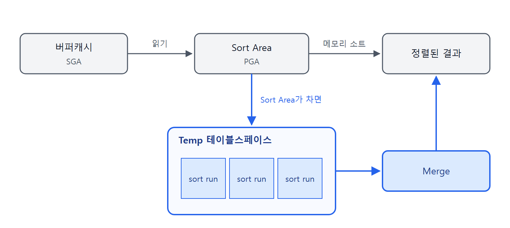

이전 글에서 소트 머지 조인과 해시 조인은 PGA에서 일하고, 공간이 모자라면 Temp 테이블스페이스로 넘어간다고 했다. 그 "넘어간다"는 건 정확히 어떤 일일까?

이 질문을 들고 실행 계획을 보면 또 하나가 눈에 들어온다. `SORT AGGREGATE`, `SORT ORDER BY`, `SORT GROUP BY`처럼 SORT라는 이름을 단 오퍼레이션이 곳곳에 있다. 이름만 보면 전부 정렬하는 것 같지만, 그중 일부는 실제로 정렬을 하지 않는다. 그렇다면 소트는 정확히 언제, 어디서 일어나고, 왜 가능하면 피하라고 할까?

소트가 일하는 공간에서부터 따라가 보자.

## 소트는 어디서 일어날까

소트 연산은 기본적으로 **PGA에 할당된 Sort Area**에서 이루어진다. PGA는 각 서버 프로세스만 쓰는 전용 메모리라, 공유 메모리인 SGA처럼 래치로 접근을 조율할 필요가 없어 빠르다. (SGA와 PGA의 차이는 이전 글에서 조인 방식과 함께 정리했다.)

문제는 Sort Area도 메모리라서 크기에 한계가 있다는 점이다. 정렬할 데이터가 Sort Area에 다 들어가면 메모리 안에서 정렬을 끝낸다. 이것이 **메모리 소트**다. 다 들어가지 않으면 디스크의 **Temp 테이블스페이스**까지 쓰게 되는데, 이것이 **디스크 소트**다.

그렇다면 Sort Area가 넘치는 순간, 정확히 무슨 일이 벌어질까?

## Sort Area가 넘치면

과정을 순서대로 따라가 보면 이렇다. 먼저 정렬할 대상을 SGA의 버퍼캐시를 통해 읽어 와 Sort Area에서 정렬을 시도한다. 데이터가 적으면 여기서 끝이다. 하지만 데이터가 많으면 Sort Area가 찰 때마다 그때까지 정렬한 중간 결과를 Temp 테이블스페이스의 임시 세그먼트에 내려 둔다. 이렇게 조각조각 저장한 중간 집합을 **sort run**이라고 한다. 모든 데이터를 읽고 나면, 정렬된 최종 결과를 얻기 위해 이 sort run들을 다시 읽어 **병합(Merge)** 한다.


*위쪽 경로는 메모리 소트, 강조된 아래쪽 경로는 디스크 소트다. 디스크 소트는 Temp에 쓰고, 다시 읽어 병합하는 단계가 더 붙는다.*

그림에서 아래쪽 경로가 바로 이전 글의 "Temp로 넘어간다"의 정체다. 메모리 소트에는 없던 일, 즉 디스크에 쓰고 다시 읽어 병합하는 일이 더해진다.

그런데 Temp를 쓰기만 하면 다 같은 디스크 소트일까? 조금 넘친 경우와 한참 넘친 경우가 같은 대가를 치를 것 같지는 않다.

## 넘친 정도에 따라 대가가 다르다

실제로 오라클은 정렬이나 해시 작업 공간(work area)이 얼마나 넉넉했는지를 세 단계로 나눈다.

| 단계 | 의미 | 영향 |
| --- | --- | --- |
| **optimal** | 입력 전체를 메모리에서 처리 | 가장 빠름 |
| **one-pass** | 일부를 디스크에 쓰고 **한 번 더** 읽어 병합 | 응답 시간 증가 |
| **multi-pass** | 메모리가 훨씬 부족해 입력을 **여러 번** 다시 읽음 | 응답 시간이 급격히 나빠짐 |

흥미로운 건 one-pass에 필요한 메모리가 생각보다 작다는 점이다. 오라클 문서의 예를 보면, 10GB를 정렬할 때 optimal로 끝내려면 10GB 남짓이 필요하지만 one-pass는 40MB 정도면 된다. 1GB 정렬은 22MB로 one-pass가 가능하다. 그래서 문서는 작업 공간의 90% 이상(OLTP라면 100%에 가깝게)을 optimal로 돌리고, multi-pass는 피하라고 권한다. ([Oracle Database Performance Tuning Guide – Tuning the Program Global Area](https://docs.oracle.com/database/121/TGDBA/tune_pga.htm))

Sort Area 크기는 보통 우리가 직접 정하지 않는다. 자동 PGA 관리에서는 `PGA_AGGREGATE_TARGET`으로 정한 전체 PGA 목표 안에서 오라클이 작업마다 공간을 나눠 준다.

여기까지 오면 소트를 다루는 방향이 두 가지로 정리된다. **소트를 아예 일으키지 않거나**, 피할 수 없다면 **메모리 안에서 끝나게** 하는 것이다. 그러려면 먼저 실행 계획의 어떤 SORT가 진짜 정렬인지부터 가려낼 수 있어야 한다.

## 이름은 SORT인데, 정렬을 하지 않는다?

두 쿼리를 비교해 보자.

```sql
SELECT SUM(sal) FROM emp;                -- SORT AGGREGATE
SELECT * FROM emp ORDER BY sal DESC;     -- SORT ORDER BY
```

첫 번째 쿼리는 GROUP BY 없이 전체 행을 하나의 값으로 집계한다. 실행 계획에는 `SORT AGGREGATE`가 나오지만, 이 오퍼레이션은 **데이터를 정렬하지 않는다.** 행을 읽어 가면서 합계나 최댓값 같은 집계 값만 갱신할 뿐이다. 생각해 보면 당연하다. 합계를 구하는 데 행의 순서는 필요 없다. SUM, MAX, MIN, AVG, COUNT 모두 마찬가지다.

두 번째 쿼리의 `SORT ORDER BY`는 이름 그대로 **실제로 정렬한다.** 앞에서 본 Sort Area와 Temp의 이야기가 그대로 적용되는 경우다.

이 둘만 그런 게 아니다. 실행 계획에서 자주 보는 정렬 관련 오퍼레이션을 모아 보면, 실제 정렬 여부가 제각각이다.

| 오퍼레이션 | 언제 나오나 | 실제 정렬 |
| --- | --- | --- |
| `SORT AGGREGATE` | GROUP BY 없는 전체 집계 | 하지 않음 |
| `SORT ORDER BY` | `ORDER BY` | 함 |
| `SORT ORDER BY STOPKEY` | `ORDER BY` 후 `ROWNUM`으로 상위 N건만 | 상위 N건만 유지하며 정렬 |
| `SORT GROUP BY` | `GROUP BY` | 함 (그룹 키 순 결과) |
| `HASH GROUP BY` | `GROUP BY` (10gR2 이후) | 하지 않음. 해시로 그룹핑 |
| `SORT GROUP BY NOSORT` | 인덱스 순서로 읽어 그룹핑 | 하지 않음 |
| `SORT UNIQUE` / `HASH UNIQUE` | `DISTINCT`, `UNION`, `MINUS` 등 중복 제거 | SORT는 함, HASH는 하지 않음 |
| `SORT JOIN` | 소트 머지 조인의 입력 | 함 |

이 표에는 함정이 하나 숨어 있다. `HASH GROUP BY`는 정렬 없이 해시로 그룹을 묶기 때문에, 결과가 그룹 키 순서로 나온다는 **보장이 없다.** 예전 버전에서 GROUP BY 결과가 늘 정렬돼 나왔다고 해서 그 순서에 기대면 안 된다. 순서가 필요하면 반드시 `ORDER BY`를 함께 써야 한다.

진짜 정렬을 가려낼 수 있게 됐다. 그렇다면 그 진짜 정렬은 어떻게 줄일 수 있을까? 가장 먼저 볼 곳은 우리가 쓰는 SQL 자체다.

## SQL 한 줄이 소트를 부른다

소트는 `ORDER BY`에서만 생기지 않는다. 중복을 없애는 `UNION`, `MINUS`, `DISTINCT`도 중복을 찾기 위해 정렬(또는 해시)을 한다. 소트 머지 조인을 고르면 조인 키로 정렬한다. 즉 무심코 쓴 SQL 한 줄이 소트를 부를 수 있다.

가장 흔한 예가 `UNION`이다.

```sql
-- 위아래 집합 간 중복을 제거하기 위해 SORT UNIQUE가 발생한다
SELECT empno, job, mgr FROM emp WHERE deptno = 10
UNION
SELECT empno, job, mgr FROM emp WHERE deptno = 20;

-- 중복을 확인하지 않고 두 집합을 이어 붙인다
SELECT empno, job, mgr FROM emp WHERE deptno = 10
UNION ALL
SELECT empno, job, mgr FROM emp WHERE deptno = 20;
```

`UNION`은 위아래 두 집합 사이의 중복을 지우려고 정렬한다. `UNION ALL`은 중복을 확인하지 않고 그냥 이어 붙이니 정렬이 없다. 그렇다고 무조건 `UNION ALL`로 바꾸면 안 된다. 바꿔도 되는 건 **두 쿼리의 결과가 같을 때뿐**이다. 위 예시처럼 두 조건(`deptno = 10`, `deptno = 20`)이 겹치지 않아 중복이 생길 수 없거나, 중복이 있어도 괜찮은 경우다. 두 집합에 같은 행이 나올 수 있는데 중복 제거가 필요하다면, `UNION ALL`은 소트를 없애는 게 아니라 결과를 바꾸는 것이다.

`DISTINCT`도 비슷하다. "조건을 만족하는 데이터가 **있는지**"만 알면 되는데, 많은 행을 읽은 뒤 `DISTINCT`로 중복을 지우는 경우가 꽤 있다.

```sql
-- 과금 테이블의 수많은 행을 읽은 뒤 중복을 제거한다
SELECT DISTINCT 과금연월
FROM   과금
WHERE  과금연월 <= :yyyymm
AND    지역 LIKE :reg || '%';

-- 연월마다 조건에 맞는 행이 하나라도 있으면 바로 다음 연월로 넘어간다
SELECT 연월
FROM   연월테이블 a
WHERE  연월 <= :yyyymm
AND    EXISTS (SELECT 'x'
               FROM   과금
               WHERE  과금연월 = a.연월
               AND    지역 LIKE :reg || '%');
```

`EXISTS`는 메인 쿼리의 값마다 조건을 만족하는 **첫 행을 만나는 순간 TRUE를 반환하고 서브쿼리를 끝낸다.** 중복된 행을 모았다가 지울 필요가 없으니 정렬도 없고, 읽는 양도 크게 줄어든다. 위 예시라면 `과금(과금연월, 지역)` 인덱스가 있을 때 연월마다 인덱스 몇 건만 확인하고 넘어간다.

SQL을 고쳐도 정렬이 꼭 필요한 경우가 있다. `ORDER BY`가 그렇다. 결과를 정렬해서 보여 줘야 한다면, 정렬 자체는 피할 수 없는 걸까?

## 이미 정렬된 것을 읽으면 된다

꼭 그렇지는 않다. 인덱스는 키 순서로 정렬된 채 저장되어 있다. 그래서 인덱스 순서대로 읽기만 하면 **이미 정렬된 결과**가 나오고, 옵티마이저는 정렬 단계를 건너뛴다.

```sql
-- customer(region) 인덱스만 있으면: INDEX RANGE SCAN 후 SORT ORDER BY
-- customer(region, custid) 인덱스가 있으면: SORT ORDER BY 없이 INDEX RANGE SCAN만
SELECT *
FROM   customer
WHERE  region = 'A'
ORDER  BY custid;
```

`WHERE`의 등치 조건 컬럼 뒤에 `ORDER BY` 컬럼이 이어지는 결합 인덱스가 있으면, `region = 'A'` 범위를 인덱스 순서대로 읽는 것 자체가 `custid` 순서가 된다.

이 방법이 진가를 발휘하는 건 **많은 행 중 앞쪽 일부만 읽고 멈추는** 쿼리다. 정렬을 하려면 대상 전체를 읽어야 하지만, 인덱스 순서로 읽으면 필요한 만큼만 읽고 끝낼 수 있다. 반대로 대상이 원래 적다면 정렬 부담도 작아서 얻는 게 크지 않다.

다만 인덱스가 있어도 정렬이 남는 경우가 있다. 하나는 `ORDER BY`가 인덱스에 저장된 순서와 다를 때다. 예를 들어 오름차순 인덱스는 NULL을 맨 뒤에 두는데, `NULLS FIRST`로 NULL을 앞에 달라고 하면 다시 정렬해야 한다. 다른 하나는 GROUP BY 컬럼이 NULL을 허용할 때다. 단일 컬럼 B-tree 인덱스는 NULL 값을 저장하지 않기 때문에, 인덱스만 읽어 그룹을 묶으면 NULL 그룹이 빠질 수 있다. 그래서 옵티마이저가 인덱스를 쓰지 않는다. `WHERE 컬럼 IS NOT NULL` 조건(또는 NOT NULL 제약)이 있으면 `SORT GROUP BY NOSORT`로 처리할 수 있다.

SQL로도, 인덱스로도 정렬을 없앨 수 없다면 마지막 방어선이 남는다. 정렬은 하되, 메모리 안에서 끝나게 만드는 것이다.

## 피할 수 없다면, 덜 싣고 정렬한다

Sort Area에는 정렬 키만 올라가는 게 아니라 SELECT 목록의 값이 통째로 올라간다. 그래서 `LPAD`, `TO_CHAR` 등으로 값을 길게 가공한 뒤 정렬하면, 정렬 기준은 같아도 Sort Area를 훨씬 많이 쓴다. 순서를 바꾸면 된다. 필요한 컬럼만 인라인 뷰에서 먼저 정렬하고, 가공은 바깥에서 한다.

```sql
SELECT LPAD(상품번호, 30) || LPAD(상품명, 30) || ...   -- 가공은 정렬 뒤에
FROM  (SELECT 상품번호, 상품명, 고객ID, 고객명, 주문일시
       FROM   주문상품
       WHERE  주문일시 BETWEEN :start AND :end
       ORDER  BY 상품번호);
```

상위 몇 건만 필요할 때 전체를 정렬하는 것도 낭비다. 정렬한 인라인 뷰 바깥에서 `ROWNUM`으로 건수를 제한하면, 오라클은 전체를 정렬하지 않고 **상위 N건만 유지하며** 처리한다(`SORT ORDER BY STOPKEY`, `COUNT STOPKEY`). 새로 읽은 행이 지금까지의 N번째 값보다 작을 때만 목록을 고치니, Sort Area를 아주 조금만 쓴다. 단, 쿼리 모양이 조금만 달라져도 이 처리가 깨진다.

```sql
-- Top-N 처리가 동작한다
SELECT *
FROM  (SELECT * FROM t ORDER BY object_name)
WHERE ROWNUM <= 10;

-- 동작하지 않는다: 안쪽에서 ROWNUM을 먼저 붙이면 전체를 정렬한다
SELECT *
FROM  (SELECT a.*, ROWNUM no
       FROM  (SELECT * FROM t ORDER BY object_name) a)
WHERE no <= 10;
```

12c 이후라면 `FETCH FIRST 10 ROWS ONLY` 구문으로 같은 Top-N 쿼리를 더 간단히 쓸 수 있다.

분석 함수에도 같은 원리가 통한다. 그룹별로 최댓값 행을 찾을 때 `MAX() OVER (PARTITION BY ...)`를 쓰면 전체를 정렬(`WINDOW SORT`)하지만, `RANK()`나 `ROW_NUMBER()`로 순위를 매기고 1위만 거르면 Top-N 방식(`WINDOW SORT PUSHED RANK`)으로 처리되어 Sort Area를 훨씬 적게 쓴다.

## 처음 질문으로 돌아가면

Temp로 "넘어간다"는 건, 정렬하던 데이터를 디스크에 sort run으로 내려 두었다가 다시 읽어 병합한다는 뜻이었다. 조금 넘치면 한 번 더 읽는 one-pass로 끝나지만, 한참 넘치면 여러 번 읽는 multi-pass가 되어 응답 시간이 급격히 나빠진다. 그래서 소트는 가능하면 일으키지 않고, 불가피하면 메모리 안에서 끝내는 게 목표가 된다.

느린 쿼리에서 SORT를 발견했다면, 지금까지 따라온 길을 그대로 되짚으면 된다. 먼저 그게 진짜 정렬인지 본다. `SORT AGGREGATE`나 `HASH GROUP BY`라면 정렬이 아니다. 진짜 정렬이라면 SQL로 없앨 수 있는지(`UNION ALL`, `EXISTS`), 인덱스로 대신할 수 있는지, 소트 머지 조인의 `SORT JOIN` 때문이라면 다른 조인 방식이 가능한지 차례로 따져 본다. 그래도 남는 정렬이라면 메모리 안에서 끝나는지 확인한다. SQL 하나를 볼 때는 `DBMS_XPLAN.DISPLAY_CURSOR(..., 'ALLSTATS LAST')`의 `Used-Mem`, `Used-Tmp`, `1Pass`/`MPass` 열이나 `V$SQL_WORKAREA`를 보면 되고, 시스템 전체로는 `V$SQL_WORKAREA_HISTOGRAM`의 optimal / one-pass / multi-pass 횟수나 AUTOTRACE의 `sorts (memory)` / `sorts (disk)` 통계를 보면 된다.

ROWID 한 줄에서 시작한 질문이 조인을 거쳐 소트까지 왔다. 세 글을 관통하는 건 결국 하나다. 실행 계획의 각 줄이 **어떤 비용을 치르고 있는지** 알면, 그 비용을 줄일 방법도 보인다.
