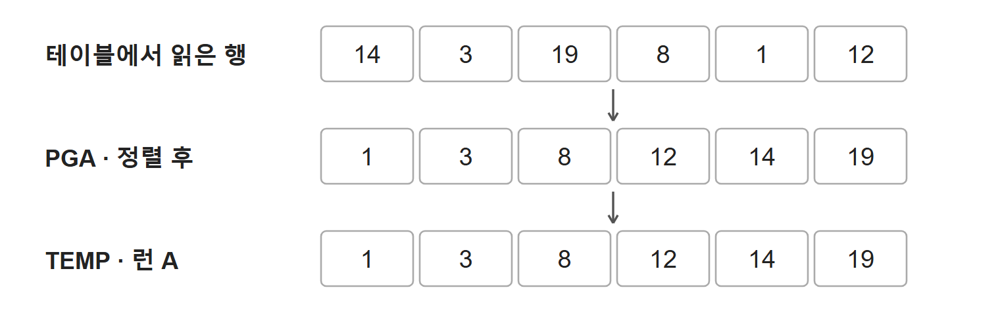
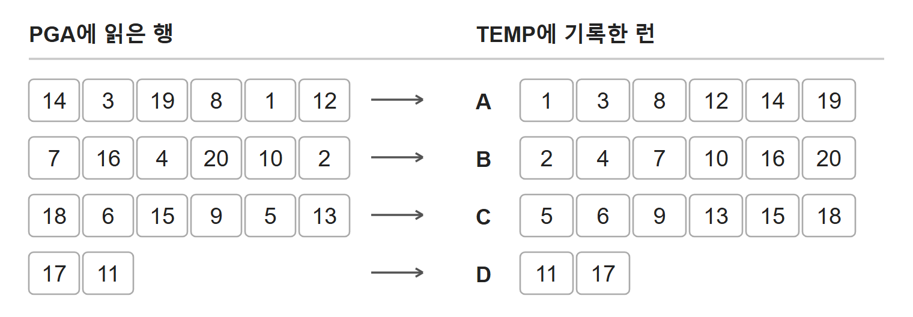
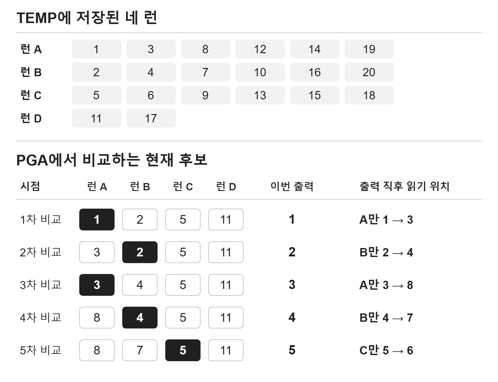
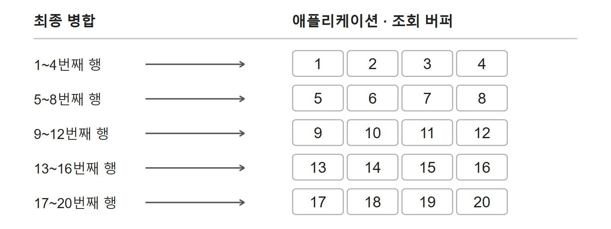
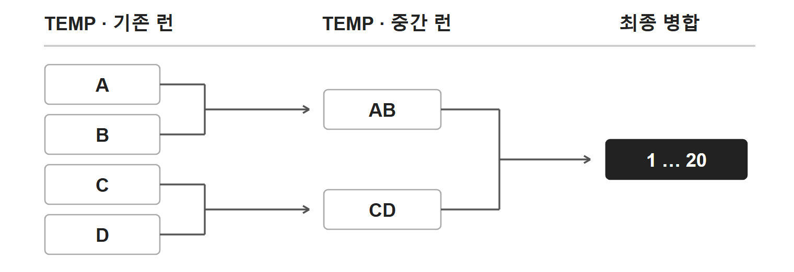

이전 글에서 Sort Area가 넘치면 정렬하던 데이터를 Temp 테이블스페이스에 sort run으로 내려 두었다가, 다시 읽어 병합한다고 했다. 그 문장을 다시 읽으면 걸리는 곳이 있다. Temp는 디스크다. 그렇다면 디스크 소트는 디스크 위에서 값을 비교하며 정렬한다는 뜻일까? 그리고 메모리보다 큰 데이터를, 그보다 작은 메모리로 어떻게 끝까지 정렬할 수 있을까?

점수 스무 개를 여섯 칸짜리 메모리로 정렬하는 작은 예를 직접 따라가며 답을 찾아보자.

## 정렬은 무엇을 바꾸는가

먼저 소트가 하는 일부터 좁혀 두자. 소트(sort)는 입력으로 받은 행들의 **반환 순서를 정렬 키에 따라 정하는 작업**이다.

```sql
SELECT student_id, score
FROM   exam_result
ORDER  BY score;
```

정렬 키는 `score`이고, 정렬 대상은 조회 결과에 포함되는 행이다. 점수가 `80, 20, 60`인 순서로 행을 읽었다면 정렬 후에는 `20, 60, 80` 순서로 각 학생의 `student_id`와 `score`를 함께 돌려준다. 바뀌는 것은 이번 조회의 반환 순서뿐이다. 테이블에 저장된 행을 점수순으로 다시 쓰는 일은 일어나지 않는다.

실행 계획의 `SORT ORDER BY`는 바로 아래 단계에서 행을 받아 정렬한 뒤 위 단계로 넘긴다. 전용 서버(dedicated server) 환경에서 오라클은 이 작업에 **PGA의 작업 영역(Sort Area)** 을 쓴다. 정렬에 쓸 수 있는 메모리는 PGA 전체가 아니라 이 연산에 할당된 만큼이다.

여기서 놓치기 쉬운 성질이 하나 있다. `ORDER BY`의 정렬은 **입력을 끝까지 읽기 전에는 첫 행을 내보낼 수 없다.** 아직 읽지 않은 행 중에 지금까지 본 어떤 값보다 작은 값이 있을 수 있기 때문이다. 그래서 정렬은 입력 전체를 어딘가에 붙잡아 두어야 하고, 그 "어딘가"가 메모리에 다 들어가느냐가 문제가 된다.

## 메모리에 다 들어가지 않으면, Temp는 무슨 역할을 할까

정렬할 데이터가 Sort Area에 다 들어가면 **메모리 소트**다. 작업 영역에서 정렬 키를 비교해 순서를 정하고 결과를 넘긴다. 원본 테이블을 읽는 과정에서 디스크 I/O가 생길 수는 있지만, 정렬의 중간 결과를 Temp에 기록할 필요는 없다.

다 들어가지 않으면 **디스크 소트**가 된다. 하지만 이때도 값을 비교하고 순서를 정하는 곳은 여전히 메모리다. Temp는 **메모리에서 정렬을 끝낸 데이터를 잠시 보관해 두었다가 나중에 다시 읽는 공간**일 뿐이다. 디스크 위에서 정렬하는 게 아니라, 메모리에서 정렬한 조각을 디스크에 맡겨 두는 것이다.

이 방식을 설명하는 알고리즘이 **외부 병합 정렬(external merge sort)** 이다. 두 단계로 나뉜다.

1. **런 생성** — 입력을 메모리에 들어가는 만큼 읽어 정렬하고 Temp에 기록한다. 이렇게 내부 순서가 정해진 행의 묶음을 **런(run)** 이라고 한다. 한 묶음을 기록하면 같은 메모리로 다음 묶음을 처리할 수 있다.
2. **런 병합** — 각 런을 앞에서부터 읽으며 전체 순서를 만든다.

말로만 들으면 두 번째 단계가 막연하다. 런이 여러 개인데, 그걸 다시 다 메모리에 올려야 하는 건 아닐까? 작은 예로 확인해 보자.

## 여섯 칸짜리 메모리로 점수 스무 개를 정렬하기

점수 20개를 오름차순으로 정렬하는데, 작업 영역에는 한 번에 **6개**만 담을 수 있다고 하자. 숫자 하나가 행 하나의 점수다. 실제 오라클은 메모리를 바이트 단위로 관리하고 Temp를 블록 단위 버퍼로 읽고 쓰지만, 여기서는 메모리의 쓰임을 따라가기 쉽도록 **같은 크기의 행 6개**로 단순화한 설명용 예시다.

테이블에서 처음 읽은 여섯 행은 `14, 3, 19, 8, 1, 12`다. PGA에서 정렬하면 `1, 3, 8, 12, 14, 19`가 된다.


*첫 여섯 행을 PGA에서 정렬해 Temp에 런 A로 기록한다.*

이 순서를 바로 결과로 내보낼 수는 없다. 아직 읽지 않은 행에 `2`가 있기 때문이다. 대신 정렬된 여섯 행을 Temp에 **런 A**로 기록하면, 같은 PGA 공간을 비워 다음 여섯 행을 받을 수 있다. 같은 일을 입력이 끝날 때까지 반복한다.


*여섯 행씩 세 번, 남은 두 행으로 한 번. Temp에 런 네 개가 생긴다.*

위에서 아래로 한 줄이 한 번의 런 생성이다. 마지막에는 두 행 `17, 11`만 남으므로 이것도 정렬해 `11, 17`로 기록한다. 이제 Temp에는 **런 A, B, C, D**가 있고, 각 런 **안에서는** 이미 오름차순이다. 하지만 런 **사이**의 순서는 아직 정해지지 않았다. A의 첫 값은 `1`이지만 두 번째로 작은 `2`는 B에 있다.

## 맨 앞값만 비교해도 되는 이유

이제 네 런을 합쳐야 한다. 런 전체를 메모리에 다시 올릴 필요는 없다. 오름차순이라면 각 런에서 **아직 꺼내지 않은 맨 앞 행**만 비교하면 된다. 같은 런의 뒤쪽에는 그보다 작은 값이 없기 때문이다. 그래서 병합에 필요한 메모리는 런마다 "지금 읽고 있는 앞부분"을 담을 만큼이면 충분하다.

아래 그림의 위쪽은 Temp에 저장된 네 런이다. 한 줄을 가로로 읽으면 그 런의 정렬된 값이 보인다. 아래쪽은 위에서 아래로 시간이 흐른다. 한 줄이 한 번의 비교이고, 검은 칸이 이번에 출력하는 값이다.


*매 비교에서 가장 작은 맨 앞값을 출력하고, 그 값을 낸 런만 읽기 위치를 한 칸 옮긴다.*

1차 비교의 후보는 `[1, 2, 5, 11]`이고 A의 `1`이 가장 작다. `1`을 출력하고 **A만** 읽기 위치를 `3`으로 옮긴다. 그래서 2차 비교의 후보는 `[3, 2, 5, 11]`이다.

2차 비교에서는 B의 `2`가 가장 작다. 이번에는 B만 `2 → 4`로 이동한다. A의 `3`은 그 자리에서 기다린다. 그래서 3차 비교에도 같은 `3`이 다시 보이고, 이때 비로소 출력된다. D의 `11`도 자기 차례가 올 때까지 같은 위치에서 계속 기다린다.

다섯 번째로 C의 `5`를 출력한 뒤 후보는 `[8, 7, 6, 11]`이고, 다음 출력은 C의 `6`이다. 이 과정을 런이 모두 빌 때까지 반복하면 `1`부터 `20`까지 순서대로 나온다.

여기서는 런이 네 개라 후보 네 개를 매번 다 훑어도 된다. 런이 수백 개라면 매번 전부 비교하는 대신, 후보들을 힙(우선순위 큐) 같은 구조에 두고 가장 작은 값을 빠르게 꺼내는 것이 외부 병합 정렬의 일반적인 구현이다. 어떤 구조를 쓰든 "각 런의 맨 앞값만 후보가 된다"는 원리는 같다.

그렇다면 이렇게 하나씩 뽑혀 나온 행은 어디로 갈까?

## 병합한 결과는 어디로 가는가

네 런을 한 번에 합칠 수 있고 정렬이 조회의 마지막 연산이라면, 병합 결과를 다시 Temp에 모아 둘 이유가 없다. 병합하면서 나오는 행을 그대로 커서를 통해 애플리케이션에 넘기면 된다.


*최종 병합 결과는 Temp를 거치지 않고, 애플리케이션이 가져가는 만큼씩 넘어간다.*

그림은 애플리케이션이 한 번에 **네 행씩** 가져가는 예다. 첫 조회 버퍼가 `1, 2, 3, 4`를 받았을 때 PGA의 다음 비교 후보는 `8, 7, 5, 11`이다. 이미 넘긴 네 행은 이후 비교에서 빠지고, 다음 묶음은 `5`부터 시작한다. 한 번에 가져가는 행 수는 클라이언트의 배열 인출 크기(SQL\*Plus의 `ARRAYSIZE` 같은 설정)에 따라 달라진다.

이 경우 각 행은 Temp에 **한 번 쓰이고 한 번 읽힌다.** 런을 만들 때 한 번 쓰고, 최종 병합 때 한 번 읽는다. 오라클이 **one-pass**라고 부르는 상태가 바로 이것이다. 메모리에 다 들어가서 Temp를 아예 쓰지 않는 상태는 **optimal**이다.

그런데 이 그림은 "네 런을 한 번에 합칠 수 있다"는 가정 위에 서 있다. 그 가정이 깨지면 어떻게 될까?

## 한 번에 다 합칠 수 없다면

병합할 때는 런마다 맨 앞부분을 읽어 둘 버퍼가 메모리에 있어야 한다. 그러니 한 번에 합칠 수 있는 런의 수, 즉 **병합 폭(merge width)** 은 작업 영역 크기에 묶인다. 데이터가 메모리보다 훨씬 커서 런이 아주 많이 생기면, 모든 런의 버퍼를 동시에 둘 수 없게 된다.

예를 들어 한 번에 **두 런씩만** 병합할 수 있다고 해 보자.


*두 런씩만 합칠 수 있으면, 중간 런을 Temp에 다시 쓰고 다시 읽는 단계가 끼어든다.*

이번에는 병합 결과의 목적지가 달라진다. A와 B를 합친 12개 행은 아직 최종 결과가 아니므로 Temp에 **중간 런 AB**로 다시 기록한다. C와 D를 합친 8개 행도 **중간 런 CD**로 기록한다. AB와 CD를 다시 읽어 최종 병합할 때 비로소 `1`부터 `20`까지 순서대로 반환한다.

같은 행이 Temp에 두 번 쓰이고 두 번 읽혔다. 이 중간 런을 쓰고 다시 읽는 작업이 병합 단계가 늘어날 때 추가되는 디스크 I/O이고, 이것이 **multi-pass**다. 런이 많을수록, 병합 폭이 좁을수록 단계가 늘어난다. 3편에서 multi-pass를 피하라고 한 이유가 여기 있다. 응답 시간이 "조금 느려지는" 게 아니라, 데이터를 Temp에 쓰고 읽는 횟수 자체가 늘어나는 것이다.

반대로 one-pass에 필요한 메모리가 생각보다 작은 이유도 이 그림에서 보인다. one-pass는 전체 데이터를 담을 메모리가 아니라, **모든 런의 맨 앞부분을 동시에 담을 만큼의 메모리**만 있으면 된다. 오라클 문서의 예에서 10GB 정렬을 optimal로 끝내려면 10GB 남짓이 필요하지만 one-pass는 40MB 정도면 되는 것도 이 때문이다.

## 내 쿼리는 몇 번 Temp를 오갔을까

원리를 알았으니, 실제 SQL이 어느 상태로 실행됐는지 확인하는 방법도 알아 두자.

- **실행 계획에서:** `DBMS_XPLAN.DISPLAY_CURSOR(sql_id, NULL, 'ALLSTATS LAST')`로 실제 실행 통계를 보면, 정렬 단계에 `OMem`(optimal에 필요한 추정 메모리), `1Mem`(one-pass에 필요한 추정 메모리), `Used-Mem`(실제 사용 메모리), `Used-Tmp`(실제 사용한 Temp) 열이 붙는다. `Used-Tmp`에 값이 있으면 디스크 소트였다는 뜻이다. `OMem`과 `1Mem`의 차이가 크게 나는 것도 위에서 본 원리 그대로다.
- **작업 영역 단위로:** `V$SQL_WORKAREA`의 `OPTIMAL_EXECUTIONS`, `ONEPASS_EXECUTIONS`, `MULTIPASSES_EXECUTIONS`가 각 정렬 작업이 어느 상태로 몇 번 실행됐는지 보여 준다. `LAST_EXECUTION`과 `LAST_TEMPSEG_SIZE`로 마지막 실행이 몇 pass였고 Temp를 얼마나 썼는지도 볼 수 있다.
- **지금 실행 중이라면:** `V$SQL_WORKAREA_ACTIVE`, `V$TEMPSEG_USAGE`로 현재 Temp를 쓰고 있는 정렬 작업과 크기를 확인할 수 있다.

multi-pass가 보인다면 손댈 곳은 두 갈래다. 정렬 자체를 없애거나 줄이는 것(3편에서 본 `UNION ALL`, 인덱스로 소트 대체, Top-N, 정렬 전 컬럼 줄이기), 아니면 작업 영역에 쓸 메모리를 늘리는 것(`PGA_AGGREGATE_TARGET` 검토)이다. 앞쪽이 먼저다. 정렬할 데이터가 줄면 런의 수가 줄고, 런이 줄면 병합 단계도 함께 준다.

## 처음 질문으로 돌아가면

디스크 소트라고 해서 디스크 위에서 정렬하는 것은 아니었다. 비교와 순서 결정은 언제나 메모리에서 일어나고, Temp는 메모리에서 정렬을 끝낸 런을 맡겨 두는 보관소다. 메모리보다 큰 데이터를 정렬할 수 있는 이유는, 런 안의 순서를 먼저 확정해 두면 병합할 때 **각 런의 맨 앞값만** 비교하면 되기 때문이다.

그래서 디스크 소트의 비용은 "Temp를 썼느냐"보다 "Temp를 몇 번 오갔느냐"로 갈린다. 모든 런을 한 번에 합칠 수 있으면 한 번 쓰고 한 번 읽는 one-pass로 끝나고, 그럴 수 없으면 중간 런을 쓰고 다시 읽는 multi-pass가 된다. 실행 계획에서 `Used-Tmp`를 발견했다면, 다음에 볼 것은 그 정렬이 몇 pass였는지, 그리고 정렬할 양 자체를 줄일 수 있는지다.

해시 조인도 메모리가 모자라면 Temp에 파티션을 내려 두었다가 다시 읽는다. 그때도 같은 질문을 던져 볼 수 있다. Temp는 무엇을 보관하고, 데이터는 몇 번 그곳을 오가는가?
