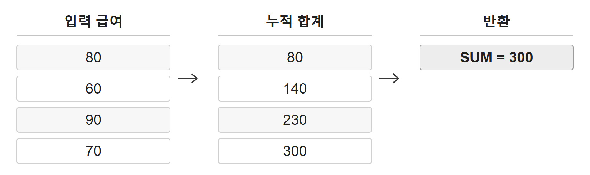
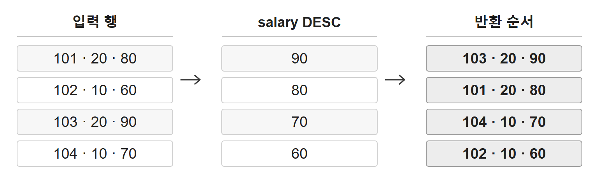
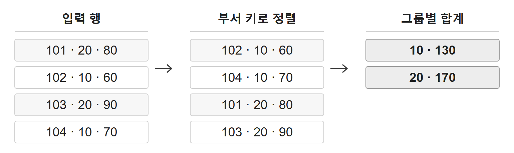
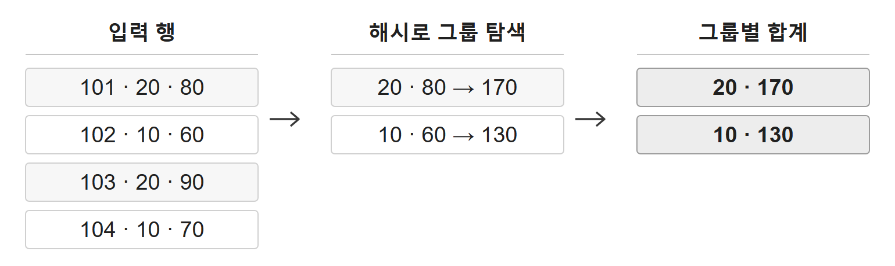
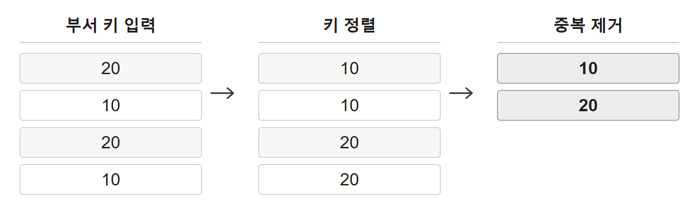
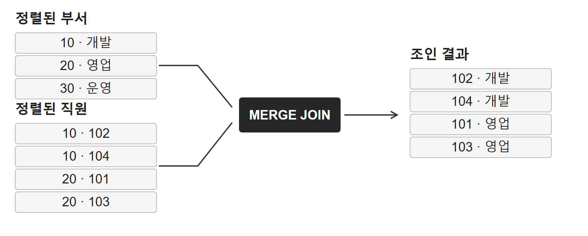
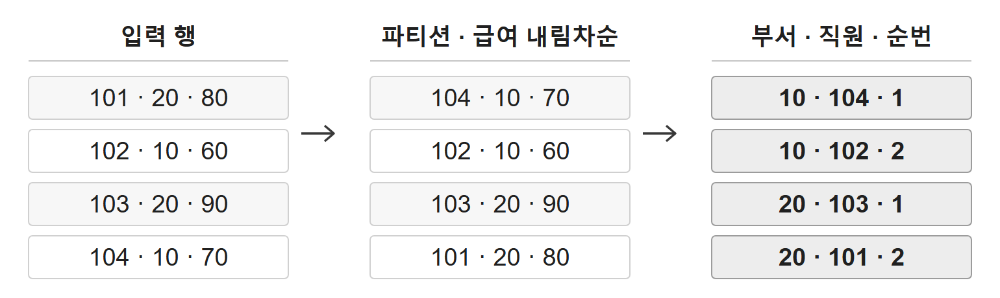

3편에서 실행 계획의 SORT 계열 오퍼레이션을 표 하나로 훑었다. 이름은 다 SORT로 시작하는데 어떤 것은 정렬하고 어떤 것은 하지 않는다는 이야기였다. 그런데 표만 보고 넘어가면 금방 다시 헷갈린다. `SORT GROUP BY`와 `HASH GROUP BY`는 결과가 같다면서 무엇이 다를까? `SORT JOIN`과 `WINDOW SORT`는 무엇을 위해 정렬할까?

이번에는 같은 네 행을 각 오퍼레이션에 차례로 통과시켜 보자. 들어간 행이 몇 행으로, 어떤 순서로 나오는지를 보면 이름 뒤에 붙은 단어가 무슨 뜻인지 손에 잡힌다.

## 네 행짜리 실험 데이터

직원 테이블에는 네 행이 있고, 아래 순서로 읽힌다고 하자. 입력 순서는 설명을 위해 정한 것이다.

| employee_id | department_id | salary |
| --- | --- | --- |
| 101 | 20 | 80 |
| 102 | 10 | 60 |
| 103 | 20 | 90 |
| 104 | 10 | 70 |

부서 테이블에는 `10 개발`, `20 영업`, `30 운영` 세 행이 있다. SQL은 Oracle Database 19c를 기준으로 썼다. 그림은 각 오퍼레이션이 **선택됐을 때의 논리적인 행 흐름**이고, 실제로 어떤 오퍼레이션이 나올지는 옵티마이저가 통계와 인덱스, 데이터 양을 보고 정한다. 직접 실행해 볼 수 있는 테이블 생성 SQL은 글 끝에 있다.

먼저 행 수부터 정리해 두면 전체 그림이 보인다.

| 오퍼레이션 | 대표 SQL | 이 예시의 행 수 |
| --- | --- | --- |
| `SORT AGGREGATE` | `GROUP BY` 없는 `SUM(salary)` | 4 → 1 |
| `SORT ORDER BY` | `ORDER BY` | 4 → 4 |
| `SORT GROUP BY` | `GROUP BY` (정렬로 그룹핑) | 4 → 2 |
| `HASH GROUP BY` | `GROUP BY` (해시로 그룹핑) | 4 → 2 |
| `SORT UNIQUE` | `DISTINCT`, `UNION` | 4 → 2 |
| `SORT JOIN` | `MERGE JOIN`의 입력 | 직원 4 → 4, 부서 3 → 3 |
| `WINDOW SORT` | 분석 함수 | 4 → 4 |

행 수를 줄이는 것, 순서만 바꾸는 것, 다른 연산을 위해 순서를 준비하는 것으로 나뉜다. 하나씩 들여다보자.

## SORT AGGREGATE는 정말 정렬할까

```sql
SELECT SUM(salary) AS total_salary
FROM   sort_demo_emp;
```

`GROUP BY` 없이 전체 입력에 `SUM`, `COUNT`, `AVG` 같은 집계 함수를 적용하면 실행 계획에 `SORT AGGREGATE`가 나온다.


*가운데 네 칸은 행 네 개가 아니라, 같은 누적값 하나가 변해 가는 과정이다.*

급여를 하나씩 받으며 합계 상태를 `80 → 140 → 230 → 300`으로 갱신하고, 입력이 끝나면 최종 합계 한 행을 돌려준다. 단순 `AVG`도 합계와 건수를 누적하면 계산된다. 이 예에서는 행을 버퍼에 모아 순서를 바꿀 일이 없다. 이름에 SORT가 들어 있어도 **4행이 1행으로 줄어드는 집계**가 이 오퍼레이션의 실체다.

그렇다면 행 수는 그대로 두고 순서만 바꾸는 쪽은 어떨까?

## SORT ORDER BY: 행은 그대로, 순서만 바뀐다

```sql
SELECT employee_id, department_id, salary
FROM   sort_demo_emp
ORDER  BY salary DESC, employee_id;
```


*정렬 키로 순서를 정하지만, 반환하는 것은 전체 행이다.*

먼저 급여를 내림차순으로 비교하고, 급여가 같다면 직원 ID를 오름차순으로 비교한다. 결과 순서는 `103 → 101 → 104 → 102`이고 행 수는 4 그대로다. 정렬 키는 `salary`와 `employee_id`뿐이지만, 정렬 작업 영역에는 `department_id`까지 포함한 행 전체가 함께 실린다.

이 오퍼레이션은 `ORDER BY`가 요구한 순서를 아래 단계가 만들어 주지 못할 때만 나타난다. 정렬 조건과 같은 순서의 인덱스로 읽는 경로를 옵티마이저가 고르면 이 단계 자체가 생략된다. 반대로 데이터가 작업 영역에 다 들어가지 않으면 4편에서 본 것처럼 런을 Temp에 기록하고 병합한다.

순서를 만드는 정렬이 다른 목적에도 쓰일 수 있을까? `GROUP BY`가 그 예다.

## SORT GROUP BY와 HASH GROUP BY: 같은 결과, 다른 길

```sql
SELECT department_id, SUM(salary) AS total_salary
FROM   sort_demo_emp
GROUP  BY department_id;
```

같은 SQL에 옵티마이저는 두 가지 방법 중 하나를 고를 수 있다. 하나는 정렬로 같은 그룹을 붙여 놓는 방법이다.


*정렬로 같은 그룹의 행을 이웃하게 만든 뒤, 키가 바뀔 때마다 한 그룹을 끝낸다.*

부서 ID로 정렬하면 입력의 `20, 10, 20, 10`이 `10, 10, 20, 20`이 된다. 위에서부터 내려오다 키가 10인 동안 급여를 더해 `130`을 만들고, 키가 20으로 바뀌는 순간 부서 10을 끝내고 부서 20의 합계 `170`을 만든다. 같은 그룹이 연달아 있으니 한 번에 하나의 합계만 들고 있으면 된다. 입력이 이미 그룹 키 순서로 들어온다면(예를 들어 그 순서의 인덱스로 읽는다면) 추가 정렬이 필요 없으므로 `SORT GROUP BY NOSORT`가 나온다.

다른 하나는 해시로 그룹을 찾아가는 방법이다.


*가운데는 그룹마다 따로 관리하는 합계 상태다. 같은 그룹의 행이 연달아 들어올 필요가 없다.*

입력 순서 그대로 따라가 보면 이렇다.

1. 부서 20의 급여 `80`을 읽어 부서 20의 합계를 만든다.
2. 부서 10의 급여 `60`을 읽어 부서 10의 합계를 만든다.
3. 다시 부서 20을 만나 합계를 `80 + 90 = 170`으로 갱신한다.
4. 다시 부서 10을 만나 합계를 `60 + 70 = 130`으로 갱신한다.

결과값은 정렬 방식과 똑같다. 차이는 **정렬을 하지 않는다**는 것, 대신 그룹 수만큼 집계 상태를 한꺼번에 들고 있어야 한다는 것이다. 그룹이 아주 많으면 이 해시 테이블도 작업 영역을 많이 쓰고, 넘치면 Temp를 쓸 수 있다.

여기서 꼭 짚고 갈 점이 있다. 그림에서 `SORT GROUP BY`는 10번 부서가 먼저, `HASH GROUP BY`는 20번 부서가 먼저 나왔다. 어느 쪽이든 그것은 처리 과정의 부산물일 뿐 SQL이 약속한 순서가 아니다. `GROUP BY`만으로는 결과 순서가 보장되지 않으므로, 순서가 필요하면 쿼리 끝에 `ORDER BY department_id`를 반드시 써야 한다.

그룹을 묶는 대신 같은 값을 하나로 접기만 하면 어떻게 될까?

## SORT UNIQUE: 같은 값이 이웃하면 하나만 남긴다

```sql
SELECT DISTINCT department_id
FROM   sort_demo_emp;
```


*정렬하면 같은 값이 이웃하므로, 연속 구간에서 대표 한 건만 내보내면 된다.*

원리는 `SORT GROUP BY`와 같다. 정렬로 같은 값을 이웃하게 만든 뒤, 같은 값이 이어지는 구간에서 한 건만 내보낸다. 결과는 `10`과 `20` 한 번씩이다. `SELECT DISTINCT department_id, salary`처럼 열이 둘이면 **두 열의 조합**으로 중복을 판정한다. `DISTINCT`는 해시로 처리될 수도 있는데, 그때는 실행 계획에 `HASH UNIQUE`가 나온다. `UNION`의 중복 제거도 같은 방식으로 처리된다.

지금까지는 정렬 결과를 그대로 위로 넘기거나 줄여서 넘겼다. 남은 두 오퍼레이션은 조금 다르다. 정렬이 최종 결과가 아니라 **다른 연산의 준비 단계**다.

## SORT JOIN: 병합 조인을 위해 양쪽을 줄 세운다

```sql
SELECT /*+ LEADING(d e) USE_MERGE(e) FULL(d) FULL(e) */
       e.employee_id, d.department_name
FROM   sort_demo_dept d
JOIN   sort_demo_emp  e
  ON   e.department_id = d.department_id;
```

예제에는 이 경로를 쉽게 관찰하려고 힌트를 넣었다. 병합 조인은 두 입력이 **조인 키 순서로 정렬되어 있어야** 앞에서부터 나란히 비교해 나갈 수 있다. 두 입력을 모두 테이블 전체 스캔으로 읽는 이 예에서는 실행 계획이 대략 이런 모양이 된다.

```text
MERGE JOIN
  SORT JOIN
    TABLE ACCESS FULL  SORT_DEMO_DEPT
  SORT JOIN
    TABLE ACCESS FULL  SORT_DEMO_EMP
```

부서 쪽도, 직원 쪽도 각각 `SORT JOIN`을 거쳐 부서 ID 순서로 줄을 선다.


*두 입력이 같은 키 순서로 줄 서 있으니, 앞에서부터 키를 맞춰 가며 결합한다.*

그 위의 `MERGE JOIN`은 정렬된 두 입력의 키를 앞에서부터 비교한다. 부서 10이 만나면 직원 102와 104에 개발 부서 이름을 붙이고, 부서 20이 만나면 직원 101과 103에 영업을 붙인다. 부서 30에는 일치하는 직원이 없으므로 이 내부 조인에서는 결과 행이 생기지 않는다.

한쪽 입력이 이미 조인 키 순서로 들어오면(예를 들어 그 키의 인덱스로 읽으면) 그쪽 정렬은 생략될 수 있다. 실행 계획에서 순서를 준비하는 단계인 **`SORT JOIN`**과 행을 결합하는 단계인 **`MERGE JOIN`**이 따로 보인다는 점이 중요하다. 조인이 느릴 때 어느 쪽 비용인지 나눠 볼 수 있기 때문이다.

## WINDOW SORT: 분석 함수가 읽을 순서를 만든다

```sql
SELECT employee_id, department_id, salary,
       ROW_NUMBER() OVER (
         PARTITION BY department_id
         ORDER BY salary DESC, employee_id
       ) AS rn
FROM   sort_demo_emp;
```


*파티션마다 순번이 1부터 다시 시작하고, 입력 4행이 결과 4행으로 유지된다.*

`ROW_NUMBER()`가 순번을 매기려면 같은 부서의 행이 모여 있고, 부서 안에서는 급여 내림차순으로 서 있어야 한다. `WINDOW SORT`가 바로 그 순서를 만든다. `PARTITION BY` 키(부서)와 `ORDER BY` 키(급여 내림차순, 직원 ID)를 합친 순서로 정렬한 뒤, 분석 함수가 그 순서를 따라 내려가며 값을 붙인다. 부서 10에서는 104가 1번, 102가 2번이고, 새 파티션인 부서 20에서 순번이 다시 1부터 시작한다.

`GROUP BY`와 달리 행이 줄지 않는다. 각 직원에 순번이 하나씩 붙을 뿐이다. 입력이 이미 필요한 순서로 들어오면 `WINDOW NOSORT`가 나온다. 그리고 여기서도 같은 함정이 있다. 분석 함수 안의 `ORDER BY`는 **순번을 매기는 순서**이지 결과를 돌려주는 순서가 아니다. 화면에서도 부서와 순번대로 보려면 바깥에 `ORDER BY department_id, rn`이 따로 필요하다.

## 실행 계획에서 직접 확인하기

그림은 논리적인 흐름일 뿐, 실제로 어떤 오퍼레이션이 선택됐는지는 실행 계획으로 확인해야 한다. 예제 SQL에 `GATHER_PLAN_STATISTICS` 힌트를 붙여 실행하고 결과를 끝까지 읽은 뒤, 같은 세션에서 커서 실행 계획을 조회한다.

```sql
SELECT /*+ GATHER_PLAN_STATISTICS */
       department_id, SUM(salary) AS total_salary
FROM   sort_demo_emp
GROUP  BY department_id;

SELECT *
FROM   TABLE(DBMS_XPLAN.DISPLAY_CURSOR(NULL, NULL, 'ALLSTATS LAST'));
```

볼 곳은 세 군데다.

- **Operation** — 옵티마이저가 어떤 방법을 골랐는지. 위 SQL이라면 `SORT GROUP BY`인지 `HASH GROUP BY`인지가 여기서 갈린다.
- **A-Rows** — 그 단계가 실제로 내보낸 행 수. 앞의 표처럼 집계 단계는 4행을 2행으로 줄이고, `SORT ORDER BY`와 `WINDOW SORT`는 4행을 그대로 넘긴다.
- **작업 영역 통계** — 그 정렬이 메모리에서 끝났는지. `Used-Mem`, `Used-Tmp` 열이나 `V$SQL_WORKAREA`의 `LAST_EXECUTION`, `LAST_TEMPSEG_SIZE`로 마지막 실행이 optimal이었는지, Temp를 얼마나 썼는지 본다. 오퍼레이션 이름은 **처리 방식**이고, 작업 영역 통계는 그 실행에서 **메모리가 충분했는지**를 알려 준다.

## 처음 질문으로 돌아가면

SORT 뒤에 붙은 단어는 그 단계가 행에게 하는 일을 알려 준다. `AGGREGATE`는 전체를 한 행으로 줄이고, `ORDER BY`는 행은 그대로 두고 순서를 바꾸고, `GROUP BY`와 `UNIQUE`는 같은 값을 모아 줄인다. `JOIN`과 `WINDOW`는 결과를 위한 정렬이 아니라 다음 연산이 읽을 순서를 준비한다. 그리고 `HASH`나 `NOSORT`가 붙으면 같은 일을 정렬 없이 해낸다는 뜻이다.

그래서 느린 쿼리에서 SORT를 만나면 먼저 물어볼 것은 "이 정렬은 누구를 위한 것인가"다. 반환 순서를 위한 것이라면 인덱스로 그 순서를 받아 올 수 있는지, 그룹핑이나 중복 제거를 위한 것이라면 그 작업이 정말 필요한지, 조인이나 분석 함수를 위한 것이라면 입력을 줄일 수 있는지를 보게 된다. 다음 글에서는 실제 API 하나를 예로 들어 이 질문들에 차례로 답해 본다.

## 직접 따라 해 보기

```sql
CREATE TABLE sort_demo_emp (
  employee_id   NUMBER,
  department_id NUMBER,
  salary        NUMBER
);

CREATE TABLE sort_demo_dept (
  department_id   NUMBER,
  department_name VARCHAR2(30)
);

INSERT ALL
  INTO sort_demo_emp  VALUES (101, 20, 80)
  INTO sort_demo_emp  VALUES (102, 10, 60)
  INTO sort_demo_emp  VALUES (103, 20, 90)
  INTO sort_demo_emp  VALUES (104, 10, 70)
  INTO sort_demo_dept VALUES (10, '개발')
  INTO sort_demo_dept VALUES (20, '영업')
  INTO sort_demo_dept VALUES (30, '운영')
SELECT 1 FROM dual;

COMMIT;
```
