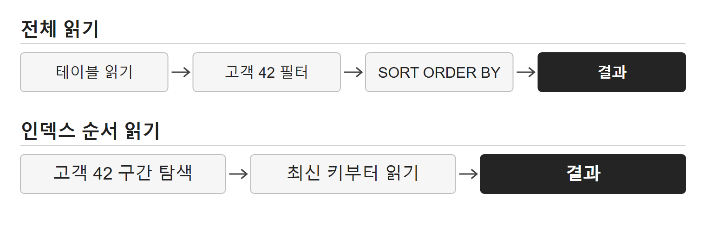
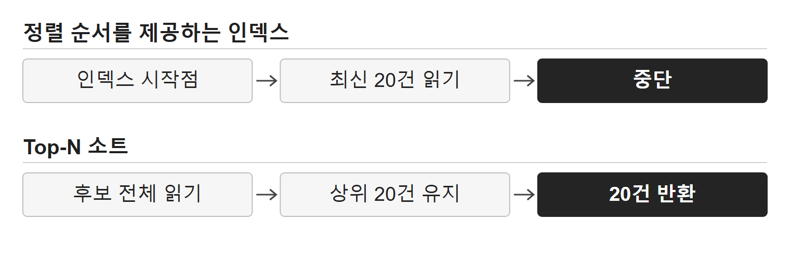
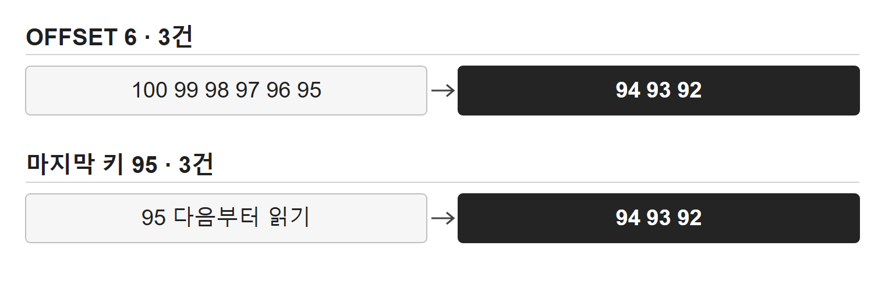
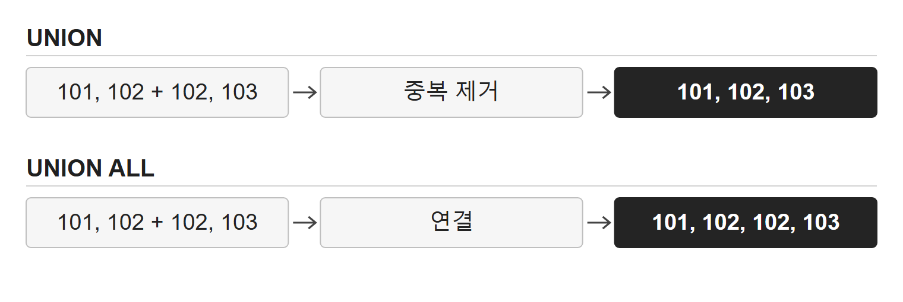
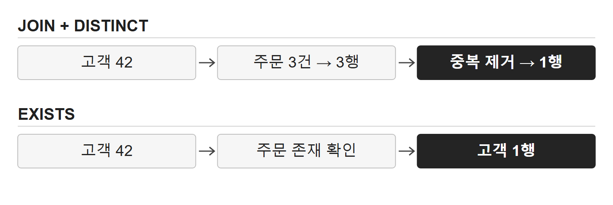
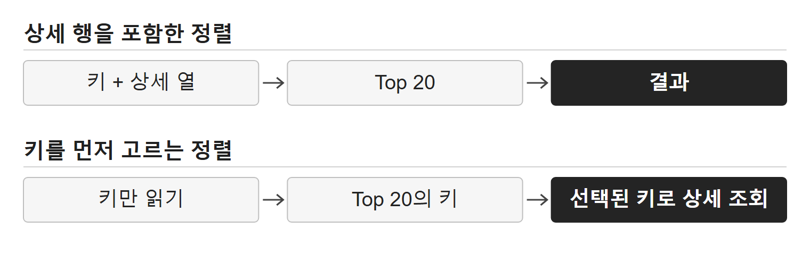

"로그인한 고객이 최근 주문을 20건씩 보고, '더 보기'를 누르면 다음 20건이 나온다." 어느 서비스에나 있을 법한 요구사항이다. 목록에는 주문 번호, 주문 시각, 금액이 필요하다. SQL로 옮기면 `ORDER BY created_at DESC` 한 줄이 들어가고, 실행 계획에는 높은 확률로 `SORT ORDER BY`가 나타난다.

이 정렬은 비싼가? 비싸다면 어디서 줄일 수 있을까? 지난 글 끝에서 던진 질문 "이 정렬은 누구를 위한 것인가"를 이 API 하나에 적용해, 첫 쿼리를 쓰는 순간부터 코드 리뷰까지 따라가 보자. SQL은 Oracle Database 19c 기준이다. 그림은 비교를 위한 행 흐름이며, 실제 실행 계획은 데이터 분포와 옵티마이저 판단에 따라 달라진다. 실습 데이터는 글 끝에 있다.

## 화면이 원하는 것을 SQL에 그대로 적는다

튜닝보다 먼저 할 일이 있다. 화면이 실제로 필요로 하는 **행 수와 순서**를 SQL에 정확히 적는 것이다.

```sql
SELECT order_id, created_at, amount
FROM   sort_lab_orders
WHERE  customer_id = :customer_id
ORDER  BY created_at DESC, order_id DESC
FETCH  FIRST 21 ROWS ONLY;
```

세 가지를 의도적으로 넣었다.

첫째, 화면에는 20건을 보여 주지만 DB에는 **21건**을 요청한다. 21번째 행이 있으면 '더 보기' 버튼을 띄우면 된다. 이 화면은 전체 페이지 수를 보여 주지 않으므로, 매 요청마다 전체 건수를 세는 `COUNT(*)` 쿼리도 필요 없다.

둘째, 정렬 키에 `order_id`를 덧붙였다. 주문 시각이 같은 주문이 있으면 `created_at`만으로는 순서가 정해지지 않는다. 실행할 때마다 순서가 바뀔 수 있고, 페이지 경계에서 같은 주문이 두 번 보이거나 빠질 수 있다. 기본 키를 마지막 정렬 키로 두면 순서가 하나로 결정된다.

셋째, 행 제한을 SQL 안에 넣었다. ORM이나 쿼리 빌더를 쓴다면 SQL 로그에서 `FETCH FIRST`와 두 정렬 키가 실제로 DB까지 전달되는지 확인해야 한다. 애플리케이션이 전부 받아 놓고 20건만 자르면, DB는 고객의 주문 전체를 정렬해서 넘긴다.

이제 이 쿼리가 어디서 비용을 치르는지 확인할 차례다.

## 정렬이 정말 비용인지 먼저 확인한다

같은 바인드 값으로 실행하고 결과를 끝까지 읽은 뒤, 실제 실행 통계를 본다.

```sql
SELECT /*+ GATHER_PLAN_STATISTICS */
       order_id, created_at
FROM   sort_lab_orders
WHERE  customer_id = 42
ORDER  BY created_at DESC, order_id DESC;

SELECT *
FROM   TABLE(DBMS_XPLAN.DISPLAY_CURSOR(NULL, NULL, 'ALLSTATS LAST'));
```

여기서 볼 것은 정렬 단계 하나가 아니다.

- **Operation** — 정렬의 목적. 5편에서 본 것처럼 SORT라는 이름이 모두 정렬은 아니다.
- **A-Rows** — 각 단계가 내보낸 실제 행 수. 정렬이 몇 행을 받아 처리했는지 보려면 **정렬 바로 아래 입력 단계**의 A-Rows를 봐야 한다. 반복 실행되는 단계라면 `Starts`도 함께 본다.
- **Buffers, 경과 시간, 작업 영역 통계** — 정렬을 없앤 대가로 테이블을 ROWID로 하나씩 찾아가는 비용이 커지면(1편에서 본 그 비용이다) 전체 응답은 오히려 느려질 수 있다. 정렬 하나만 보지 말고 전체를 비교한다.

인덱스가 없다면 실행 계획은 테이블 전체를 읽고, 고객 42의 주문을 거른 뒤, 정렬하는 모양이 된다. 고객 한 명의 주문 몇 건을 보여 주려고 테이블 전체를 읽고 정렬까지 하는 셈이다. 정렬을 없애려면 누군가 그 순서를 대신 만들어 줘야 한다.

## 인덱스가 순서를 대신 만들어 준다

```sql
CREATE INDEX sort_lab_orders_i1
ON sort_lab_orders (customer_id, created_at, order_id);
```


*인덱스가 필터와 순서를 함께 해결하면 SORT ORDER BY 단계가 사라진다.*

`customer_id = :customer_id`로 인덱스의 첫 열을 한 값에 고정하면, 그 구간 안의 나머지 키는 이미 `created_at, order_id` 순으로 정렬되어 있다. 쿼리는 두 키 모두 내림차순을 원하므로, 오라클은 오름차순 인덱스를 **뒤에서부터 읽는** `INDEX RANGE SCAN DESCENDING`으로 순서를 얻을 수 있다. 정렬할 필요가 없으니 `SORT ORDER BY`가 사라진다.

다만 이 방법은 조건이 맞을 때만 통한다.

- **선두 열이 한 값으로 고정돼야 한다.** 여러 고객을 한꺼번에 읽으면 인덱스는 고객별로 묶여 있으므로, 전체 고객의 주문을 시각순으로 내놓지 못한다.
- **방향이 맞아야 한다.** 한 열은 오름차순, 다른 열은 내림차순처럼 섞거나, 함수식이나 `NULLS FIRST` 같은 NULL 위치를 지정하면 인덱스 순서와 요구 순서가 어긋날 수 있다. 이 예제는 `created_at`이 `NOT NULL`이고 `order_id`가 기본 키라 문제가 없다.
- **인덱스가 보인다고 정렬이 사라진 게 아니다.** `INDEX FAST FULL SCAN`은 인덱스를 멀티블록으로 통째로 읽을 뿐 키 순서를 보장하지 않는다. 실행 계획에서 확인할 것은 인덱스 이름이 아니라 `SORT ORDER BY`가 남아 있는지다.
- **필터 열을 무조건 앞에 넣지 않는다.** 예를 들어 `status`를 고객과 시각 사이에 끼워 `(customer_id, status, created_at)`으로 만들면, 상태와 상관없이 전체 주문을 보는 화면에서는 같은 고객 안에서도 키가 상태별로 나뉘어 시각 순서가 끊긴다.
- 새 인덱스는 쓰기 비용과 저장 공간을 늘린다. 기존 인덱스로 같은 접근이 가능한지 먼저 확인하고, 대표 고객으로 테이블 접근까지 포함한 비용을 비교한다.

순서를 인덱스에서 얻었다. 그런데 이 화면은 20건(정확히는 21건)만 필요하다. 순서대로 읽을 수 있다면, 다 읽을 필요도 없지 않을까?

## 20건에서 멈출 수 있는가

```sql
SELECT order_id, created_at
FROM   sort_lab_orders
WHERE  customer_id = :customer_id
ORDER  BY created_at DESC, order_id DESC
FETCH  FIRST 20 ROWS ONLY;
```


*같은 Top-N이라도, 순서대로 읽고 멈추는 경로와 전부 읽되 상위 N개만 들고 있는 경로는 읽는 양이 다르다.*

여기서 길이 둘로 갈린다.

인덱스가 요구 순서를 제공하고 추가 필터가 없다면, 해당 고객의 최신 키부터 읽다가 20건에서 **멈출 수 있다**. 정렬을 없앴을 뿐 아니라 읽는 양까지 줄어든다. 고객의 주문이 10만 건이어도 읽는 것은 20건 남짓이다.

정렬된 접근 경로가 없으면 후보 행을 모두 읽어야 한다. 그래도 오라클의 Top-N 최적화가 적용되면 전체를 정렬하지 않고 **지금까지 본 행 중 상위 20개 후보만 유지**한다. 3편에서 본 `SORT ORDER BY STOPKEY`가 그것이다. 작업 영역은 아주 적게 쓰지만, 입력은 전부 읽는다.

`FETCH FIRST`는 실행 계획에서 `ROW_NUMBER` 기반의 `WINDOW` 오퍼레이션으로 나타나는 경우가 많아서, 앞의 경우는 `WINDOW NOSORT STOPKEY`, 뒤의 경우는 `WINDOW SORT PUSHED RANK`처럼 표시가 달라질 수 있다. 그러니 이름보다 확실한 기준을 보자. `FETCH FIRST`의 20은 **반환 상한**일 뿐이다. 실제로 몇 행을 읽고 멈췄는지는 정렬(또는 WINDOW) 단계 **아래** 입력 단계의 `A-Rows`와 `Buffers`가 알려 준다.

같은 화면에 "최근 주문 시각" 하나만 필요하다면 쿼리가 더 단순해진다. 값 하나라면 `SELECT MAX(created_at) FROM sort_lab_orders WHERE customer_id = :customer_id`로 충분하고, 적합한 인덱스가 있으면 인덱스의 끝에서 값 하나만 읽는 `INDEX RANGE SCAN (MIN/MAX)`가 가능하다. 최신 주문의 상태와 금액처럼 **행 전체**가 필요하면 위 Top-N 쿼리에서 1건만 가져온다.

첫 페이지는 해결됐다. 그런데 사용자가 '더 보기'를 계속 누르면 어떻게 될까?

## 다음 페이지는 마지막으로 본 행에서 시작한다

흔히 쓰는 방식은 `OFFSET`이다. 세 번째 페이지라면 `OFFSET 40 ROWS FETCH NEXT 20 ROWS ONLY`처럼 앞의 40행을 건너뛴다. 문제는 "건너뛴다"가 "읽지 않는다"가 아니라는 점이다.


*결과는 같지만, OFFSET은 버릴 행까지 읽고 키셋 방식은 마지막 키 다음부터 읽는다.*

그림의 숫자는 정렬된 키 하나를 단순화한 것이다. `OFFSET 6`은 앞의 여섯 행을 읽고 버린 뒤 `94, 93, 92`를 돌려준다. 뒤 페이지로 갈수록 버리는 행이 늘어나니 점점 느려진다. **키셋 페이지네이션(keyset pagination)** 은 직전 페이지의 마지막 키 `95`를 받아, 인덱스에서 그 다음 위치부터 바로 읽는다. 몇 번째 페이지든 읽는 양이 같다.

실제 쿼리에서는 정렬 키가 두 개이므로 직전 페이지의 마지막 **주문 시각과 주문 ID를 모두** 넘긴다.

```sql
SELECT order_id, created_at, amount
FROM   sort_lab_orders
WHERE  customer_id = :customer_id
AND    (created_at < :last_created_at
        OR (created_at = :last_created_at AND order_id < :last_order_id))
ORDER  BY created_at DESC, order_id DESC
FETCH  FIRST 21 ROWS ONLY;
```

조건이 왜 이렇게 길까? 다른 DB라면 `(created_at, order_id) < (:t, :id)`처럼 행 값(row value)으로 한 번에 비교할 수 있지만, 오라클은 행 값에 범위 비교 연산자를 쓸 수 없다([Use The Index, Luke – Paging Through Results](https://use-the-index-luke.com/sql/partial-results/fetch-next-page)). 그래서 일반 비교로 풀어 써야 한다.

풀어 쓴 조건이 **인덱스를 어디부터 읽을지 정하는 데 쓰이는지**도 확인해야 한다. 실행 계획 아래 `Predicate Information`에서 커서 조건이 `access`로 잡히는지 `filter`로만 잡히는지 보면 된다. `filter`로만 잡히면 고객 구간을 처음부터 읽으면서 걸러 내므로, 뒤 페이지로 갈수록 느려지는 문제가 그대로 남는다. 그럴 때는 같은 뜻을 범위 조건이 드러나게 바꿔 쓸 수 있다.

```sql
AND created_at <= :last_created_at
AND NOT (created_at = :last_created_at AND order_id >= :last_order_id)
```

`created_at <= :last_created_at`이 인덱스의 시작 위치를 정하고, 뒤의 `NOT (...)`이 경계에 걸린 같은 시각의 행만 걸러 낸다. 두 형태가 같은 결과를 내는지, 어느 쪽이 접근 조건으로 쓰이는지는 실제 실행 계획으로 확인한다.

서비스 코드에서는 두 조회를 이렇게 잇는다.

```text
rows       = 커서가 없으면 첫 페이지 조회, 있으면 다음 페이지 조회
items      = rows의 앞 20개
hasNext    = rows가 21개인가
nextCursor = hasNext이면 items의 마지막 행의 (created_at, order_id), 아니면 null
return { items, hasNext, nextCursor }
```

**커서는 20번째 행에서 만든다.** 21번째 행은 다음 페이지의 첫 행이다. 21번째 행으로 커서를 만들면, 다음 페이지는 그 행 "다음"부터 읽으므로 그 주문이 두 페이지 어디에도 보이지 않는다. 커서에는 DB 시각의 정밀도를 그대로 담고, 다음 요청에도 같은 고객·필터·정렬 조건을 적용한다.

이 방식에도 한계는 있다. 페이지 번호로 임의 이동해야 하는 화면이라면 `OFFSET`이 맞다. 그리고 키셋은 "마지막으로 본 위치에서 이어 읽기"이므로, 요청 사이에 주문이 추가되거나 정렬 키가 바뀌면 조회 대상도 달라진다. 처음 본 목록을 정확히 재현해야 하는 내보내기 기능이라면 조회 시점을 고정하는 설계가 따로 필요하다.

## 코드 리뷰에서는 결과와 읽기량을 따로 본다

여기까지 왔으면 테스트로 굳혀 둘 차례다.

| 테스트 | 기대하는 결과 |
| --- | --- |
| 고객 주문이 0건 / 20건 / 21건 | 각각 0건 / 20건 / 20건을 반환한다. 21건일 때만 다음 커서가 있고, 다음 요청에서 마지막 1건이 나온다. |
| 같은 시각에 ID 105, 104, 103인 주문을 만들고 페이지 크기 2 | 첫 페이지 105·104, 다음 페이지 103. 시각만 커서에 넣으면 103이 빠지는 오류를 잡는다. |
| 실습 데이터의 고객 42를 끝까지 조회 | 총 100건, 고유 ID 100개. 페이지 크기 20일 때 첫 페이지의 마지막 ID는 8042, 다음 페이지 첫 ID는 7942. |
| 주문이 적은 고객과 몰린 고객을 각각 조회 | 같은 바인드·같은 페이지에서 변경 전후의 응답 시간, `Buffers`, 입력 단계의 `A-Rows`, Temp 사용량을 비교한다. |

마지막 행이 중요하다. 실행 계획 맨 위 단계가 21행을 반환했다는 것은 **API 계약**이 지켜졌다는 뜻일 뿐이다. 아래 단계에서 10만 행을 넘겨받아 위에서 21행을 고른 경우와, 인덱스 구간에서 21행만 읽고 멈춘 경우는 결과가 같아도 비용이 전혀 다르다. 그래서 하위 단계의 `A-Rows`와 `Buffers`를 함께 본다. 인덱스 안에서 많은 키를 검사한 뒤 걸러 냈다면, `A-Rows`는 작아도 읽은 블록 수는 클 수 있다.

목록 API는 이렇게 정리됐다. 그런데 같은 서비스에는 목록만 있는 게 아니다. 주문 이력이 있는 고객 목록, 보관 테이블과 합친 주문 목록처럼 **중복 제거 때문에** 정렬이 생기는 쿼리도 있다.

## 중복 제거가 정말 필요한가

### 두 결과를 그대로 합쳐도 되는가: UNION ALL

```sql
SELECT order_id FROM sort_lab_orders
UNION ALL
SELECT order_id FROM sort_lab_orders_hist;
```


*UNION은 합친 결과에서 중복을 지우는 단계가 하나 더 있다.*

`UNION`은 합친 결과에서 중복 행을 지우느라 `SORT UNIQUE`(또는 `HASH UNIQUE`)를 거치고, `UNION ALL`은 각 입력의 행을 그대로 이어 붙인다. 이 예처럼 주문 ID만 고를 때, 두 테이블이 **각각 ID가 유일하고 서로 겹치지 않도록 관리**된다면 결과가 같으므로 `UNION ALL`을 쓸 수 있다. 하지만 보관 작업 도중 같은 주문이 양쪽에 잠깐 보일 수 있고 한 번만 반환해야 한다면, 중복 제거는 필요한 일이다. 바꾸기 전에 확인할 것은 성능이 아니라 **결과가 같은가**다. 결과의 순서가 필요하다면 그건 바깥 `ORDER BY`로 따로 표현한다.

### 있는지만 알면 되는가: EXISTS

```sql
-- 조인한 뒤 같은 고객을 한 번씩만 남긴다
SELECT DISTINCT c.customer_id
FROM   sort_lab_customers c
JOIN   sort_lab_orders    o ON o.customer_id = c.customer_id;

-- 주문이 하나라도 있는 고객만 남긴다
SELECT c.customer_id
FROM   sort_lab_customers c
WHERE  EXISTS (SELECT 1
               FROM   sort_lab_orders o
               WHERE  o.customer_id = c.customer_id);
```


*조인은 고객당 주문 수만큼 행을 만들고, EXISTS는 있는지만 확인한다.*

"주문 이력이 있는 고객 목록"은 주문 내용이 아니라 **주문이 있는지**만 알면 된다. 조인 후 `DISTINCT`는 고객당 주문 수만큼 행을 만들었다가 다시 접는다. `EXISTS`는 세미 조인으로 처리되어, 한 고객의 주문이 세 건이어도 고객 행을 한 번만 반환한다. 고객 테이블의 고객 ID가 유일하고 결과에 고객 ID만 필요하다면 두 쿼리는 같은 집합을 돌려준다. 반대로 주문별 상세가 필요하거나 고객 쪽에 자체 중복이 있다면 결과 행 수가 달라질 수 있다.

## 그래도 정렬이 남는다면, 입력을 가볍게 만든다

인덱스로도, 쿼리 의도로도 없앨 수 없는 정렬이 있다. 집계 결과로 순위를 매기거나, 여러 조건을 섞은 복잡한 목록이 그렇다. 그때는 정렬이 받는 입력을 줄인다.

**행 수를 줄인다.** 고객·기간처럼 업무상 필요한 조건을 명시하고, 실행 계획에서 그 조건이 큰 조인이나 집계 **앞에서** 적용되는지 본다. `GROUP BY`에서 대상 기간을 제한하는 조건은 `WHERE`에 두고, `HAVING SUM(amount) >= 1000`처럼 그룹의 집계 결과를 거르는 조건만 집계 후에 둔다. 분석 함수의 순번이나 누적 합계는 계산 대상이 바뀌면 값이 달라지므로, 필터를 옮길 때는 결과도 함께 확인한다.

**정렬에 싣는 폭을 줄인다.** 3편에서 본 것처럼 정렬 작업 영역에는 정렬 키만이 아니라 SELECT한 열이 통째로 실린다. 긴 `note` 열까지 함께 정렬하는 대신, 키만으로 상위 20건을 먼저 정하고 선택된 주문만 기본 키로 상세 조회하는 형태를 비교해 볼 수 있다.

```sql
WITH top_keys AS (
  SELECT order_id, created_at
  FROM   sort_lab_orders
  WHERE  customer_id = :customer_id
  ORDER  BY created_at DESC, order_id DESC
  FETCH  FIRST 20 ROWS ONLY
)
SELECT o.order_id, o.created_at, o.amount, o.note
FROM   top_keys k
JOIN   sort_lab_orders o ON o.order_id = k.order_id
ORDER  BY k.created_at DESC, k.order_id DESC;
```


*상세 열은 상위 20건이 정해진 뒤에만 가져온다.*

바깥 `ORDER BY`는 조인 이후의 반환 순서를 정한다. 여기에 정렬이 남더라도 대상은 최대 20행이다. 다만 옵티마이저가 원래 SQL에서도 필요한 열만 넘기거나 접근 경로를 바꿀 수 있으므로, 재작성 전후에 하위 단계의 행 수, 테이블 접근 횟수, `Buffers`, Temp 사용량을 비교한 뒤 고른다.

**집계·조인 방식은 전체 비용으로 판단한다.** 그룹 키 순서로 들어오는 입력은 `SORT GROUP BY NOSORT`의 후보가 된다. `HASH GROUP BY`도 정렬을 피하지만, 그룹이 아주 많으면 작업 영역을 많이 쓰거나 Temp를 쓸 수 있다. 병합 조인의 `SORT JOIN`을 피하겠다고 모든 조인을 NL 조인으로 바꾸면, 바깥 입력이 많을 때 반복되는 인덱스 조회가 더 비쌀 수 있다(2편의 이야기다). 조인 앞뒤 행 수와 `Starts`를 비교한다.

## Temp가 반복해서 쓰인다면, SQL 다음에 PGA를 본다

입력을 줄인 뒤에도 같은 SQL이 계속 Temp를 쓴다면, 작업 영역 단위로 확인한다.

```sql
SELECT operation_id,
       operation_type,
       last_execution,
       last_memory_used,
       last_tempseg_size
FROM   v$sql_workarea
WHERE  sql_id = :sql_id
AND    child_number = :child_number
ORDER  BY operation_id;
```

`OPERATION_ID`를 실행 계획의 `Id`와 맞춰 보면 어느 단계의 작업 영역인지 알 수 있다. `LAST_MEMORY_USED`와 `LAST_TEMPSEG_SIZE`의 단위는 바이트이고, `LAST_TEMPSEG_SIZE`가 NULL이면 마지막 실행에서 디스크로 넘기지 않았다는 뜻이다. `LAST_EXECUTION`에 one-pass나 multi-pass가 반복해서 나온다면, 4편에서 본 것처럼 Temp를 한 번 이상 오가고 있다는 뜻이다.

이때도 순서는 같다. 먼저 입력을 줄일 수 있는지 보고, 그다음에 메모리를 본다. 자동 작업 영역 관리에서 `PGA_AGGREGATE_TARGET`은 **인스턴스 전체의 목표치**다. 쿼리마다 같은 크기의 메모리가 보장되는 게 아니라, 동시에 도는 작업들이 나눠 쓴다. 그래서 운영 환경의 조정은 DBA와 함께 동시 실행이 몰리는 시간대의 `V$PGASTAT`과 `V$PGA_TARGET_ADVICE`를 보며 판단한다.

## 처음 질문으로 돌아가면

최근 주문 20건 목록의 `SORT ORDER BY`는 비쌀 수도, 아닐 수도 있었다. 그걸 가르는 건 정렬 단계 자체가 아니라 **정렬이 받는 입력**이었다. 인덱스가 필터와 순서를 함께 해결하면 정렬이 사라지고, 순서대로 읽을 수 있으니 21건에서 멈출 수 있고, 마지막 키를 커서로 넘기면 몇 번째 페이지든 같은 양만 읽는다. 정렬을 없앨 수 없는 쿼리라면 행 수와 폭을 줄여 정렬이 메모리 안에서 끝나게 한다.

다른 기능을 만들 때도 같은 질문을 던지면 된다. 이 정렬은 누구를 위한 것이고, 그 순서를 다른 곳에서 얻을 수 없는가?

| 화면 요구사항 | 쿼리에서 먼저 볼 것 |
| --- | --- |
| 주문 이력이 있는 고객 목록 | 조인 후 `DISTINCT` 대신 `WHERE EXISTS (...)` |
| 최신 주문 한 건의 상태·금액 | 고객으로 범위를 좁히고 `ORDER BY created_at DESC, order_id DESC FETCH FIRST 1 ROW ONLY` |
| 부서별 월매출 상위 10개 | 대상 월을 먼저 거르고, 부서별 합계를 낸 **뒤에** 상위 10개를 고른다. 집계 전에 매출 행을 10개로 자르면 순위의 의미가 달라진다. |
| 주문 목록에 상품 목록도 표시 | 주문 20건을 먼저 확정한 뒤 그 ID의 상품을 일괄 조회해 주문별로 묶는다. 주문과 상품을 조인한 상태로 20행을 자르면 한 주문의 여러 상품이 페이지를 차지한다. |

## 직접 따라 해 보기

아래 데이터를 만든 뒤 인덱스 없이 실행 계획을 보고, 인덱스를 만든 다음 같은 SQL을 다시 실행해 비교해 보자. 고객 ID는 `42`를 쓰면 된다.

```sql
CREATE TABLE sort_lab_customers (
  customer_id NUMBER PRIMARY KEY
);

INSERT INTO sort_lab_customers
SELECT LEVEL FROM dual CONNECT BY LEVEL <= 100;

CREATE TABLE sort_lab_orders (
  order_id    NUMBER PRIMARY KEY,
  customer_id NUMBER NOT NULL,
  created_at  DATE NOT NULL,
  amount      NUMBER NOT NULL,
  note        VARCHAR2(500)
);

INSERT INTO sort_lab_orders
SELECT LEVEL,
       MOD(LEVEL - 1, 100) + 1,
       DATE '2025-01-01' + TRUNC((LEVEL - 1) / 250),
       MOD(LEVEL, 1000) + 1,
       RPAD('order note', 400, 'x')
FROM   dual
CONNECT BY LEVEL <= 10000;

CREATE TABLE sort_lab_orders_hist (
  order_id NUMBER PRIMARY KEY
);

INSERT INTO sort_lab_orders_hist VALUES (10001);
INSERT INTO sort_lab_orders_hist VALUES (10002);
COMMIT;

BEGIN
  DBMS_STATS.GATHER_TABLE_STATS(USER, 'SORT_LAB_ORDERS');
END;
/
```
