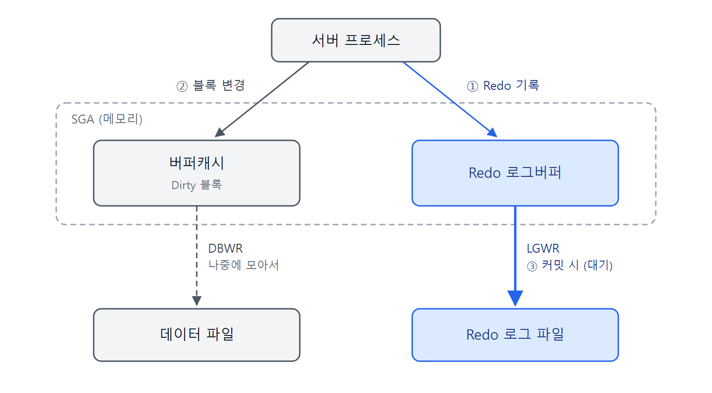

`UPDATE accounts SET balance = balance - 100 WHERE id = 1;` 다음에 `COMMIT;`을 실행하면 곧바로 "커밋 완료"가 돌아온다. 그런데 바로 그 순간 서버 전원이 꺼진다면 이 변경은 살아남을까?

직관적으로는 "커밋했으니 테이블 데이터 파일에 써졌겠지"라고 생각하기 쉽다. 하지만 오라클은 커밋 시점에 데이터 파일을 거의 건드리지 않는다. 바뀐 블록은 여전히 메모리에 있다. 그런데도 변경은 살아남는다. 메모리에만 있는 변경이 어떻게 장애를 견디는지, DML 한 건이 커밋되기까지의 길을 따라가 보자. 이 길을 알아야 다음 글에서 다룰 "대량 DML은 왜 느린가"도 설명할 수 있다. 내용은 Oracle Database 19c 기준이다.

## DML은 테이블이 아니라 메모리 위의 블록을 바꾼다

SQL이 도착하면 먼저 파싱과 최적화를 거친다. 문법과 객체 권한을 확인하고, 같은 SQL의 실행 계획이 공유 풀에 있으면 재사용하고, 없으면 옵티마이저가 새로 만든다. 여기까지는 SELECT와 같다.

차이는 실행 단계에서 생긴다. 변경할 행이 들어 있는 블록을 버퍼캐시에서 찾고, 없으면 데이터 파일에서 읽어 버퍼캐시에 올린다. 그다음 바꾼다. 디스크의 데이터 파일이 아니라 **버퍼캐시의 블록**을 바꾼다. 디스크보다 메모리가 훨씬 빠르니 당연한 선택이다.

문제는 메모리가 휘발성이라는 점이다. 전원이 꺼지면 버퍼캐시에서 바꾼 블록은 사라진다. 그렇다고 변경할 때마다 블록을 데이터 파일에 쓰면, 행 하나를 바꾸려고 8KB 블록을 디스크의 제자리에 랜덤하게 써야 한다. 여러 테이블과 인덱스를 건드리는 트랜잭션이라면 커밋 한 번에 수십 번의 랜덤 쓰기가 일어난다.

그래서 오라클은 블록을 바꾸기 전에 두 가지 기록을 먼저 남긴다.

## 바꾸기 전에 남기는 두 기록: Undo와 Redo

**Undo**는 "되돌리는 방법"이다. 바꾸기 전 값을 언두 세그먼트에 적어 둔다. 트랜잭션을 롤백하거나, 아직 커밋되지 않은 변경을 다른 세션이 읽을 때 변경 전 모습을 만들어 주는 데 쓴다. 언두 세그먼트도 결국 블록이므로 버퍼캐시에 있다.

**Redo**는 "다시 하는 방법"이다. 어떤 블록의 어디를 어떻게 바꿨는지를 적은 변경 기록이다. 데이터 블록의 변경뿐 아니라 언두 블록의 변경도 Redo로 남는다. Redo는 SGA의 **Redo 로그버퍼**에 먼저 쌓였다가, LGWR(Log Writer) 프로세스가 온라인 Redo 로그 파일에 순서대로 이어 쓴다.

순서를 정리하면 이렇다.

1. 대상 블록을 버퍼캐시에서 찾는다. 없으면 데이터 파일에서 읽어 온다.
2. 변경할 행에 로우 Lock을 건다. (Lock은 마지막 글에서 따로 다룬다.)
3. 데이터 블록과 언두 블록에 대한 변경 내용을 Redo 레코드로 만들어 Redo 로그버퍼에 기록한다.
4. 언두 블록에 변경 전 값을 쓰고, 버퍼캐시의 데이터 블록을 바꾼다. 이 블록은 이제 디스크와 내용이 다른 **Dirty 블록**이다.

인덱스가 있다면 인덱스 블록에도 같은 일이 반복된다. 다음 글에서 볼 "인덱스가 많을수록 DML이 느리다"는 말은 이 과정이 인덱스마다 한 번씩 더 일어난다는 뜻이다.

여기서 이상한 점이 하나 있다. Redo도 결국 메모리(로그버퍼)에 먼저 쓴다. 휘발성 문제를 해결하려고 남긴 기록이 또 휘발성 메모리에 있는 셈이다.

## 커밋하는 순간 디스크에 써지는 것은 Redo뿐이다

이 빈틈을 메우는 규칙이 **Log Force at Commit**이다. 커밋하면 서버 프로세스는 커밋 레코드를 Redo 로그버퍼에 넣고 LGWR에게 로그버퍼를 디스크에 쓰라고 요청한다. 그리고 LGWR가 그 트랜잭션의 Redo를 온라인 Redo 로그 파일에 다 쓸 때까지 기다린다. 이 기다림이 대기 이벤트 `log file sync`로 보인다. 쓰기가 끝나야 "커밋 완료"가 사용자에게 돌아간다.

*커밋을 기다리게 하는 것은 LGWR의 Redo 쓰기뿐이다. DBWR의 데이터 파일 쓰기는 커밋과 따로 움직인다.*

반대로 DBWR(Database Writer)는 커밋을 기다리지 않는다. Dirty 블록을 데이터 파일에 쓰는 일은 나중에, 여러 블록을 모아서 한다. 그러니 이 글 첫 질문의 답은 이렇다. 커밋 완료가 돌아온 순간 데이터 파일에는 변경이 없을 수 있지만, Redo 로그 파일에는 변경 기록이 있다. 전원이 꺼져도 다시 켜질 때 Redo를 읽어 블록을 다시 바꾸면 된다. **서버 프로세스가 바꾼 블록을 아직 디스크에 쓰지 않았더라도, 커밋 시점에 Redo를 디스크에 썼다면 그 순간부터 트랜잭션의 영속성은 보장된다.**

왜 블록 대신 Redo를 쓰는 게 더 싼가? Redo 로그 파일은 끝에 이어 쓰는 **순차 쓰기**다. 어떤 테이블의 어느 블록을 바꿨든 Redo는 로그 파일 한 곳에 차례로 붙는다. 랜덤 쓰기 여러 번이 순차 쓰기 한 번으로 바뀐다. 게다가 여러 세션이 거의 동시에 커밋하면 LGWR가 그 Redo를 한 번에 모아 쓴다. 블록 쓰기는 미루고 모아서 하고, 커밋은 짧은 순차 쓰기 하나로 끝내는 구조다. 오라클 문서는 이를 Fast Commit이라 부른다.

## LGWR는 커밋 때만 쓰지 않는다

커밋 시점에만 Redo를 쓴다고 이해하면 반만 맞다. LGWR는 다음 경우에도 깨어나 로그버퍼를 디스크에 쓴다.

- 사용자가 커밋할 때
- 3초마다
- 로그버퍼가 3분의 1 찼을 때, 또는 쌓인 Redo가 1MB에 이르렀을 때
- DBWR가 Dirty 블록을 쓰기 전에

마지막 조건이 중요하다. DBWR가 어떤 블록을 데이터 파일에 쓰려면, 그 블록 변경을 설명하는 Redo가 먼저 로그 파일에 있어야 한다. 이것이 Write-Ahead Logging 원칙이다. 데이터 파일에 변경이 있는데 Redo가 없으면 장애 후 그 변경이 커밋된 것인지 알 수 없기 때문이다.

그렇다면 커밋하지 않은 트랜잭션의 Redo도 디스크에 있을 수 있고, 커밋하지 않은 변경이 데이터 파일에 써져 있을 수도 있다. 이건 문제가 아닐까? 아니다. 앞에서 언두 블록의 변경도 Redo로 남는다고 했다. 장애 후 복구할 때 오라클은 먼저 Redo를 처음부터 다시 적용해 장애 직전 상태(커밋되지 않은 변경 포함)를 만들고(Roll Forward), 그다음 커밋되지 않은 트랜잭션을 언두로 되돌린다(Roll Back). Redo가 커밋된 변경을 살리고, Undo가 커밋되지 않은 변경을 지운다.

## 체크포인트는 복구할 Redo의 양을 줄인다

DBWR가 계속 쓰기를 미루면 어떻게 될까? 장애가 났을 때 다시 적용해야 할 Redo가 끝없이 길어진다. 또 온라인 Redo 로그 파일은 몇 개를 돌려 쓰는 구조라, 아직 데이터 파일에 반영되지 않은 변경의 Redo가 들어 있는 로그 파일은 덮어쓸 수 없다.

**체크포인트**가 이 문제를 푼다. 체크포인트는 "이 시점(SCN)까지의 변경은 데이터 파일에 모두 반영됐다"는 표시다. DBWR가 그 시점까지의 Dirty 블록을 쓰고, CKPT 프로세스가 컨트롤 파일과 데이터 파일 헤더에 체크포인트 위치를 기록한다. 인스턴스 복구는 이 위치부터 Redo를 적용하면 된다. 오라클은 Dirty 블록을 오래된 순서로 꾸준히 쓰는 증분 체크포인트로 복구 시작점을 계속 앞으로 당긴다. `FAST_START_MTTR_TARGET` 파라미터로 목표 복구 시간을 정하면 오라클이 이 속도를 조절한다.

정리하면, 커밋은 영속성을 약속하고 체크포인트는 그 약속을 지키는 데 필요한 Redo의 양을 관리한다.

## 그래서 DML 성능에서 무엇을 봐야 하나

이 흐름을 알고 나면 DML 비용이 어디서 생기는지 보인다.

**Redo와 Undo는 변경량에 비례한다.** 행을 많이 바꿀수록, 인덱스가 많을수록 Redo와 Undo가 늘어난다. 대량 DML에서 Redo를 줄이는 방법(Direct Path Insert와 NOLOGGING)은 다음 글에서 다룬다.

**커밋은 공짜가 아니다.** 커밋마다 `log file sync`를 기다린다. 행 하나 바꾸고 커밋하는 루프를 만 번 돌면 만 번 기다린다. 반대로 커밋을 너무 미루면 Lock을 오래 쥐고 Undo도 오래 붙잡는다. 커밋 단위는 업무 단위에 맞추는 것이 원칙이고, 성능 때문에 쪼개거나 모을 때도 이 두 비용을 함께 본다.

**영속성을 낮추는 선택지도 있다.** `COMMIT WRITE NOWAIT`는 LGWR의 쓰기를 기다리지 않고 바로 돌아온다. `COMMIT WRITE BATCH`는 Redo를 모아 쓰게 한다. 세션이나 시스템 단위로는 `COMMIT_WAIT`, `COMMIT_LOGGING` 파라미터로 정한다(예전 `COMMIT_WRITE` 파라미터는 더 이상 권장되지 않는다). 커밋 대기는 줄지만, 커밋 완료를 받은 직후 장애가 나면 그 트랜잭션이 사라질 수 있다. 잃어도 다시 만들 수 있는 데이터에만 검토할 선택지다.

확인할 곳도 정해진다.

| 보고 싶은 것 | 확인 방법 |
| --- | --- |
| 커밋 대기 시간 | `V$SESSION_EVENT`, AWR에서 `log file sync` 평균 대기 |
| 세션이 만든 Redo 양 | `V$MYSTAT`와 `V$STATNAME`의 `redo size` |
| Redo 로그 전환 빈도 | `V$LOG_HISTORY` (너무 잦으면 로그 파일 크기 검토) |
| 복구 예상 시간 | `V$INSTANCE_RECOVERY`의 `ESTIMATED_MTTR` |

처음 질문으로 돌아가 보자. 커밋 직후 전원이 꺼져도 변경은 살아남는다. 커밋이 기다린 것은 데이터 블록이 아니라 Redo가 로그 파일에 써지는 일이었고, 재시작할 때 그 Redo로 블록을 다시 만들기 때문이다. 이 구조 덕분에 DML 한 건의 비용은 "블록을 바꾸고, Redo와 Undo를 남기고, 커밋 때 Redo를 한 번 쓰는 일"로 줄어든다.

그렇다면 백만 건을 바꿀 때는? 같은 과정이 백만 번 반복되고, 애플리케이션과 DB 사이를 오가는 호출도 그만큼 늘어난다. 다음 글에서는 대량 DML이 느려지는 지점과 그것을 줄이는 방법(One SQL, Array Processing, Direct Path I/O, 파티션)을 살펴본다.
