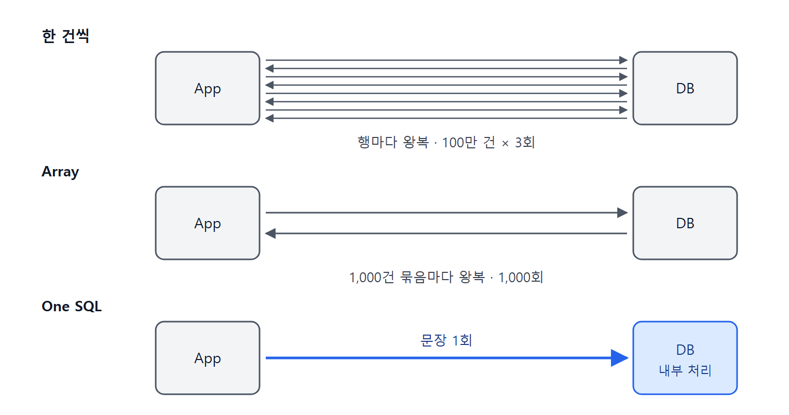
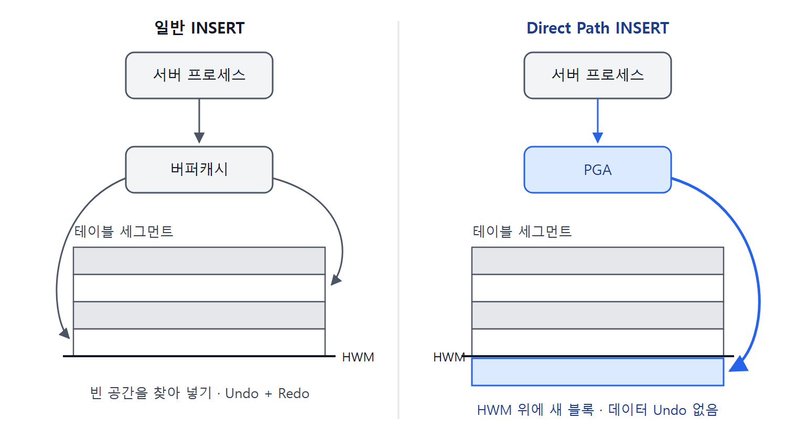
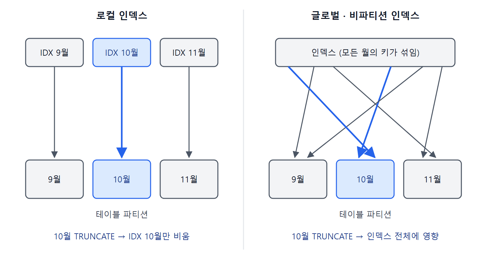

매일 밤 지난달 주문 100만 건을 이력 테이블로 옮기고 원본에서 지우는 배치가 있다고 해 보자. 가장 먼저 떠오르는 코드는 아마 이런 모양이다.

```java
// 설명용 예시: 한 건씩 읽고, 한 건씩 넣고, 한 건씩 커밋한다
ResultSet rs = select.executeQuery();          // 지난달 주문 조회
while (rs.next()) {
    insert.setLong(1, rs.getLong("order_id"));
    // ... 나머지 컬럼
    insert.executeUpdate();                     // 이력 테이블에 1건 INSERT
    delete.setLong(1, rs.getLong("order_id"));
    delete.executeUpdate();                     // 원본에서 1건 DELETE
    conn.commit();                              // 1건마다 커밋
}
```

SQL 자체는 단순하고, 실행 계획도 각각 인덱스 한 번 타는 정도다. 그런데 이 배치는 느리다. 어디서 시간이 새는 걸까?

지난 글에서 DML 한 건이 커밋되기까지의 길을 따라갔다. 블록을 바꾸고, Undo와 Redo를 남기고, 커밋 때 Redo를 디스크에 쓴다. 이번에는 그 한 건이 100만 번 반복될 때 비용이 쌓이는 지점을 하나씩 찾고, 각 지점을 줄이는 방법을 보자. Oracle Database 19c 기준이다.

## 한 행을 넣을 때 실제로 바뀌는 것은 테이블만이 아니다

테이블에 행 하나를 넣는 일은 빈 공간이 있는 블록을 찾아 붙이면 끝난다. 하지만 인덱스는 다르다. 인덱스는 **정렬된** 자료구조라서 새 키는 정해진 자리에 들어가야 한다. 루트에서 리프까지 내려가 자리를 찾고, 리프 블록이 꽉 찼으면 블록을 둘로 나눈다(인덱스 분할). UPDATE는 더하다. 인덱스 키가 바뀌면 기존 위치의 엔트리를 지우고 새 위치에 다시 넣는다. 인덱스 키가 바뀌는 UPDATE는 인덱스 입장에서 DELETE와 INSERT다.

그리고 이 모든 블록 변경마다 지난 글에서 본 Undo와 Redo가 붙는다. 인덱스가 다섯 개인 테이블에 한 행을 넣으면 테이블 블록 하나와 인덱스 블록 다섯 개가 바뀌고, 그만큼 Redo와 Undo가 생긴다. **인덱스가 많을수록 DML이 느려지는** 이유다.

무결성 제약도 비용을 더한다. 다만 제약마다 하는 일이 다르다.

| 제약 | DML 때 하는 일 | 비용 |
| --- | --- | --- |
| NOT NULL, CHECK | 넣는 행의 값만 확인 | 작다 |
| PK, UNIQUE | 해당 인덱스를 탐색해 중복 확인, 인덱스 엔트리 추가 | 인덱스 유지 비용과 거의 같다 |
| FK (자식 쪽 INSERT·UPDATE) | 부모 테이블의 PK 인덱스에서 부모 키가 있는지 조회 | 행마다 인덱스 탐색 한 번 |
| FK (부모 쪽 DELETE·키 UPDATE) | 자식 테이블에 참조하는 행이 있는지 확인 | 자식 FK 컬럼에 인덱스가 없으면 자식 테이블을 훑고, 자식 테이블에 더 강한 테이블 Lock이 걸린다 |

즉 "PK·FK는 실제 데이터를 조회해야 해서 비싸다"는 말은 맞지만, 정확히는 **인덱스를 조회한다**. 그래서 FK 컬럼에 인덱스가 있는지가 부모 테이블 DML의 성능과 동시성을 크게 가른다(Lock 이야기는 다음 글에서 이어진다).

대량 적재에서는 이 비용을 아예 미루는 방법도 쓴다. 적재 전에 인덱스를 UNUSABLE로 만들고 적재 후 재생성하거나, 제약을 끄고 적재한 뒤 다시 켜는 식이다. 인덱스를 한 행씩 유지하는 것보다 다 넣은 뒤 정렬해서 한 번에 만드는 편이 싸기 때문이다. 다만 그동안 그 인덱스를 쓰는 조회는 느려지고, 제약을 `NOVALIDATE`로 켜면 기존 데이터는 검증하지 않으므로 운영 중인 테이블에는 신중해야 한다.

이것으로 행마다 드는 DB 내부 비용은 설명된다. 그런데 앞의 배치에는 그보다 큰 비용이 숨어 있다.

## 100만 건을 옮기는 데 호출은 몇 번 오갔을까

SQL 하나를 실행하면 DB는 Parse, Execute, Fetch 단계를 거치고, 애플리케이션은 각 단계를 DB에 요청한다. 이 요청이 **Call**이다. 애플리케이션에서 네트워크를 건너 오는 Call을 User Call, DB 안에서 PL/SQL 등이 내부적으로 부르는 Call을 Recursive Call이라 한다.

앞의 배치는 한 행마다 INSERT Execute, DELETE Execute, COMMIT을 보낸다. PreparedStatement를 재사용해 Parse를 아꼈더라도 행마다 최소 세 번 네트워크를 왕복한다. 100만 건이면 300만 번이다. 왕복 한 번이 0.5ms만 걸려도 왕복에만 25분이다. 여기에 커밋마다 `log file sync` 대기가 100만 번 붙는다.


*같은 100만 건이라도 애플리케이션과 DB 사이를 몇 번 오가느냐가 달라진다.*

이 배치에서 가장 큰 비용은 SQL이 아니라 **왕복 횟수**다. 줄이는 방법은 두 가지다. 아예 한 번에 보내거나(One SQL), 여러 건을 묶어 보내거나(Array Processing).

## 데이터를 애플리케이션으로 가져오지 않는다: One SQL

옮기려는 데이터가 이미 DB 안에 있다면, 애플리케이션으로 꺼냈다가 다시 넣을 이유가 없다.

```sql
INSERT INTO order_hist (order_id, customer_id, created_at, amount)
SELECT order_id, customer_id, created_at, amount
FROM   orders
WHERE  created_at >= DATE '2026-10-01'
AND    created_at <  DATE '2026-11-01';

DELETE FROM orders
WHERE  created_at >= DATE '2026-10-01'
AND    created_at <  DATE '2026-11-01';

COMMIT;
```

`INSERT INTO ... SELECT`는 읽기와 쓰기를 DB 안에서 끝낸다. 호출은 문장당 한 번이다. 오라클은 One SQL을 위해 두 가지 도구를 더 준다.

**수정 가능 조인 뷰.** 다른 테이블 값을 읽어 UPDATE할 때, 상관 서브쿼리 대신 조인 결과를 바로 갱신한다.

```sql
UPDATE (SELECT c.grade, s.new_grade
        FROM   customers c
        JOIN   customer_grade_stage s ON s.customer_id = c.customer_id)
SET    grade = new_grade;
```

이 문장이 성립하려면 갱신 대상인 `customers`가 **키 보존 테이블**이어야 한다. 조인 상대 `s`의 조인 컬럼 `customer_id`에 PK나 UNIQUE 제약이 있어서, `customers`의 한 행이 조인 결과에서도 한 행으로만 나온다고 DB가 보장할 수 있어야 한다. 그렇지 않으면 `ORA-01779`가 난다.

**MERGE.** 소스 기준으로 타깃과 조인해, 맞는 행이 있으면 UPDATE하고 없으면 INSERT한다. 소스를 기준으로 한 Outer 조인처럼 동작한다.

```sql
MERGE INTO customers t
USING customer_stage s
ON (t.customer_id = s.customer_id)
WHEN MATCHED THEN
  UPDATE SET t.grade = s.grade, t.updated_at = SYSDATE
WHEN NOT MATCHED THEN
  INSERT (customer_id, grade, updated_at)
  VALUES (s.customer_id, s.grade, SYSDATE);
```

두 가지만 주의하면 된다. `ON` 절에 쓴 컬럼은 `UPDATE SET`에서 바꿀 수 없다(`ORA-38104`). 그리고 타깃 한 행에 소스 여러 행이 매칭되면 어느 값으로 바꿀지 정할 수 없어 `ORA-30926`이 난다. 소스는 조인 키 기준으로 유일해야 한다. 10g부터는 MATCHED와 NOT MATCHED 중 하나만 쓸 수도 있고, 각 절에 `WHERE` 조건을 달 수도 있다.

## 한 번에 못 하겠다면 묶어서 보낸다: Array Processing

업무 규칙이 복잡해서 행마다 애플리케이션 로직을 거쳐야 할 수도 있다. 그럴 때는 여러 행을 배열로 묶어 Call 한 번에 보낸다.

```java
int n = 0;
while (rs.next()) {
    insert.setLong(1, rs.getLong("order_id"));
    // ... 행마다 필요한 가공
    insert.addBatch();
    if (++n % 1000 == 0) insert.executeBatch();  // 1,000건에 한 번 왕복
}
insert.executeBatch();
conn.commit();
```

PL/SQL이라면 `BULK COLLECT ... LIMIT`로 묶어 읽고 `FORALL`로 묶어 쓴다. 100만 건을 1,000건씩 보내면 INSERT 호출은 100만 번에서 1,000번으로 준다. 묶음 크기를 키울수록 호출은 줄지만 메모리를 더 쓰고 효과는 점점 작아지므로, 수백에서 수천 건 사이에서 측정해 정한다.

커밋도 같이 본다. 행마다 하던 커밋을 묶음마다, 또는 배치 끝에 한 번으로 바꾸면 `log file sync` 대기가 그만큼 준다. 다만 중간에 실패했을 때 어디서부터 다시 할지(재시작 지점)를 함께 설계해야 한다.

여기까지 오면 호출 비용은 거의 사라진다. 남은 것은 DB 안에서 100만 건을 버퍼캐시를 거쳐 바꾸는 비용이다. 이것도 줄일 수 있을까?

## 대량 데이터에는 버퍼캐시가 오히려 짐이 된다: Direct Path I/O

버퍼캐시는 같은 블록을 반복해서 읽을 때 빛난다. 온라인 트랜잭션은 기준 정보, 특정 고객, 최근 거래처럼 자주 쓰는 블록을 반복해서 읽으니 캐시가 큰 도움이 된다. 하지만 배치나 정보계 SQL이 100만 건을 한 번 읽고 쓸 때는 사정이 다르다. 그 블록이 캐시에 있을 가능성은 낮고, 한 번 쓰고 말 블록을 하나하나 캐시에 올렸다가 내리는 일만 늘어난다. 게다가 그 블록들이 다른 세션이 자주 쓰던 블록을 캐시에서 밀어낸다.

그래서 오라클은 버퍼캐시를 건너뛰고 데이터 파일과 PGA 사이에서 블록을 직접 읽고 쓰는 **Direct Path I/O**를 제공한다. 다음 경우에 동작한다.

1. 병렬 쿼리로 Full Scan할 때
2. 병렬 DML을 수행할 때
3. Direct Path Insert를 수행할 때
4. Temp 세그먼트 블록을 읽고 쓸 때 (4편의 디스크 소트가 여기에 해당한다)
5. `direct` 옵션을 지정해 export할 때 (예전 exp 유틸리티 기준)
6. `NOCACHE` 옵션을 지정한 LOB 컬럼을 읽고 쓸 때

여기에 하나를 더해야 한다. 11g부터는 **병렬이 아닌 일반 Full Table Scan도** 테이블이 버퍼캐시에 비해 충분히 크면 Direct Path Read로 읽을 수 있다(serial direct path read). 그래서 실행 계획은 같아도 대기 이벤트에 `db file scattered read` 대신 `direct path read`가 보일 수 있다. 큰 테이블을 여러 세션이 반복해서 Full Scan하는 시스템이라면, 이제는 캐시를 공유하지 못하고 매번 디스크에서 읽는다는 점을 함께 알아 두자.

이 배치에 직접 쓸 수 있는 것은 3번, Direct Path Insert다.


*Direct Path Insert는 빈 공간을 찾지 않고 HWM 위에 새 블록을 직접 쓴다.*

```sql
INSERT /*+ APPEND */ INTO order_hist
SELECT order_id, customer_id, created_at, amount
FROM   orders
WHERE  created_at >= DATE '2026-10-01'
AND    created_at <  DATE '2026-11-01';
COMMIT;
```

Direct Path Insert는 이렇게 빨라진다.

- **빈 블록을 찾지 않는다.** 테이블의 HWM(High Water Mark, 사용한 적 있는 블록의 끝) 위에 새 블록을 만들어 채운다.
- **버퍼캐시를 거치지 않는다.** 블록을 PGA에서 만들어 데이터 파일에 바로 쓴다.
- **테이블 데이터에 대한 Undo를 만들지 않는다.** 롤백하면 HWM을 원래 위치로 되돌리면 되기 때문이다. (인덱스 유지에 대한 Undo와 Redo는 여전히 생긴다.)
- **Redo를 최소화할 수 있다.** 테이블이 `NOLOGGING`이면 테이블 데이터의 Redo를 거의 남기지 않는다.

어떻게 쓰는지는 문장 종류에 따라 다르다. `INSERT ... SELECT`에는 `APPEND` 힌트를, 11gR2부터는 `INSERT ... VALUES`를 `FORALL`로 배열 처리할 때 `APPEND_VALUES` 힌트를 쓴다. 병렬 DML을 켜고 병렬로 INSERT하면 힌트 없이도 기본적으로 Direct Path로 동작한다.

대신 치르는 비용도 분명하다.

- **테이블에 배타적 Lock이 걸린다.** Direct Path Insert 중에는 다른 세션이 그 테이블에 DML을 할 수 없다. 낮에 온라인 트랜잭션이 쓰는 테이블에는 쓰기 어렵다.
- **HWM 아래 빈 공간을 재사용하지 않는다.** DELETE로 비운 공간이 있어도 계속 위로만 쌓는다.
- **커밋 전에는 같은 트랜잭션에서 그 테이블을 다시 읽거나 고칠 수 없다** (`ORA-12838`).
- **NOLOGGING으로 넣은 데이터는 Redo로 복구할 수 없다.** 적재 후 백업을 받아야 미디어 복구가 가능하다. DB가 `FORCE LOGGING` 모드(Data Guard 환경에서 흔하다)면 NOLOGGING은 무시된다.
- **조건이 안 맞으면 조용히 일반 INSERT로 돌아간다.** 대상 테이블에 활성화된 트리거나 FK 제약이 있는 경우가 대표적이다. 에러 메시지는 없다.

마지막 항목 때문에 힌트를 넣었다고 끝이 아니다. 실행 계획에서 `LOAD AS SELECT`가 보이면 Direct Path, `LOAD TABLE CONVENTIONAL`이 보이면 일반 INSERT로 실행된 것이다.

INSERT는 이렇게 줄였다. 이제 남은 것은 원본에서 100만 건을 지우는 DELETE다. DELETE는 Direct Path로 할 방법이 없고, 행마다 Undo와 Redo, 인덱스 엔트리 삭제를 그대로 치른다. 그렇다면 지우지 않고 없앨 수는 없을까?

## 행 대신 덩어리를 다룬다: 파티션

**파티셔닝**은 테이블이나 인덱스 데이터를 특정 컬럼 값에 따라 별도 세그먼트에 나눠 저장하는 것이다. 기본 방식은 셋이다.

- **Range 파티션** — 날짜·번호처럼 범위로 나눈다. 11g부터는 새 범위가 들어오면 파티션을 자동으로 만드는 **Interval 파티션**도 있다.
- **Hash 파티션** — 해시 값으로 고르게 나눈다. 특정 블록에 쓰기가 몰리는 것을 분산할 때 쓴다.
- **List 파티션** — 지역, 상태 코드처럼 값 목록으로 나눈다.

이 셋을 두 단계로 섞는 복합(Composite) 파티션과, 부모 테이블의 파티션을 FK로 물려받는 Reference 파티션 등도 있다. 그러니 "세 종류"라기보다 "세 가지 기본 방식과 그 조합"이라고 보는 편이 정확하다.

주문 테이블을 `created_at` 기준 월별 Range 파티션으로 만들었다면, 지난달 주문 100만 건은 파티션 하나에 모여 있다. 그러면 DELETE 대신 DDL로 덩어리째 다룰 수 있다.

```sql
-- 파티션 하나를 통째로 비운다 (행 단위 Undo·Redo 없음)
ALTER TABLE orders TRUNCATE PARTITION p_2026_10 UPDATE INDEXES;

-- 또는 이력 테이블과 세그먼트를 맞바꾼다 (데이터 이동 없이 메타데이터만 교체)
ALTER TABLE orders EXCHANGE PARTITION p_2026_10 WITH TABLE order_hist_2026_10;
```

`TRUNCATE`와 `DROP PARTITION`은 행을 하나씩 지우지 않고 세그먼트를 비우거나 떼어낸다. `EXCHANGE PARTITION`은 같은 구조의 일반 테이블과 파티션의 세그먼트를 바꿔 끼운다. 이력 테이블로 옮기는 작업이 데이터 복사 없이 끝난다. 반대로 적재할 때도 임시 테이블에 Direct Path Insert와 인덱스 생성을 끝낸 뒤 파티션과 바꿔 끼우면, 운영 테이블에 대량 INSERT를 하지 않아도 된다. UPDATE나 DELETE를 해야 할 때도 WHERE 조건이 파티션 키를 포함하면 해당 파티션만 읽는다(파티션 Pruning).

### 이때 인덱스는 어떻게 될까

파티션 단위 작업이 빠르려면 인덱스 구성이 맞아야 한다. 먼저 테이블은 **비파티션 테이블**과 **파티션 테이블**로 나뉜다. 인덱스도 파티션 여부에 따라 **파티션 인덱스**와 **비파티션 인덱스**로 나뉘고, 파티션 인덱스는 각 인덱스 파티션이 담당하는 범위에 따라 다시 둘로 나뉜다.

- **로컬 파티션 인덱스** — 테이블 파티션과 1:1로 짝지어진다. 테이블을 월별로 나누면 인덱스도 월별로 나뉘고, 파티션 키 정의를 따로 하지 않는다.
- **글로벌 파티션 인덱스** — 테이블 파티션과 무관한 기준으로 인덱스를 나눈다. 한 인덱스 파티션이 여러 테이블 파티션의 행을 가리킨다.
- **비파티션 인덱스** — 파티션 테이블 전체를 인덱스 하나가 담당한다. 오라클에서는 이것도 글로벌 인덱스의 한 형태로 취급한다.


*로컬 인덱스는 테이블 파티션과 함께 움직이고, 글로벌 인덱스는 여러 파티션에 걸쳐 있다.*

그림에서 차이가 보인다. 10월 파티션을 TRUNCATE하면 로컬 인덱스는 짝이 되는 10월 인덱스 파티션만 비우면 된다. 하지만 글로벌 인덱스와 비파티션 인덱스에는 10월 행을 가리키는 엔트리가 다른 달 엔트리와 섞여 있다. `UPDATE INDEXES`(또는 `UPDATE GLOBAL INDEXES`) 없이 파티션 작업을 하면 글로벌 인덱스는 `UNUSABLE` 상태가 되고, 다시 만들기 전까지 그 인덱스를 쓰는 SQL은 실패하거나 다른 실행 계획으로 바뀐다. 12c부터는 `DROP`·`TRUNCATE PARTITION`에 `UPDATE INDEXES`를 주면 글로벌 인덱스 정리를 나중으로 미루는 비동기 유지보수가 적용돼, 명령 자체는 빠르게 끝나면서 인덱스도 사용 가능한 상태로 남는다. `EXCHANGE PARTITION`은 여전히 글로벌 인덱스 유지 비용을 치르므로 함께 확인한다.

정리하면, 파티션 단위 작업을 자주 할 테이블이라면 인덱스를 가능한 한 로컬로 만들고, 파티션 키가 없는 조회 때문에 글로벌 인덱스가 꼭 필요하다면 파티션 작업에 `UPDATE INDEXES`를 붙이는 것을 기본으로 삼는다.

## 처음 배치로 돌아가서

100만 건 배치가 느렸던 이유는 SQL 하나하나가 아니라 반복이었다. 행마다 네트워크를 세 번 왕복했고, 행마다 커밋을 기다렸고, 행마다 테이블과 모든 인덱스에 Undo와 Redo를 남겼다. 각 비용을 줄이는 방법이 따로 있다.

| 비용이 생기는 곳 | 줄이는 방법 | 확인할 것 |
| --- | --- | --- |
| 애플리케이션과 DB 사이 왕복 | One SQL(`INSERT ... SELECT`, 수정 가능 조인 뷰, MERGE), 안 되면 Array Processing | SQL 트레이스나 AWR의 Execute·User Call 수 |
| 커밋 대기 | 커밋을 업무 단위·묶음 단위로 | `log file sync` 대기 |
| 버퍼캐시 경유, Undo·Redo | Direct Path Insert(`APPEND`, `APPEND_VALUES`), 필요하면 NOLOGGING | 실행 계획의 `LOAD AS SELECT`, `redo size` 통계 |
| 인덱스·제약 유지 | 불필요한 인덱스 정리, 적재 중 인덱스 UNUSABLE 후 재생성 | 인덱스 개수, 적재 전후 인덱스 상태 |
| 대량 DELETE | 파티션 TRUNCATE·DROP·EXCHANGE | 글로벌 인덱스 상태(`USABLE`), `ORPHANED_ENTRIES` |

적용 순서는 비용이 큰 곳부터다. 대부분의 배치는 왕복 횟수만 줄여도 크게 빨라지고, Direct Path와 파티션은 Lock과 복구 정책까지 함께 정해야 하는 무거운 선택이다. 특히 Direct Path Insert가 거는 테이블 Lock은 같은 테이블을 쓰는 다른 트랜잭션을 멈춰 세운다. 다음 글에서는 DML이 거는 Lock이 무엇이고, 트랜잭션끼리 언제 서로를 기다리게 되는지 살펴본다.
