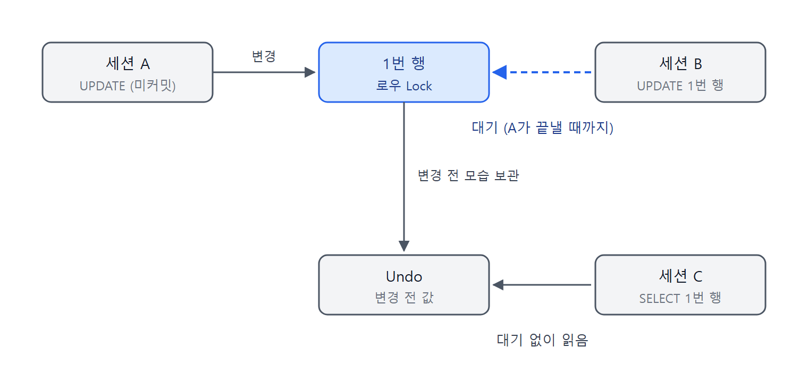
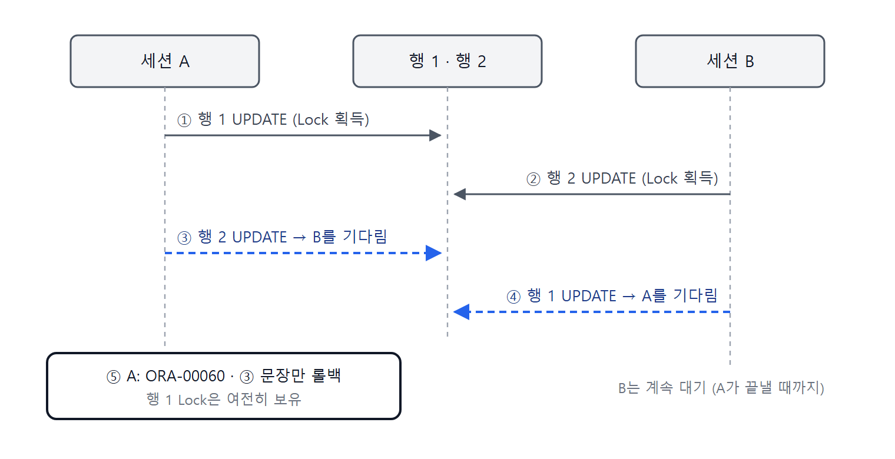

세션 A가 `UPDATE accounts SET balance = balance - 100 WHERE id = 1;`을 실행하고 아직 커밋하지 않았다. 이때 세션 B가 같은 행을 UPDATE하면 B는 멈춘다. 그런데 세션 C가 같은 행을 SELECT하면 C는 멈추지 않고 바로 결과를 받는다. 결과에 찍힌 잔액은 A가 바꾸기 **전** 값이다.

같은 행인데 왜 B는 기다리고 C는 기다리지 않을까? 그리고 B는 언제까지 기다려야 할까? 이 질문을 따라가면 오라클이 DML에 거는 Lock의 정체와, 트랜잭션끼리 서로를 멈춰 세우는 블로킹·교착상태, 그리고 애플리케이션이 고를 수 있는 동시성 제어 방식까지 이어진다. 앞의 두 글이 DML 한 건과 대량 DML의 비용을 다뤘다면, 이번에는 DML이 **다른 트랜잭션에게** 치르게 하는 비용이다. Oracle Database 19c 기준이다.

## 오라클의 Lock은 여러 겹이다

오라클은 공유 리소스와 사용자 데이터를 보호하려고 여러 종류의 Lock을 쓴다. DML Lock, DDL Lock, 래치, 버퍼 Lock, 라이브러리 캐시 Lock/Pin 등이 있고, 내부에는 더 많은 종류가 있다. 래치나 버퍼 Lock은 메모리 구조를 아주 짧게 보호하는 장치라 애플리케이션이 직접 다룰 일은 드물다.

개발자가 매일 부딪히는 것은 **DML Lock**이다. DML Lock은 두 가지다. 행을 보호하는 **로우 Lock**(TX Lock)과 테이블을 보호하는 **테이블 Lock**(TM Lock). 처음 질문은 로우 Lock에서 답이 나온다.

## 로우 Lock은 쓰는 사람끼리만 막는다

로우 Lock은 두 트랜잭션이 같은 행을 동시에 변경하지 못하게 막는다. 행을 바꾸려면 먼저 로우 Lock을 얻어야 하고, 다른 트랜잭션이 이미 그 행을 바꾸고 있으면 그 트랜잭션이 커밋하거나 롤백할 때까지 기다린다. 세션 B가 멈춘 이유다.

그럼 C는? 오라클에서 **읽기는 로우 Lock을 걸지도, 기다리지도 않는다.** 아직 커밋되지 않은 변경이 있는 블록을 읽으면, 지난 글에서 본 Undo를 이용해 변경 전 모습의 블록을 만들어 읽는다(읽기 일관성). 그래서 C는 기다리지 않고, A가 바꾸기 전 잔액을 본다.


*오라클에서 로우 Lock은 쓰는 트랜잭션끼리만 막는다. 읽는 쪽은 Undo로 변경 전 값을 본다.*

정리하면 이렇다.

| 먼저 한 일 → 나중에 하려는 일 | 기다리는가 |
| --- | --- |
| 읽기 → 읽기 | 아니다 |
| 읽기 → 쓰기 | 아니다 |
| 쓰기 → 읽기 | 아니다 (변경 전 값을 읽는다) |
| 쓰기 → 쓰기 (같은 행) | 기다린다 |

"다른 트랜잭션이 읽고 있는 행은 바꿀 수 없고, 변경 중인 행은 커밋될 때까지 읽을 수 없다"는 설명을 볼 때가 있다. 읽기에 공유 Lock을 거는 DBMS(예를 들어 SQL Server의 기본 READ COMMITTED 설정)라면 맞는 말이지만, 오라클은 그렇게 동작하지 않는다. 읽기가 쓰기를 막는 예외는 `SELECT ... FOR UPDATE`처럼 **읽으면서 일부러 로우 Lock을 거는** 경우뿐이다.

로우 Lock을 저장하는 방식도 독특하다. 오라클은 로우 Lock을 별도의 Lock 목록에 두지 않고, 데이터 블록 안의 행 헤더와 트랜잭션 슬롯(ITL)에 표시한다. 그래서 행을 아무리 많이 바꿔도 Lock 관리 메모리가 늘지 않고, 행 Lock이 많아졌다고 테이블 Lock으로 승격(Lock Escalation)하지도 않는다.

이제 두 번째 질문, B는 언제까지 기다리는가. 답은 단순하다. **A가 커밋하거나 롤백할 때까지**다. 그러니 로우 Lock 때문에 생기는 성능 저하를 줄이는 방법도 단순하다. Lock을 필요 이상으로 오래 쥐지 않는 것이다. 온라인 트랜잭션이 몰리는 시간대에는 트랜잭션 안의 SQL을 모두 튜닝해 빨리 끝내고, 커밋 시점을 업무상 필요한 곳에 정확히 둔다. 트랜잭션을 열어 둔 채 사용자 입력이나 외부 API 응답을 기다리거나, 행을 먼저 바꿔 놓고 오래 걸리는 계산을 그 뒤에 하는 구조는 그만큼 다른 세션을 세워 둔다.

## 테이블 Lock은 테이블을 잠그지 않는다

오라클은 로우 Lock을 걸기 전에 **테이블 Lock**(TM Lock)을 먼저 건다. 이름만 보면 테이블 전체를 잠가서 다른 트랜잭션이 행을 추가하거나 바꾸지 못하게 막을 것 같다. 하지만 DML은 **항상** 테이블 Lock을 먼저 건다. 행 하나 바꾸는데 테이블 전체가 잠긴다면 두 세션이 같은 테이블의 다른 행을 동시에 바꾸는 일이 불가능할 것이다. 실제로는 잘 된다.

오라클의 테이블 Lock은 "이 트랜잭션이 지금 이 테이블에서 이런 작업을 하고 있다"고 알리는 **푯말**이다. 목적은 현재 트랜잭션이 갱신 중인 테이블의 구조를 다른 트랜잭션이 바꾸지 못하게 막는 것이다. 푯말에는 모드가 있고, 모드끼리 함께 설 수 있는지가 정해져 있다.

| 모드 | 이름 | 거는 작업 (대표) |
| --- | --- | --- |
| 2 | RS (Row Share) | `LOCK TABLE ... IN ROW SHARE MODE` |
| 3 | RX (Row Exclusive) | INSERT, UPDATE, DELETE, MERGE, `SELECT ... FOR UPDATE` |
| 4 | S (Share) | `LOCK TABLE ... IN SHARE MODE`, 인덱스 없는 FK의 부모 행 삭제 시 자식 테이블 |
| 5 | SRX (Share Row Exclusive) | `LOCK TABLE ... IN SHARE ROW EXCLUSIVE MODE` |
| 6 | X (Exclusive) | DDL 일부, `LOCK TABLE ... IN EXCLUSIVE MODE`, Direct Path Insert |

일반 DML이 거는 RX끼리는 함께 설 수 있다. 그래서 여러 세션이 같은 테이블의 서로 다른 행을 동시에 바꿀 수 있다. 반면 X는 어떤 모드와도 함께 서지 못한다. 지난 글의 Direct Path Insert가 다른 세션의 DML을 막는 이유가 이것이다. 반대 방향도 있다. 커밋하지 않은 DML이 RX를 쥐고 있으면, 그 테이블에 컬럼을 추가하는 DDL은 기다리거나 `ORA-00054`(리소스 사용 중)로 실패한다.

지난 글에서 FK 컬럼에 인덱스가 없으면 부모 행을 지울 때 자식 테이블에 더 강한 Lock이 걸린다고 했다. 표의 4번 S 모드가 그것이다. S는 RX와 함께 서지 못하므로, 그 순간 자식 테이블에 DML을 하던 세션과 서로를 기다리게 된다. FK 컬럼에 인덱스를 만드는 것이 성능뿐 아니라 동시성 문제이기도 한 이유다.

## 기다림이 풀리지 않을 때: 블로킹과 교착상태

**블로킹**은 먼저 시작한 트랜잭션이 건 Lock 때문에 뒤의 트랜잭션이 작업을 진행하지 못하고 멈춰 있는 상태다. 처음 장면의 세션 B가 블로킹된 상태다. 블로킹을 푸는 방법은 Lock을 쥔 트랜잭션의 커밋 또는 롤백뿐이다. 운영 중에는 다음처럼 누가 누구를 막고 있는지 찾는다.

```sql
SELECT sid, serial#, blocking_session, event, seconds_in_wait, sql_id
FROM   v$session
WHERE  blocking_session IS NOT NULL;
```

로우 Lock을 기다리는 세션은 대기 이벤트 `enq: TX - row lock contention`으로, 테이블 Lock을 기다리는 세션은 `enq: TM - contention`으로 보인다.

블로킹은 기다리면 풀린다. 그런데 두 트랜잭션이 **서로를** 기다리면 어떻게 될까?


*두 트랜잭션이 서로가 쥔 행을 기다리면, 오라클은 한쪽의 문장을 롤백해 순환을 끊는다.*

**교착상태(Deadlock)**는 두 트랜잭션이 각각 Lock을 쥔 채, 상대가 쥔 리소스에 Lock을 걸려고 하는 상황이다. 둘 중 하나가 물러서지 않으면 영원히 풀리지 않는다. 오라클은 교착상태를 자동으로 감지하고, 먼저 감지한 쪽 트랜잭션의 **그 문장만** 롤백하고 `ORA-00060: deadlock detected`를 돌려준다. 동시에 alert log에 기록하고 트레이스 파일을 남긴다.

여기서 흔히 놓치는 점이 있다. 롤백된 것은 문장 하나이지 트랜잭션 전체가 아니다. 에러를 받은 트랜잭션은 그 전에 바꾼 행의 Lock을 여전히 쥐고 있다. 그래서 교착상태는 풀렸지만 상대 트랜잭션은 여전히 **블로킹 상태**로 남는다. 에러를 받은 쪽은 커밋할지 롤백할지 결정해야 하고, 애플리케이션에서는 보통 트랜잭션 전체를 롤백한 뒤 재시도한다. 에러를 잡아서 무시하고 커넥션을 풀에 돌려주면, 상대 세션은 계속 기다린다.

교착상태를 줄이는 방법은 순환이 생기지 않게 하는 것이다. 여러 행이나 여러 테이블을 바꿀 때 **항상 같은 순서**(예: 계좌 이체는 ID가 작은 계좌부터)로 접근하고, FK 컬럼에는 인덱스를 둔다.

## 충돌을 어떻게 다룰 것인가: 비관적 vs 낙관적 동시성 제어

지금까지는 DB가 Lock으로 같은 행의 동시 변경을 막는 이야기였다. 그런데 이것만으로는 막지 못하는 충돌이 있다. 사용자 둘이 같은 상품의 재고 10개를 화면에 띄워 놓고, 각자 3개와 4개를 빼서 "7"과 "6"으로 저장하면 어떻게 될까? 각 UPDATE는 Lock 덕분에 차례로 실행되지만, 나중에 저장한 값이 먼저 저장한 값을 덮어쓴다(Lost Update). 읽은 시점과 쓰는 시점 사이에 다른 트랜잭션이 끼어들었기 때문이다. 이를 막는 방법은 두 가지 태도로 나뉜다.

**비관적 동시성 제어**는 사용자들이 같은 데이터를 동시에 수정할 것이라고 가정한다. 그래서 데이터를 **읽는 시점에** Lock을 걸고, 조회와 갱신이 끝날 때까지 유지한다.

```sql
SELECT stock FROM products WHERE product_id = :id FOR UPDATE;
-- 재고 계산
UPDATE products SET stock = :new_stock WHERE product_id = :id;
COMMIT;
```

`FOR UPDATE`로 읽은 순간부터 다른 트랜잭션은 이 행을 바꿀 수 없다. 확실하지만, 첫 번째 사용자가 트랜잭션을 끝낼 때까지 다른 사용자가 기다려야 하므로 잘못 쓰면 동시성이 나빠진다. 그래서 무작정 기다리지 않도록 옵션을 함께 쓴다. `FOR UPDATE NOWAIT`는 Lock을 못 얻으면 바로 `ORA-00054`를 반환하고, `FOR UPDATE WAIT 3`은 3초까지만 기다린다. 작업 큐처럼 "아무 행이나 하나 처리하면 되는" 경우에는 `FOR UPDATE SKIP LOCKED`로 이미 잠긴 행을 건너뛸 수 있다.

**낙관적 동시성 제어**는 사용자들이 같은 데이터를 동시에 수정하지 않을 것이라고 가정한다. 그래서 읽을 때는 Lock을 걸지 않고, **쓰는 시점에** 그사이 다른 트랜잭션이 값을 바꿨는지 확인한다. 흔한 방법은 버전 컬럼이다.

```sql
SELECT stock, version FROM products WHERE product_id = :id;
-- 화면 표시, 사용자 입력, 계산 (Lock 없음)
UPDATE products
SET    stock = :new_stock, version = version + 1
WHERE  product_id = :id
AND    version = :read_version;
-- 갱신 건수가 0이면 그사이 누군가 바꾼 것 → 다시 읽고 재시도하거나 사용자에게 알린다
```

버전 컬럼 대신 읽었던 컬럼 값을 모두 WHERE에 넣어 비교하거나, 수정 시각 컬럼을 쓰기도 한다. JPA의 `@Version`이 이 방식이다. 읽고 나서 쓰기까지 시간이 길어도 Lock을 쥐지 않으니 동시성이 좋다. 대신 충돌이 잦으면 재시도가 늘고, 충돌을 처리하는 코드(재시도, 사용자 안내)를 애플리케이션이 책임져야 한다.

| 기준 | 비관적 | 낙관적 |
| --- | --- | --- |
| 가정 | 충돌이 잦다 | 충돌이 드물다 |
| Lock 시점 | 읽을 때부터 | 쓸 때만 (UPDATE의 로우 Lock) |
| 충돌 시 | 뒤의 트랜잭션이 기다림 | 갱신 건수 0 → 재시도 |
| 맞는 경우 | 재고 차감, 좌석 배정처럼 짧고 경합이 심한 트랜잭션 | 사용자가 화면에서 오래 편집하는 데이터, 경합이 드문 데이터 |

참고로 재고 차감처럼 계산이 단순하면 `UPDATE products SET stock = stock - :qty WHERE product_id = :id AND stock >= :qty`처럼 읽기와 쓰기를 한 문장에 넣는 방법도 있다. 문장 하나가 로우 Lock 아래에서 현재 값을 기준으로 계산하므로 Lost Update가 생기지 않는다. 앞의 글에서 본 One SQL이 동시성 문제도 줄여 주는 셈이다.

## 처음 장면으로 돌아가서

세션 B가 기다리고 C가 기다리지 않은 이유는, 오라클의 로우 Lock이 쓰는 트랜잭션끼리만 막고 읽는 쪽에는 Undo로 변경 전 값을 보여 주기 때문이었다. B는 A가 커밋하거나 롤백할 때까지 기다리고, 그 시간을 줄이는 것은 결국 트랜잭션을 짧게 만드는 일이다.

실무에서 확인할 것을 정리하면 이렇다.

- 트랜잭션 안에 사용자 입력·외부 호출·긴 계산이 끼어 있지 않은가?
- 여러 행·테이블을 바꾸는 코드가 항상 같은 순서로 접근하는가?
- FK 컬럼에 인덱스가 있는가?
- `ORA-00060`을 받으면 트랜잭션을 롤백하고 재시도하는가?
- Lost Update가 생길 수 있는 화면에 비관적·낙관적 중 어떤 방식을 쓰는지 정했는가?
- 운영 중 `enq: TX - row lock contention` 대기가 보이면 `V$SESSION.BLOCKING_SESSION`으로 Lock을 쥔 세션과 SQL을 찾는다.

이 시리즈는 인덱스로 테이블을 찾아가는 비용에서 시작해 조인, 소트, 그리고 DML과 Lock까지 왔다. DML 편 세 글을 하나로 묶으면, DML의 비용은 블록을 바꾸며 남기는 기록(Redo·Undo), 그 일을 반복하며 오가는 호출, 그리고 그동안 다른 트랜잭션을 세워 두는 Lock 세 가지다.

다음 글에서는 시선을 SQL 바깥으로 넓혀, 지금까지의 설명이 모두 기대고 있던 무대인 오라클 인스턴스의 메모리 구조(SGA, PGA)와 백그라운드 프로세스, 그리고 논리 I/O와 물리 I/O의 관계를 정리한다.
