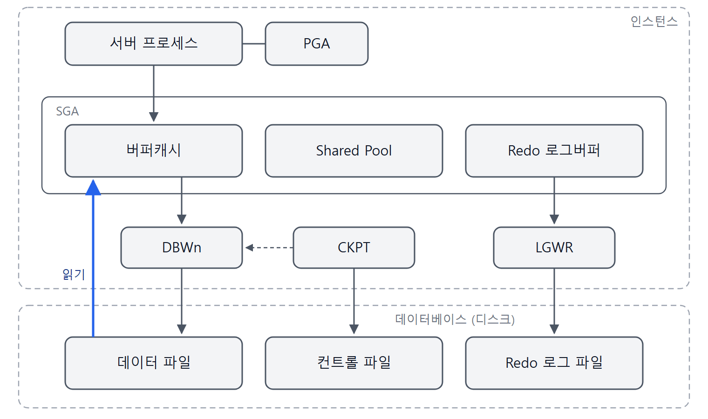
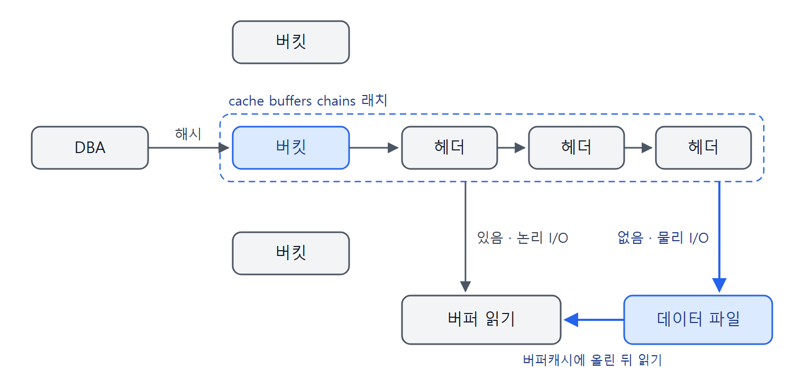

SQL을 실행하고 AUTOTRACE 통계를 보면 비슷한 이름의 숫자가 나란히 찍힌다. `consistent gets 1,204`, `db block gets 12`, `physical reads 3`. 같은 SQL이 블록을 1,216번 읽었다는데 디스크에서 읽은 것은 3번뿐이다. 나머지 1,213번은 어디서 읽었을까? 그리고 튜닝할 때는 어느 숫자를 줄여야 할까?

이 질문에 답하려면 블록 하나가 디스크에서 메모리로 올라와 사용자에게 전달되기까지의 길을 머릿속에 그릴 수 있어야 한다. 그 길 위에 오라클의 메모리 구조(SGA, PGA)와 백그라운드 프로세스가 놓여 있다. 이 시리즈의 앞선 글들이 "인덱스로 찾아가면 왜 비싼가", "커밋하면 무엇이 써지는가"를 하나씩 다뤘다면, 이번 글은 그 설명들이 공통으로 기대고 있는 무대를 정리한다. 내용은 Oracle Database 19c 기준이다.

## 데이터베이스와 인스턴스는 다른 것이다

평소에는 "오라클 DB"라고 뭉뚱그려 부르지만, 오라클은 둘을 구분한다.

**데이터베이스**는 디스크에 있는 파일들이다. 실제 데이터가 담긴 데이터 파일, 변경 기록을 남기는 온라인 Redo 로그 파일, 데이터베이스의 물리 구조와 동기화 정보를 담은 컨트롤 파일이 여기에 속한다. 서버가 꺼져도 남는다.

**인스턴스**는 그 파일을 읽고 쓰기 위해 서버 메모리에 올라온 것이다. 모든 프로세스가 함께 쓰는 공유 메모리(SGA)와, 그 메모리를 관리하며 일하는 백그라운드 프로세스들의 묶음이다. 메모리에만 있으므로 서버가 내려가면 사라진다.

애플리케이션이 접속하면 그 세션을 맡을 **서버 프로세스**가 생긴다(전용 서버 방식 기준). 서버 프로세스는 자기만 쓰는 메모리인 PGA를 받고, SGA와 디스크 파일 사이를 오가며 SQL을 처리한다.

*인스턴스는 SGA와 백그라운드 프로세스, 데이터베이스는 디스크의 파일이다. 서버 프로세스는 PGA를 들고 둘 사이에서 일한다.*

이 그림에서 서버 프로세스가 디스크를 직접 건드리는 화살표는 데이터 파일을 **읽는** 방향 하나뿐이다. 쓰기는 백그라운드 프로세스의 몫이다. 왜 이렇게 나눴는지는 블록을 읽는 길을 따라가 보면 보인다.

## 모두가 함께 쓰는 메모리, SGA

SGA는 여러 영역으로 나뉘는데, SQL 하나가 실행될 때 직접 맞닿는 영역은 셋이다.

**버퍼캐시(Database Buffer Cache)** 는 데이터 파일에서 읽어 온 블록의 복사본을 두는 곳이다. 한 번 읽은 블록을 메모리에 남겨 두면 다음 요청은 디스크까지 가지 않아도 된다. 버퍼캐시의 버퍼는 상태로 구분한다. 지금 누군가 쓰고 있는 **Pinned** 버퍼, 메모리에서 바뀌었지만 아직 디스크에 쓰이지 않은 **Dirty** 버퍼, 디스크와 내용이 같거나 비어 있어 언제든 다른 블록으로 덮어쓸 수 있는 **Free(Clean)** 버퍼다.

**Shared Pool**은 SQL을 다시 쓰기 위한 공간이다. SQL 문장과 실행 계획을 담는 Library Cache, 테이블·컬럼·권한 같은 딕셔너리 정보를 담는 Data Dictionary Cache가 여기 있다. 같은 SQL이 다시 오면 실행 계획을 새로 만들지 않고 가져다 쓴다. 이 재사용이 어떻게 일어나고 언제 실패하는지는 다음 글의 주제다.

**Redo 로그버퍼**는 모든 변경 기록을 순서대로 쌓는 순환 버퍼다. 블록을 바꾸기 전에 그 변경의 Redo가 먼저 여기 기록되고, LGWR가 로그 파일로 내려쓴다. 이 과정은 7편에서 커밋을 따라가며 자세히 봤다.

세 영역 모두 "공유"된다는 점이 중요하다. 수백 개의 서버 프로세스가 같은 버퍼, 같은 실행 계획을 동시에 보려 한다. 그래서 SGA에서는 누가 지금 이 구조를 만지고 있는지 짧게 줄을 세우는 장치(래치, 뮤텍스)가 곳곳에 있고, 그 줄이 길어지면 대기 이벤트로 드러난다.

## 블록 하나를 읽는 길: 논리 I/O와 물리 I/O

서버 프로세스가 어떤 블록이 필요하다고 해 보자. 블록은 파일 번호와 블록 번호로 이루어진 주소(DBA, Data Block Address)로 식별된다.

1. DBA를 해시 함수에 넣어 버퍼캐시의 **해시 버킷**을 정한다.
2. 그 버킷에 매달린 **체인**을 따라가며 같은 DBA의 버퍼 헤더를 찾는다. 이 체인을 따라가는 동안에는 체인을 보호하는 **cache buffers chains 래치**를 잡아야 한다. 래치 하나가 버킷 여러 개를 맡는다.
3. 찾으면 그 버퍼를 읽는다. 디스크를 거치지 않았으니 이것이 **논리 I/O**만 일어난 경우다.
4. 없으면 데이터 파일에서 블록을 읽어(**물리 I/O**) Free 버퍼에 올리고, 체인에 연결한 뒤 읽는다.

*버퍼캐시에 있든 없든 블록은 버퍼캐시를 거쳐 읽힌다. 없을 때만 데이터 파일 읽기가 한 번 더 붙는다.*

여기서 첫 질문의 답이 나온다. 디스크에서 읽은 블록도 결국 버퍼캐시에 올라온 뒤 읽히므로, 물리 I/O는 논리 I/O에 **포함**된다. AUTOTRACE의 숫자로 말하면 1,216번(consistent gets + db block gets)이 SQL이 읽은 블록 전부이고, 그중 3번은 디스크에서 가져와야 했다는 뜻이다. 나머지는 이미 버퍼캐시에 있었다. 물리 I/O는 단일 블록 읽기면 `db file sequential read`, 여러 블록을 한 번에 읽는 Full Scan이면 `db file scattered read` 대기 이벤트로 보인다.

### consistent gets와 db block gets는 무엇이 다른가

논리 I/O도 두 가지로 나뉜다. 차이는 "어느 시점의 블록을 원하는가"다.

**Consistent get**은 일관 모드 읽기다. SELECT는 쿼리가 시작된 시점(SCN)의 데이터를 봐야 한다. 그사이 다른 트랜잭션이 블록을 바꿨거나 아직 커밋하지 않은 변경이 있으면, 오라클은 언두를 적용해 쿼리 시작 시점의 모습으로 되돌린 복사본(CR 블록)을 만들어 읽는다. 블록이 바뀌지 않았다면 언두를 쓸 필요 없이 그대로 읽는다. 즉 consistent get은 "언두를 적용한 읽기"가 아니라 "필요하면 언두를 적용해서라도 시작 시점을 보장하는 읽기"다.

**DB block get**은 현재 모드(current mode) 읽기다. UPDATE·DELETE처럼 블록을 실제로 바꾸려면 지금 이 순간의 최신 버전을 잡아야 한다. 과거 모습을 바꿔 봐야 의미가 없기 때문이다. 그래서 DML이 많은 SQL에서 db block gets가 커진다.

### 그런데 모든 읽기가 버퍼캐시를 거치지는 않는다

"오라클은 모든 블록 읽기와 쓰기를 버퍼캐시를 거쳐 한다"는 설명을 자주 보는데, 예외가 있다. 병렬 쿼리의 Full Scan, 그리고 11g부터는 직렬 쿼리라도 버퍼캐시에 비해 큰 테이블을 Full Scan하면 블록을 버퍼캐시가 아니라 PGA로 바로 읽는 **Direct Path Read**를 쓸 수 있다. 큰 테이블 하나를 훑느라 다른 세션이 쓰던 블록이 캐시에서 밀려나지 않게 하려는 선택이다. 대기 이벤트도 `direct path read`로 따로 보인다. 8편에서 본 Direct Path Insert, 그리고 정렬이 넘쳐 Temp에 쓰고 읽는 I/O도 버퍼캐시를 거치지 않는다.

이 예외는 해석에 영향을 준다. Direct Path Read로 읽은 블록은 버퍼캐시에 남지 않으므로, 같은 Full Scan을 여러 세션이 반복하면 매번 디스크에서 읽는다. 반대로 버퍼캐시 경합은 피한다. 어느 쪽을 택할지는 오라클이 테이블 크기와 버퍼캐시 크기를 보고 실행할 때마다 정한다.

## 왜 튜닝은 논리 I/O를 줄이는 데서 시작할까

물리 I/O가 느리다면 버퍼캐시를 키워 물리 I/O를 줄이면 되지 않을까? 그래서 오래전부터 "버퍼캐시 히트율"이 성능 지표로 쓰였다. 하지만 이 지표는 함정이 있다. 필요 없는 블록을 수백만 번 읽는 비효율적인 SQL은 같은 블록을 반복해서 읽으니 오히려 히트율이 높게 나온다. 히트율 99%가 "SQL이 효율적이다"를 뜻하지 않는다.

논리 I/O 자체도 비용이다. 블록 하나를 읽을 때마다 해시 계산, 래치 획득, 체인 탐색, 필요하면 CR 블록 생성이 따라온다. 디스크를 건드리지 않아도 CPU를 쓰고, 래치라는 공유 자원을 잠깐씩 점유한다. 같은 블록을 많은 세션이 동시에 읽으면(예: 모두가 같은 인덱스 루트 블록이나 작은 코드 테이블을 계속 읽는 경우) 그 블록이 매달린 체인의 래치에 줄이 생긴다. 이것이 `latch: cache buffers chains` 대기이고, 이런 블록을 핫 블록이라 부른다. 버퍼를 바꾸려는 세션과 읽으려는 세션이 같은 버퍼에서 부딪히면 `buffer busy waits`가 보인다.

그래서 SQL 튜닝의 목표는 **SQL이 읽는 블록 수 자체를 줄이는 것**이다. 1편에서 인덱스를 경유한 테이블 랜덤 액세스를 줄이려 했던 것, 2편에서 조인 순서와 방식을 고른 것 모두 결국 읽는 블록 수를 줄이는 일이었다. 논리 I/O가 줄면 그 안에 포함된 물리 I/O도 함께 준다. 버퍼캐시 크기는 그다음에 시스템 단위로 조정할 문제다.

## 혼자 쓰는 메모리, PGA

이제 서버 프로세스 쪽으로 가 보자. **PGA**는 서버 프로세스마다 따로 잡히는 메모리라 다른 프로세스와 공유하지 않는다. 공유하지 않으니 래치로 줄을 세울 필요도 없다. 들어 있는 것은 크게 셋이다.

- **Private SQL Area**: 실행 중인 커서의 상태와 바인드 변수 값. 실행 계획 자체는 Shared Pool에 있고, 이 세션이 그 계획을 어디까지 실행했는지가 여기 있다.
- **세션 메모리**: 로그인 정보, 세션 변수 같은 세션 단위 정보.
- **SQL Work Area**: 정렬(Sort Area), 해시 조인(Hash Area), 비트맵 병합에 쓰는 작업 공간.

SQL Work Area가 SQL 성능과 직접 닿는다. 정렬하거나 해시 테이블을 만들 데이터가 작업 공간보다 크면 남는 부분을 Temp 테이블스페이스에 쓰고 다시 읽는다. 이것이 3·4편에서 본 디스크 소트다. 요즘은 DBA가 `PGA_AGGREGATE_TARGET`으로 인스턴스 전체 PGA 목표치를 정하면 오라클이 작업 공간 크기를 자동으로 나눠 주고, 12c부터는 `PGA_AGGREGATE_LIMIT`으로 PGA 총량의 상한도 둔다.

한 가지 예외가 있다. 전용 서버가 아닌 **공유 서버** 방식에서는 세션이 여러 서버 프로세스를 오가며 처리되므로, 세션 메모리와 커서 상태(UGA)가 PGA가 아니라 SGA(Large Pool)에 있다. "세션 정보는 PGA에 있다"는 설명은 전용 서버 기준이다.

## 바뀐 블록은 누가 디스크에 쓰나: 백그라운드 프로세스

서버 프로세스는 블록을 읽어 오고 메모리에서 바꾸기까지만 한다. 메모리와 디스크를 맞추는 일은 백그라운드 프로세스가 나눠 맡는다.

| 프로세스 | 하는 일 | 언제 |
| --- | --- | --- |
| DBWn (Database Writer) | Dirty 버퍼를 데이터 파일에 쓴다 | Free 버퍼가 부족할 때, 체크포인트를 진행할 때. 커밋과는 무관 |
| LGWR (Log Writer) | Redo 로그버퍼를 온라인 Redo 로그 파일에 쓴다 | 커밋할 때, 3초마다, 로그버퍼가 3분의 1 찼을 때, DBWn이 쓰기 전에 |
| CKPT (Checkpoint) | 체크포인트 정보를 컨트롤 파일과 데이터 파일 헤더에 기록한다 | 체크포인트 시. 블록을 직접 쓰지는 않고 DBWn에게 신호를 보낸다 |
| SMON (System Monitor) | 인스턴스 복구, 쓰지 않는 임시 세그먼트 정리 | 비정상 종료 후 재기동 시, 그리고 주기적으로 |
| PMON (Process Monitor) | 비정상 종료한 프로세스를 찾아 정리를 지휘한다 | 주기적으로 |

DBWn이 커밋 때 움직이지 않는다는 점이 중요하다. 커밋은 LGWR가 Redo를 쓰는 것으로 끝나고, Dirty 버퍼는 나중에 모아서 쓴다. 이 분업이 왜 영속성과 성능을 함께 지키는지는 7편에서 따라가 봤다. 버퍼캐시 쪽에서 보면 DBWn은 "Free 버퍼를 만들어 주는" 프로세스다. 서버 프로세스가 새 블록을 올릴 Free 버퍼를 찾지 못하면 DBWn에게 쓰기를 요청하고 기다리는데, 이 기다림이 `free buffer waits`다.

PMON의 역할은 버전에 따라 조금 달라졌다. 예전에는 PMON이 죽은 세션의 Lock을 풀고 트랜잭션을 롤백하는 일까지 직접 했지만, 12c R2부터는 PMON이 비정상 종료한 프로세스를 찾아내고, 실제 정리(리소스 해제, 롤백 지시)는 CLMN(Cleanup Main Process)과 그 보조 프로세스(CLnn)가 맡는다. 결과는 같다. 접속이 끊긴 세션이 쥐고 있던 Lock은 결국 풀린다.

## 이론을 관측으로 바꾸기

지금까지의 그림은 동적 성능 뷰(V$ 뷰)로 직접 확인할 수 있다.

| 보고 싶은 것 | 확인 방법 |
| --- | --- |
| SGA 영역별 크기와 여유 | `V$SGAINFO`, `V$SGASTAT` |
| SQL 하나의 논리·물리 I/O | AUTOTRACE의 `consistent gets`·`db block gets`·`physical reads`, `V$SQL`의 `BUFFER_GETS`·`DISK_READS` |
| 인스턴스 전체 I/O 누적 | `V$SYSSTAT`의 `session logical reads`, `physical reads` |
| 지금 무엇을 기다리는지 | `V$SESSION_WAIT`(현재), `V$SYSTEM_EVENT`(누적) |
| 핫 블록과 래치 경합 | `V$LATCH`, `V$LATCH_CHILDREN`의 `cache buffers chains` 자식 래치별 `SLEEPS` |
| PGA 사용량과 디스크 소트 | `V$PGASTAT`, `V$SQL_WORKAREA` |

SQL을 튜닝할 때는 `V$SQL`에서 `BUFFER_GETS / EXECUTIONS`(실행 한 번당 읽은 블록 수)가 큰 SQL부터 보는 것이 출발점이 된다. 대기 이벤트는 "어디서 시간이 새는가"를 알려 준다. `db file sequential read`가 많으면 인덱스 경유 랜덤 액세스를, `latch: cache buffers chains`가 많으면 같은 블록을 지나치게 많이 읽는 SQL을, `free buffer waits`가 많으면 DBWn의 쓰기 속도를 의심해 볼 수 있다.

처음 질문으로 돌아가 보자. SQL이 읽은 1,216개 블록 중 1,213개는 버퍼캐시에서 읽었다. 디스크에서 읽은 3개도 버퍼캐시를 거쳐 읽혔으니, SQL이 한 일의 양을 나타내는 숫자는 1,216이다. 튜닝이 줄여야 할 숫자도 이것이다. 물리 I/O는 그 안에 포함된 일부이고, 논리 I/O를 줄이면 함께 준다.

그런데 SQL이 블록을 읽기 전에 거치는 단계가 하나 더 있다. 어떤 순서로 블록을 읽을지, 곧 실행 계획을 정하는 일이다. 같은 SQL이 다시 오면 Shared Pool에서 실행 계획을 꺼내 쓴다고 했는데, "같은 SQL"이란 정확히 무엇이고 그 재사용에 실패하면 무슨 일이 생길까? 다음 글에서는 하드 파싱과 소프트 파싱, 바인드 변수와 커서 캐싱을 따라가 본다.
