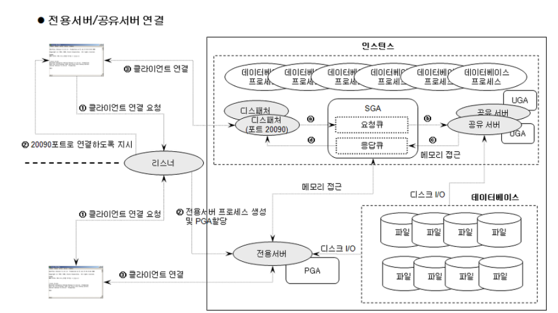
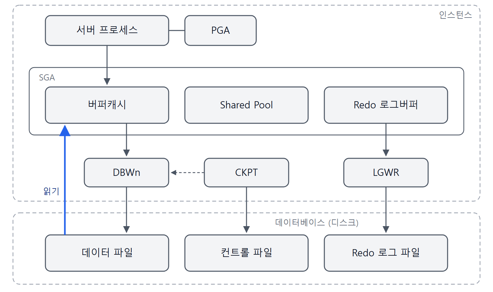

## 오라클 아키텍처

데이터베이스 아키텍트(DA)나 SQL 튜닝을 수행하고 트러블슈팅할 때 가장 든든한 무기가 되는 것은 오라클 서버의 내부 아키텍처에 대한 깊은 이해이다. 특정 쿼리가 왜 느린지, 왜 특정 대기 이벤트가 발생하는지 정확히 진단하려면 데이터가 디스크에서 메모리로 올라와 사용자에게 전달되고 다시 디스크에 기록되기까지의 전 과정을 머릿속에 그릴 수 있어야 한다.

*전용 서버와 공유 서버 연결 방식*

> **보충** 그림 아래쪽이 전용 서버 방식(접속마다 서버 프로세스와 PGA), 위쪽이 공유 서버 방식(디스패처가 요청 큐에 넣고 공유 서버 프로세스가 처리)이다. 공유 서버에서는 세션 정보(UGA)가 SGA에 있다. 이 글은 전용 서버 기준이다.

오라클 인스턴스를 구성하는 양대 산맥인 메모리 구조(SGA, PGA)와 백그라운드 프로세스의 내부 메커니즘을 파헤쳐본다.

- 인스턴스 :
  - 물리적인 디스크 파일에 접근하여 데이터를 읽고 쓰기 위해 서버 메모리에 할당된 공유 메모리 영역(SGA)와 이를 관리하고 작업을 수행하는 백그라운드 프로세스들의 집합. 인스턴스는 메모리에만 존재하므로 서버가 내려가면 사라진다
- 데이터베이스 :
  - 디스크 상에 물리적으로 존재하는 파일들의 집합. 실제 데이터가 저장된 Datafile, 변경 이력을 기록하는 Redo Log File, 데이터베이스의 물리적 구조와 동기화 정보를 담고 있는 Control File 등이 있다.

사용자 애플리케이션이 DB에 접속하면 서버 프로세스가 생성되며, 이 서버 프로세스가 고유 메모리 영역인 PGA를 할당받아 인스턴스(SGA) 및 디스크 파일과 상호작용하며 쿼리를 처리한다.

오라클 내부에서 하나의 SQL이 수행될 때 각 컴포넌트가 어떻게 맞물려 돌아가는지 핵심 구조별로 살펴보자.

1. 공유 메모리 영역 : SGA

   SGA는 모든 서버 프로세스가 공유하는 메모리 영역으로, 동시성 제어가 가장 치열하게 일어나는 곳이다.

   - Database Buffer Cache(버퍼 캐시) : 디스크의 데이터 파일로부터 읽어 들인 데이터 블록의 복사본을 보관하는 영역. 오라클은 디스크 I/O를 최소화하기 위해 모든 블록 읽기 쓰기 작업을 버퍼 캐시를 거쳐 수행한다. 내부적으로 해시 체인 구조로 관리되며, 체인을 탐색할 때 Cache Buffer Chains Latch를 획득해야 한다.
     - Pinned Buffer : 현재 다른 프로세스가 사용 중인 버퍼
     - Dirty Buffer : 메모리 상에서 데이터가 변경되었으나 아직 디스크의 데이터 파일에 기록되지 않아 디스크 블록과 불일치하는 버퍼
     - Free/Clean Buffer : 비어있거나 디스크와 동기화가 완료되어 언제든 새로운 블록으로 덮어쓸 수 있는 버퍼

   > **바로잡기** 모든 읽기·쓰기가 버퍼 캐시를 거치지는 않는다. 큰 테이블의 Full Scan(병렬, 11g부터는 직렬도)은 Direct Path Read로 PGA에 바로 읽고, Direct Path Insert와 Temp I/O도 버퍼 캐시를 건너뛴다.

   - Shared Pool : SQL 문장 자체의 텍스트, 파싱된 트리, 실행 계획을 저장하는 Library Cache와 데이터 딕셔너리 메타데이터를 캐싱하는 Data Dictionary Cache로 구성된다. SQL 수행 시 하드 파싱을 피하고 실행 계획을 재사용하기 위한 핵심 공간이다.
   - Redo Log Buffer : 데이터베이스에서 발생하는 모든 변경 사항을 순서대로 기록하는 순환형 버퍼. 장애 복구를 위한 핵심 장치로, 버퍼 캐시의 블록이 변경되기 전 리두 레코드가 이곳에 먼저 기록된다.

2. 전용 메모리 영역 : PGA

   각 서버 프로세스마다 독립적으로 할당되는 비공유 메모리 영역. 다른 프로세스와 공유하지 않으므로 래치 경합이 발생하지 않아 매우 빠른 접근이 가능하다.

   - SQL Work Area : Order by, Group by 등을 위한 정렬 공간(Sort Area)와 해시 조인을 수행하기 위한 (Hash Area)가 여기에 속한다. 만약 작업해야 할 데이터량이 할당된 PGA 크기를 초과하면, 디스크의 Temporary Tablespace를 사용하게 되어 성능이 급격히 저하된다.
   - Session Memory, Private SQL Area : 세션 변수, 로그인 정보 및 바인드 변수 값, 커서의 실행 상태 정보를 보관한다.

   > **보충** Work Area 크기는 보통 `PGA_AGGREGATE_TARGET`을 기준으로 오라클이 자동 배분한다. 디스크 소트는 3·4편에서 다뤘다.

## 핵심 백그라운드 프로세스

메모리와 디스크 사이의 동기화 및 인스턴스 유지를 담당하는 일꾼들

*서버 프로세스는 데이터 파일을 읽기만 하고, 디스크에 쓰는 일은 백그라운드 프로세스가 나눠 맡는다.*

1. DBWn (Database Writer) : 버퍼 캐시의 Dirty Buffer들을 모아 디스크의 데이터 파일에 비동기적으로 내려쓰는 역할을 한다. 주의할 점은 커밋 시점에 DBWn이 작동하는 것이 아니라, 가용한 Free Buffer가 부족하거나 체크포인트가 발생할 때 작동한다는 것이다.

   > **보충** Free Buffer를 못 찾은 서버 프로세스는 `free buffer waits`로 DBWn을 기다린다. 커밋이 기다리는 것은 LGWR뿐이다(7편).

2. LGWR : Redo Log Buffer의 내용을 디스크의 Online Redo Log File에 내려쓴다. 사용자가 commit을 날리면 LGWR이 즉시 작동하여 해당 트랜잭션의 리두 레코드를 디스크에 기록하고 완료 신호를 보낸다.

   > **보충** 커밋 외에도 3초마다, 로그 버퍼가 3분의 1 찼을 때, DBWn이 쓰기 전(Write-Ahead Logging)에도 쓴다. 커밋 대기는 `log file sync`로 보인다.

3. CKPT : 특정 시점의 SCN(System Change Number)을 기준으로 버퍼 캐시의 변경 사항을 데이터 파일에 동기화하도록 DBWn에게 신호를 보내고, 완료된 체크포인트 정보를 Control File과 Datafile Header에 기록하여 추후 장애 복구 시간을 단축시킨다.

   > **보충** CKPT는 블록을 직접 쓰지 않는다. 쓰는 것은 DBWn이다.

4. SMON, PMON :
   - SMON은 비정상 종료 후 재기동 시 Redo Log를 읽어 인스턴스 복구를 수행하고 임시 세그먼트를 정리한다.
   - PMON은 비정상 종료된 사용자 세션을 감지하여 해당 세션이 잡고 있던 락과 리소스를 해제하고 트랜잭션을 롤백한다.

   > **바로잡기** 12c R2부터 실제 정리(리소스 해제, 롤백)는 CLMN·CLnn 프로세스가 맡고, PMON은 감지와 지휘를 한다.

> **보충** 확인할 곳: SGA는 `V$SGASTAT`, PGA는 `V$PGASTAT`, 위에 나온 대기 이벤트는 `V$SYSTEM_EVENT`.
