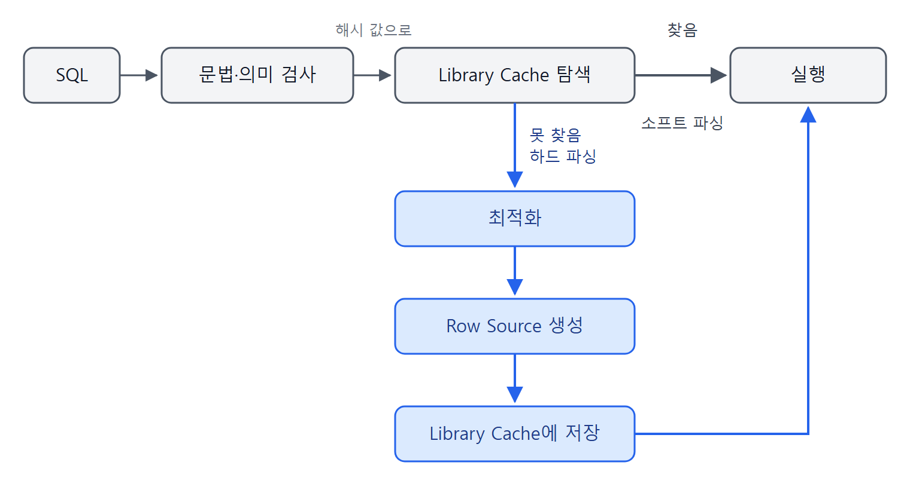
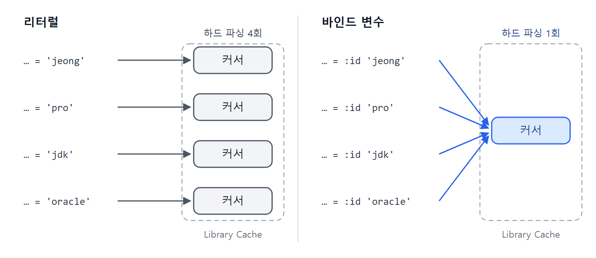

로그인할 때마다 실행되는 쿼리가 있다고 해 보자. 하루에 100만 번 실행된다.

```sql
SELECT * FROM members WHERE login_id = 'jeong';
SELECT * FROM members WHERE login_id = 'pro';
SELECT * FROM members WHERE login_id = 'oracle';
```

```sql
SELECT * FROM members WHERE login_id = :login_id;
```

두 방식은 같은 결과를 돌려주고, 실행 계획도 똑같이 `login_id` 인덱스를 탈 것이다. 그런데 앞의 방식으로 짠 시스템에서는 접속이 몰리는 시간에 DB 서버 CPU가 치솟고, `library cache: mutex X` 같은 낯선 대기가 쌓이고, 심하면 `ORA-04031: unable to allocate ... bytes of shared memory` 오류가 난다. 읽는 블록 수는 같은데 왜 이런 차이가 날까?

답은 SQL이 블록을 읽기 **전**에 있다. 지난 글에서는 SQL이 버퍼캐시에서 블록을 읽는 길을 따라갔다. 이번에는 그보다 앞, SQL 문장이 실행 계획으로 바뀌는 과정(파싱)을 따라가 보자. 내용은 Oracle Database 19c 기준이다.

## SQL 한 문장이 실행되기까지

SQL이 도착하면 오라클은 바로 실행하지 않고 몇 가지를 확인한다.

1. **문법 검사(Syntax Check)**: `SELEC`처럼 SQL 문법에 맞지 않는 곳이 없는지 본다.
2. **의미 검사(Semantic Check)**: 테이블과 컬럼이 실제로 있는지, 이 사용자가 접근할 권한이 있는지 딕셔너리를 확인한다. 문법은 맞아도 없는 테이블을 조회하면 여기서 걸린다.
3. **Shared Pool 확인**: SQL 텍스트로 해시 값을 계산하고, 그 값으로 Library Cache의 해시 버킷을 찾아간다. 버킷에 체인으로 연결된 항목을 차례로 보며 같은 SQL이 있는지 찾는다.

여기서 길이 갈린다. 같은 SQL을 찾으면 함께 저장된 실행 계획을 가져와 바로 실행한다. 이것이 **소프트 파싱**이다. 찾지 못하면 옵티마이저가 가능한 실행 계획들의 비용을 계산해 하나를 고르고(**최적화**), 그 계획을 실제로 실행할 수 있는 구조로 만든 뒤(**Row Source 생성**), 방금 탐색한 체인에 SQL과 계획을 연결하고 실행한다. 이것이 **하드 파싱**이다.


*소프트 파싱과 하드 파싱은 Library Cache에서 같은 SQL을 찾았는지에서 갈린다. 하드 파싱에만 최적화와 저장 단계가 붙는다.*

성능의 차이는 대부분 최적화를 하느냐 마느냐에서 나온다. 옵티마이저는 조인 순서, 조인 방식, 인덱스 선택지를 조합해 비용을 계산한다. 테이블이 많은 SQL일수록 조합이 늘어나 CPU를 많이 쓴다. 이 과정을 한 번만 하고 계속 재사용하자는 것이 Library Cache의 존재 이유다.

## "같은 SQL"의 기준은 생각보다 엄격하다

그렇다면 오라클은 무엇을 보고 "같은 SQL"이라고 판단할까? 먼저 **텍스트가 글자 하나까지 같아야 한다**. 해시 값을 SQL 텍스트로 계산하므로 대소문자, 공백, 줄바꿈, 주석 하나만 달라도 다른 SQL이 된다.

```sql
SELECT * FROM members WHERE login_id = :id;
select * from members where login_id = :id;   -- 대소문자가 달라 다른 SQL
SELECT  * FROM members WHERE login_id = :id;  -- 공백 하나 차이로 다른 SQL
```

텍스트가 같아도 공유되지 않는 경우가 있다. 같은 `members`라도 접속한 사용자의 스키마가 달라 실제로는 다른 테이블을 가리키거나, 세션의 옵티마이저 설정이 다르면 같은 텍스트 아래에 다른 실행 계획(자식 커서)이 따로 생긴다. 한 SQL에 자식 커서가 많이 쌓였다면 `V$SQL_SHARED_CURSOR`에서 왜 공유되지 못했는지 이유를 볼 수 있다.

이제 처음 예시가 다시 보인다. `login_id = 'jeong'`과 `login_id = 'pro'`는 텍스트가 다르다. 오라클 입장에서는 완전히 다른 SQL이다. 사용자가 100만 명이면 100만 개의 SQL이 각자 하드 파싱을 거치고, 각자 Library Cache에 자리를 잡는다.

## 하드 파싱이 많아지면 무슨 일이 생길까

하드 파싱이 비싼 이유는 옵티마이저의 CPU 사용만이 아니다. 지난 글에서 SGA는 모든 프로세스가 공유하는 메모리라서 동시 접근을 줄 세우는 장치가 있다고 했다. Shared Pool도 마찬가지다.

- 새 SQL과 실행 계획을 저장하려면 Shared Pool에서 메모리 조각을 할당받아야 한다. 이 할당은 `shared pool` 래치로 보호된다.
- Library Cache의 체인에 새 항목을 연결하고 커서를 만드는 동안 해당 객체를 배타적으로 잡아야 한다. 11g부터는 Library Cache를 보호하던 래치 대부분이 더 잘게 나뉜 **뮤텍스**로 바뀌었고, 이 경합은 `library cache: mutex X`, 같은 커서를 다른 세션이 하드 파싱하는 동안 기다리는 `cursor: pin S wait on X` 같은 대기로 드러난다.

한 세션의 하드 파싱은 짧다. 문제는 리터럴 SQL이 초당 수천 건씩 들어올 때다. 모든 세션이 같은 공유 구조에서 메모리를 할당받고 배타적으로 잠그려 하니, CPU는 놀지 않는데 처리량은 오르지 않는다.

메모리 문제도 따라온다. 한 번 쓰고 다시 쓰이지 않을 SQL이 Library Cache를 계속 채운다. 오라클은 오래 쓰이지 않은 항목을 밀어내고 그 자리를 재사용하지만, 크기가 제각각인 조각이 할당되고 해제되기를 반복하면 여유 메모리가 작은 조각으로 흩어진다. 전체 여유 공간은 충분한데 연속된 큰 조각을 구하지 못하면 `ORA-04031`이 난다.


*리터럴 값이 바뀔 때마다 새 커서가 생기지만, 바인드 변수를 쓰면 값이 달라도 하나의 커서를 공유한다.*

## 바인드 변수: 값만 바꿔 같은 커서를 쓰기

해법은 SQL 텍스트에서 값을 빼는 것이다. `:login_id` 같은 **바인드 변수** 자리에 값을 나중에 넣으면 SQL 텍스트는 늘 같다. 처음 한 번만 하드 파싱하고, 나머지 99만 9,999번은 소프트 파싱으로 같은 실행 계획을 쓴다. 값은 Shared Pool이 아니라 세션의 Private SQL Area에 들어간다.

Java라면 문자열을 이어 붙이는 대신 `PreparedStatement`의 `?` 자리에 값을 넣는다.

```java
// 리터럴: 값마다 다른 SQL 텍스트가 된다
stmt.executeQuery("SELECT * FROM members WHERE login_id = '" + loginId + "'");

// 바인드 변수: SQL 텍스트는 하나
PreparedStatement ps = conn.prepareStatement("SELECT * FROM members WHERE login_id = ?");
ps.setString(1, loginId);
ResultSet rs = ps.executeQuery();
```

바인드 변수에는 성능 말고도 이득이 있다. 사용자 입력이 SQL 텍스트에 섞이지 않으니 SQL 인젝션도 막는다.

이미 리터럴로 짜여 고칠 수 없는 애플리케이션이라면 `CURSOR_SHARING = FORCE`로 오라클이 리터럴을 시스템 바인드 변수로 바꿔 공유하게 할 수 있다. 하지만 모든 리터럴이 바뀌므로 값에 따라 계획이 달라져야 하는 SQL까지 하나의 계획을 쓰게 된다. 애플리케이션을 고치기 전까지의 임시 처방으로 보는 것이 좋다.

### 그렇다면 리터럴이 더 나은 경우는 없을까

있다. 바인드 변수의 약점은 **값이 달라도 실행 계획이 하나**라는 점이다. 주문 상태 컬럼에 '완료'가 99%, '취소'가 1%라면, '취소'를 찾을 때는 인덱스가, '완료'를 찾을 때는 Full Scan이 낫다. 리터럴로 쓰면 옵티마이저가 값과 히스토그램을 보고 각각에 맞는 계획을 고르지만, 바인드 변수로 쓰면 하나의 계획을 같이 써야 한다.

오라클도 이 문제를 알고 보완해 왔다. 9i부터는 처음 하드 파싱할 때 바인드 변수에 실제로 들어온 값을 엿보고 계획을 정하고(**Bind Peeking**), 11g부터는 값에 따라 성능이 크게 달라지는 것을 감지하면 값의 범위별로 다른 자식 커서를 만든다(**Adaptive Cursor Sharing**). 그래도 처음 들어온 값에 따라 계획이 정해지는 불안정성은 남는다.

그래서 리터럴을 고려할 만한 경우는 이렇게 정리된다.

- **실행 빈도가 아주 낮고 한 번 실행이 긴 SQL**: 하루 몇 번 도는 배치나 분석 쿼리라면 파싱 비용은 실행 시간에 비해 무시할 만하고, 값에 맞는 정확한 계획이 더 중요하다.
- **조건 컬럼의 값 종류가 적고 분포가 치우친 경우**: 값 종류가 적으면 리터럴을 써도 SQL이 그 개수만큼만 생기므로 Shared Pool 부담이 작고, 분포가 치우쳤다면 값마다 다른 계획을 얻는 이점까지 있다. 값 종류가 적어도 분포가 고르다면 리터럴의 이점은 없다.

반대로 OLTP에서 자주 실행되고 값 종류가 사실상 무한한 조건(회원 ID, 주문 번호)은 바인드 변수가 원칙이다.

## 소프트 파싱도 공짜는 아니다

바인드 변수로 하드 파싱을 없앴다면 끝일까? 소프트 파싱도 문법·의미 검사를 하고, 해시 값을 계산하고, Library Cache 체인을 뮤텍스로 보호하며 탐색한다. 최적화만 생략할 뿐 공유 구조를 건드리는 일은 매번 반복된다. 초당 수만 번 실행되는 SQL이라면 소프트 파싱마저 경합의 원인이 된다.

이 비용을 더 줄이는 단계가 둘 있다.

**세션 커서 캐싱**은 오라클 쪽 장치다. 한 세션에서 같은 SQL이 반복해서(흔히 세 번째 파싱부터) 파싱되면, 오라클은 그 커서를 세션의 커서 캐시에 넣어 둔다. 다음 파싱 요청은 Library Cache를 다시 탐색하지 않고 캐시에서 바로 찾는다. 크기는 `SESSION_CACHED_CURSORS` 파라미터로 정하고 19c 기본값은 50이다. 애플리케이션은 여전히 파싱을 요청하지만, 오라클 안에서 하는 일이 줄어든다.

**애플리케이션 커서 캐싱**은 한 걸음 더 나간다. 애플리케이션이 커서를 닫지 않고 쥐고 있다가 값만 바꿔 다시 실행하면, 파싱 요청 자체가 일어나지 않는다. "Parse once, execute many"다.

| 단계 | 일어나는 일 | 남는 비용 |
| --- | --- | --- |
| 하드 파싱 | 검사 + Library Cache 탐색 + 최적화 + 저장 | 전부 |
| 소프트 파싱 | 검사 + Library Cache 탐색 | 검사, 해시, 뮤텍스 경합 |
| 세션 커서 캐시 적중 | 세션 캐시에서 커서를 찾음 | 파싱 호출 자체 |
| 애플리케이션 커서 캐싱 | 파싱 없이 실행만 | 실행 비용만 |

### 커서란 정확히 무엇인가

여기서 "커서"라는 말이 여러 뜻으로 쓰여 헷갈리기 쉽다. 흔히 커서를 "SQL 결과 집합을 가리키는 포인터"라고 설명하는데, 오라클 내부를 이해하려면 세 층으로 나눠 보는 편이 정확하다.

- **공유 커서**: Library Cache에 저장된 SQL 텍스트와 실행 계획. 모든 세션이 함께 쓴다. 하드 파싱이 만드는 것이 이것이다.
- **세션 커서**: 세션의 Private SQL Area. 이 세션이 공유 커서를 실행하며 필요한 상태(바인드 값, 실행 위치, 결과를 어디까지 가져갔는지)를 담는다. 전용 서버라면 PGA에 있다.
- **클라이언트의 커서 핸들**: 애플리케이션이 쥐고 있는 참조. JDBC의 `PreparedStatement`·`ResultSet`이 이것을 통해 세션 커서를 가리킨다.

결과를 한 행씩 꺼내는 일은 세션 커서와 클라이언트 핸들 사이에서 일어나고, 그 행을 만드는 방법(실행 계획)은 공유 커서에 있다. 애플리케이션 커서 캐싱은 클라이언트 핸들과 세션 커서를 닫지 않고 재사용하는 것이다.

PL/SQL에서 말하는 **묵시적 커서**(SELECT INTO나 DML을 실행할 때 오라클이 자동으로 여닫는 커서)와 **명시적 커서**(`CURSOR c IS ...`로 선언하고 OPEN·FETCH·CLOSE하는 커서)는 세션 커서를 다루는 방식의 차이다. 참고로 PL/SQL은 정적 SQL의 커서를 스스로 캐싱하므로, 프로시저 안의 SQL은 이미 애플리케이션 커서 캐싱의 혜택을 받는다.

### Java에서는 문장 캐시를 켠다

Java 애플리케이션에서 `PreparedStatement`를 매번 `prepareStatement()`로 새로 만들고 닫으면, 바인드 변수를 써도 실행마다 파싱 요청이 간다. 오라클 JDBC 드라이버의 **묵시적 문장 캐싱(Implicit Statement Caching)** 을 켜면, `close()`를 호출해도 드라이버가 문장을 실제로 닫지 않고 커넥션별 캐시에 보관했다가 같은 SQL로 `prepareStatement()`를 부르면 돌려준다. 코드는 그대로 두고 파싱 요청을 없앨 수 있다.

```java
OracleConnection oconn = conn.unwrap(OracleConnection.class);
oconn.setImplicitCachingEnabled(true);
oconn.setStatementCacheSize(50);
```

커넥션 풀을 쓴다면 풀이나 드라이버 설정에서 문장 캐시 크기를 지정하는 것이 일반적이다. 오라클은 공식 문서에서 묵시적 문장 캐시를 쓰도록 강하게 권한다([Oracle JDBC – Statement and Result Set Caching](https://docs.oracle.com/en/database/oracle/oracle-database/19/jjdbc/statement-and-resultset-caching.html)).

비용도 있다. 캐시에 있는 문장은 DB 쪽에서도 커서가 열린 상태로 남는다. 커넥션 수 × 캐시 크기만큼 열린 커서가 생기므로, 세션당 열 수 있는 커서 수인 `OPEN_CURSORS`보다 캐시를 크게 잡으면 `ORA-01000: maximum open cursors exceeded`를 만날 수 있다.

## 파싱 문제를 관측하는 방법

| 보고 싶은 것 | 확인 방법 |
| --- | --- |
| 하드 파싱 비율 | `V$SYSSTAT`의 `parse count (hard)` / `parse count (total)`, `execute count`와 비교 |
| 세션 커서 캐시 효과 | `V$SYSSTAT`의 `session cursor cache hits` |
| SQL별 파싱 횟수 | `V$SQL`의 `PARSE_CALLS`와 `EXECUTIONS` (둘이 비슷하면 실행마다 파싱 중) |
| Library Cache 적중과 재적재 | `V$LIBRARYCACHE`의 `GETHITRATIO`, `RELOADS`, `INVALIDATIONS` |
| Shared Pool 여유 | `V$SGASTAT`에서 `pool = 'shared pool'`의 `free memory`, `V$SHARED_POOL_RESERVED`의 `REQUEST_FAILURES` |
| 파싱 관련 대기 | `V$SYSTEM_EVENT`의 `library cache: mutex X`, `cursor: pin S wait on X`, `latch: shared pool` |

리터럴 SQL이 Shared Pool을 채우고 있는지 찾을 때는 `FORCE_MATCHING_SIGNATURE`가 유용하다. 리터럴을 바인드 변수로 바꿨다고 가정했을 때의 서명이라, 값만 다른 SQL들은 같은 값을 갖는다. 아래는 그런 SQL 묶음을 찾는 쿼리 예시다(설명용으로 작성했고 실행 결과는 싣지 않는다).

```sql
SELECT force_matching_signature,
       COUNT(*)      AS sql_count,
       MIN(sql_text) AS sample_sql
FROM   v$sql
WHERE  force_matching_signature <> 0
GROUP  BY force_matching_signature
HAVING COUNT(*) > 100
ORDER  BY sql_count DESC;
```

`sql_count`가 큰 묶음이 바인드 변수로 바꿀 후보다.

처음 질문으로 돌아가 보자. 리터럴 쿼리와 바인드 변수 쿼리는 읽는 블록 수가 같았다. 차이는 블록을 읽기 전, 실행 계획을 얻는 단계에 있었다. 리터럴은 값마다 다른 SQL이 되어 매번 최적화하고, 매번 Shared Pool에서 메모리를 할당받고, 매번 공유 구조를 배타적으로 잠근다. 실행 횟수가 많을수록 이 비용은 CPU 사용, 뮤텍스·래치 대기, `ORA-04031`로 드러난다. 그러니 자주 실행되는 SQL은 바인드 변수로 하드 파싱을 없애고, 더 자주 실행되는 SQL은 커서 캐싱으로 파싱 요청까지 없앤다. 값 분포가 치우친 컬럼이나 드물게 실행되는 긴 쿼리만 예외로 따져 보면 된다.

코드 리뷰에서는 SQL 문자열에 값을 이어 붙이는 곳이 없는지, 운영에서는 `PARSE_CALLS`가 `EXECUTIONS`만큼 큰 SQL이 없는지부터 확인해 보자.

여기까지 오면 다음 질문이 남는다. 하드 파싱에서 옵티마이저가 고른 실행 계획이 마음에 들지 않는다면? 바인드 변수 때문에 계획이 하나로 고정됐는데 그 계획이 특정 값에 맞지 않는다면? 그때 옵티마이저에게 접근 경로와 조인 방법을 직접 지시하는 수단이 힌트다. 힌트가 언제 필요하고 왜 조심해서 써야 하는지는 다음에 다룬다.
