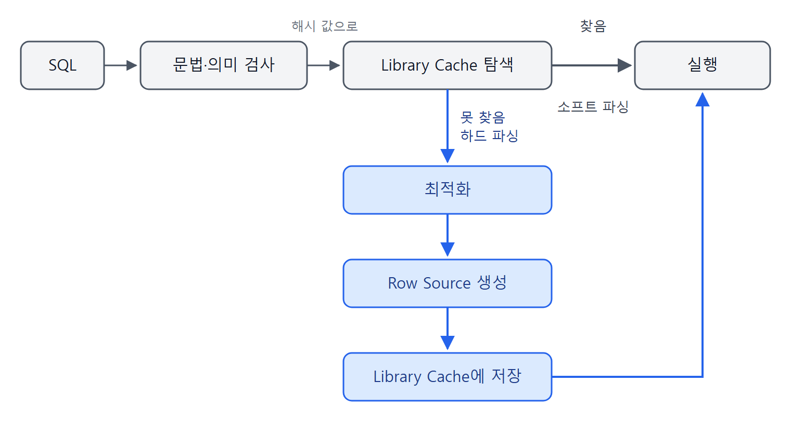
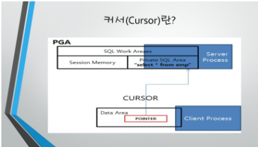

## SQL 처리 과정

1. 쿼리 입력
2. SQL Parser가 SQL 문장에 문법적 오류가 없는지 확인
3. SQL 문장을 해시 함수로부터 변환한 후, 해시 값으로 라이브러리 캐시 내 해시 버킷을 찾아간다.
   - 라이브러리 캐시는 SQL의 실행 계획이 캐싱되어 있는 영역이다.
4. 해시 버킷에 체인으로 연결된 엔트리를 차례로 스캔하면서 같은 SQL 문장을 찾는다
5. SQL 문장을 찾으면 함께 저장되어 있는 실행 계획을 가지고 바로 실행
6. SQL 문장을 찾지 못하면 "최적화"를 수행한다
7. 최적화를 거친 SQL과 실행 계획을 방금 탐색한 해시 버킷 체인에 연결한다.
8. 방금 최적화한 실행 계획을 실행한다.

> **보충** 2번 다음엔 의미 검사(객체·권한), 6번 다음엔 Row Source 생성이 있다. 4번의 "같은 SQL"은 대소문자·공백까지 같아야 한다.


*소프트 파싱과 하드 파싱은 Library Cache에서 같은 SQL을 찾았는지에서 갈린다.*

SQL 쿼리를 입력했을 때 데이터베이스에서 처리하는 과정은 위와 같다.

SQL을 실행할 때 SQL을 바로 실행하는 것이 아니라 최소한의 시간이 걸리도록 실행계획을 찾는다.

그렇게 해서 가장 최적화된 실행 계획을 찾으면 라이브러리 캐시에 넣는다.

그것을 다음에도 똑같은 SQL 문이 왔을 때 캐시에 있으면 해당 SQL의 최적화된 실행계획은 이미 있으니 바로 실행해버리면 되는 것이다.

결과적으로 성능 향상의 포인트는 이 최적화 과정을 거치느냐 마느냐 이다.

- 소프트 파싱 : SQL과 실행계획을 캐시에서 찾아서 바로 실행하는 경우
- 하드 파싱 : SQL과 실행계획을 캐시에서 찾지 못해서 최적화 과정을 거친 후 실행하는 경우

> **보충** 하드 파싱은 Shared Pool 메모리 할당과 Library Cache 잠금(`library cache: mutex X`)을 동반하고, 한 번 쓰고 버려지는 SQL이 쌓이면 `ORA-04031`이 나기도 한다.

## 바인드 변수를 사용하자

```sql
SELECT * FROM JEONGPRO WHERE LOGIN_ID = :LOGIN_ID;
```

```sql
SELECT * FROM JEONGPRO WHERE LOGIN_ID = 'jeong'
SELECT * FROM JEONGPRO WHERE LOGIN_ID = 'pro'
SELECT * FROM JEONGPRO WHERE LOGIN_ID = 'jdk'
SELECT * FROM JEONGPRO WHERE LOGIN_ID = 'oracle'
```

바인드 변수를 사용하면 위의 쿼리가 100만번 수행한다면 최초 1회 때 최적화 과정을 거친 후 캐시되고 나머지는 실행 계획을 공유해서 금방 실행될 것이다.

수행빈도가 아주 낮거나, 조건절 컬럼의 값 종류가 적을 때는 굳이 바인드 변수를 쓰지 않아도 된다.

> **바로잡기** 값 종류보다 분포가 핵심이다. 바인드 변수는 값이 달라도 실행 계획이 하나라서, 값마다 맞는 계획이 다를 만큼 분포가 치우쳤을 때 리터럴이 낫다.

이제 SQL 쿼리문의 처리 과정과 바인드 변수도 알았다.

그러면 다른 부분은 안봐도 될까? 그건 또 아니다.

여전히 SQL 문장의 문법적, 의미적 오류를 확인하고 해시함수를 타서 실행계획을 찾고 실행에 필요한 리소스를 사용하는 등의 과정은 그대로 반복된다.

이런 과정마저 생략하고 빠르게 수행하는 방법은 애플리케이션 커서 캐싱이라고 한다.

> **보충** 그 중간 단계로 오라클의 세션 커서 캐시(`SESSION_CACHED_CURSORS`)도 있다.

Java에서는 묵시적 캐싱을 사용하면 된다.

> **보충** 오라클 JDBC는 `setImplicitCachingEnabled(true)`, `setStatementCacheSize(n)`으로 켠다. 캐시 크기는 `OPEN_CURSORS`보다 작게 잡는다.

## 커서

커서는 SQL의 데이터 셋을 순차적으로 접근할 수 있는 메모리 영역이다. 이를 이용하여 쿼리 결과를 한 행씩 처리할 수 있도록 한다. 쉽게 말하면 C의 포인터와 같은 기능이다.

즉, SQL 문을 처리한 결과 집합을 가리키는 포인터이다.

SQL 처리 결과를 오라클 서버 프로세스 내부의 Private SQL Area 라는 메모리 영역에 저장되는데 클라이언트 프로세스에서 포인터라는 것이 가리키고 있다.


*커서(Cursor)란?*

> **보충** 실행 계획은 Library Cache의 공유 커서에, 이 세션의 실행 상태는 Private SQL Area에 있다.

1. 다중 행 처리 : 여러 행의 데이터를 한 번에 여러 행을 반환하거나 각 행을 개별적으로 처리할 수 있다.
2. 복잡한 로직 구현 : 프로시저나 함수에서 반복문과 함께 사용하여 복잡한 로직을 구현할 수 있다
3. 트랜잭션 제어 : 데이터를 가공하거나 조건에 맞게 처리하여 트랜잭션을 관리할 수 있다.

커서의 종류로는 두 가지가 있다.

1. 묵시적 커서
   - 오라클 내부에서 자동으로 생성되는 커서로 select into, dml이 실행될 때마다 자동으로 만들어져 사용
2. 명시적 커서
   - 사용자가 직접 선언하고 사용하는 방식의 커서

## hint란?

hint란 SQL 튜닝의 핵심 부분으로 일종의 지시 구문이다.

오라클 옵티마이저에게 SQL 문 실행을 위한 데이터를 스캐닝하는 경로, 조인하는 방법 등을 알려주기 위해 SQL 사용자가 SQL 구문에 작성하는 것을 뜻한다. 오라클이 항상 최적의 실행 경로를 만들어 내기는 불가능하기 때문에 직접 최적의 실행 경로를 작성해 주는 것이다.

> **보충** 문법이 틀린 힌트는 오류 없이 무시되므로 적용 여부는 실행 계획으로 확인한다.

