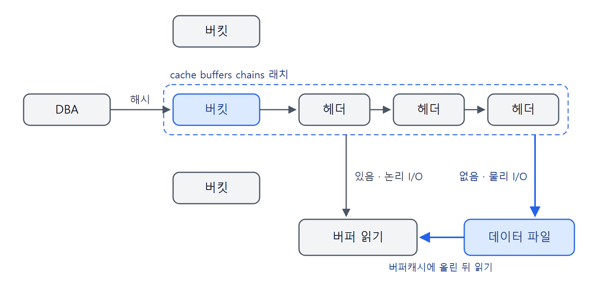

## 논리적 I/O

논리적 I/O는 데이터베이스에서 데이터를 요청할 때 발생하는 논리적인 데이터 접근을 의미한다.

즉, 사용자가 특정 데이터를 조회하거나 변경할 때, DBMS의 메모리에 데이터가 있는지 확인하는 과정이 논리적 I/O

- 데이터 블록이 버퍼 캐시에 존재할 경우, 디스크에서 읽지 않고 메모리에서 바로 조회
- 디스크에 직접 접근하지 않음 → 성능이 상대적으로 빠름
- SQL 실행 시 블록을 읽는 횟수로 측정 가능

*버퍼 캐시에 있든 없든 블록은 버퍼 캐시를 거쳐 읽힌다.*

논리적 I/O의 종류

- Consistent Get : Undo 정보를 반영하여 커밋되지 않은 변경을 고려한 블록 읽기
- DB Block Get : Undo 작용 없이 최신 블록을 읽는 경우

> **바로잡기** Consistent Get은 쿼리 시작 시점 기준 읽기로, 블록이 그사이 바뀐 경우에만 Undo를 적용한다. DB Block Get은 DML이 쓰는 최신 버전 읽기다.

## 물리적 I/O

물리적 I/O는 디스크에서 데이터를 직접 읽거나 쓰는 I/O 작업을 의미한다.

즉, 요청된 데이터가 메모리에 존재하지 않을 때, 디스크에서 데이터를 읽거나 쓰는 과정이다.

- 디스크에서 직접 데이터를 읽어야 하므로 속도가 느리다
- Buffer Cache에 데이터가 없을 때 발생 → 성능 저하 원인
- physical reads로 측정 가능 (디스크에서 데이터를 읽은 횟수)
- 물리적 I/O를 최소화하는 것이 DB 성능 최적화의 핵심이다.

> **바로잡기** 물리적 I/O도 버퍼 캐시를 거치므로 논리적 I/O에 포함된다. 그래서 튜닝은 논리적 I/O를 줄이는 데서 시작한다.

> **보충** AUTOTRACE의 `consistent gets + db block gets`가 논리적 I/O, `physical reads`가 물리적 I/O다.
